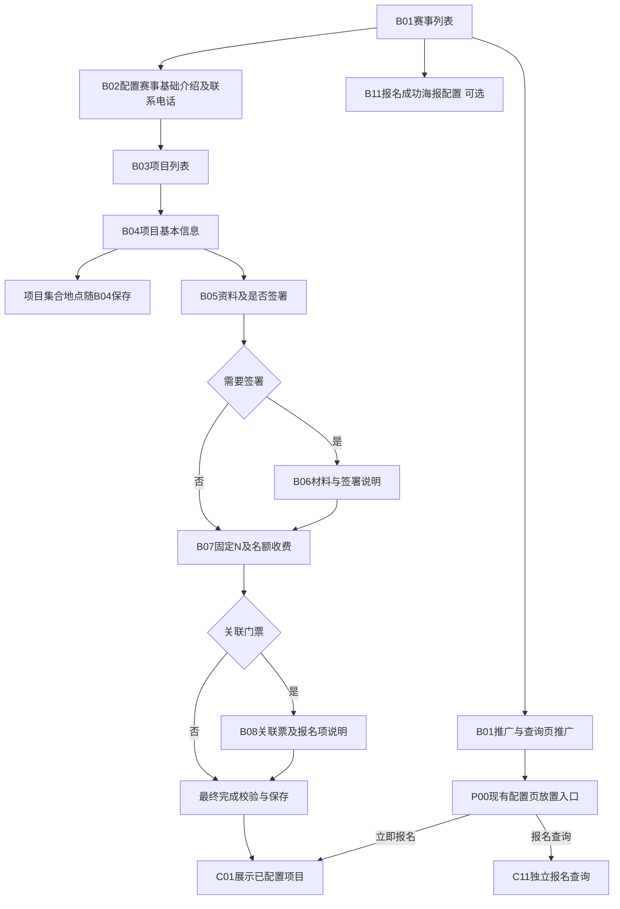
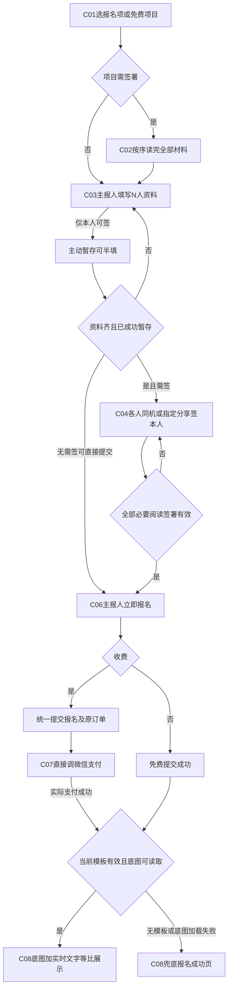
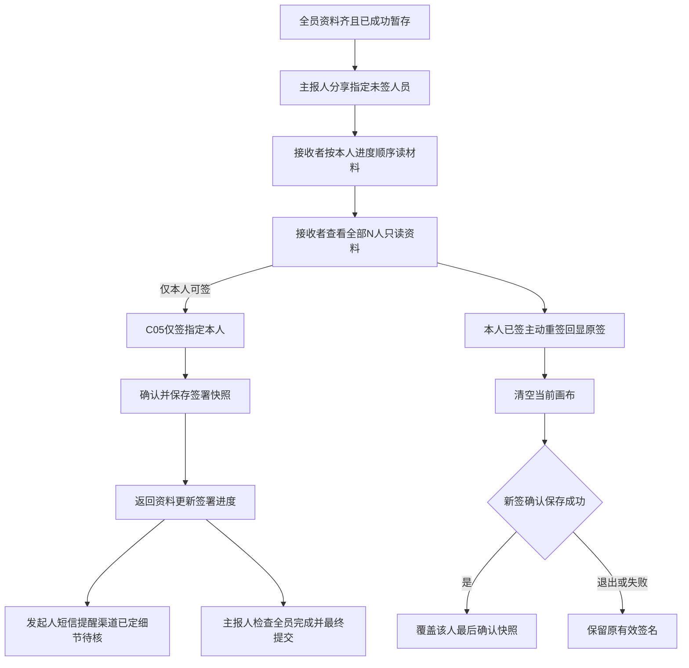
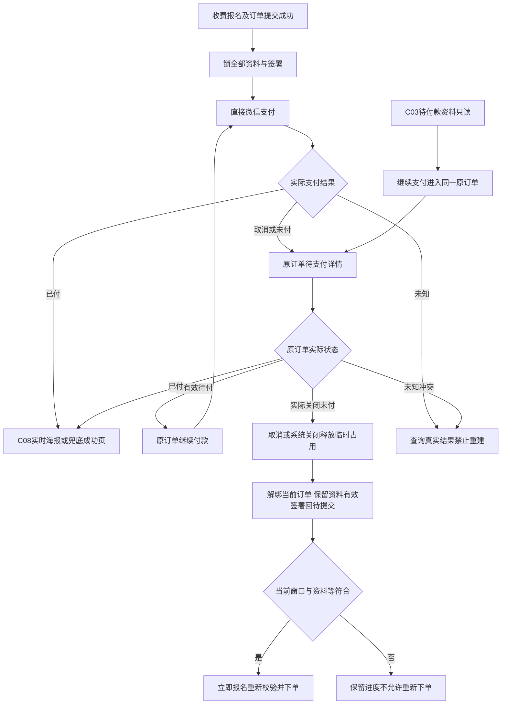
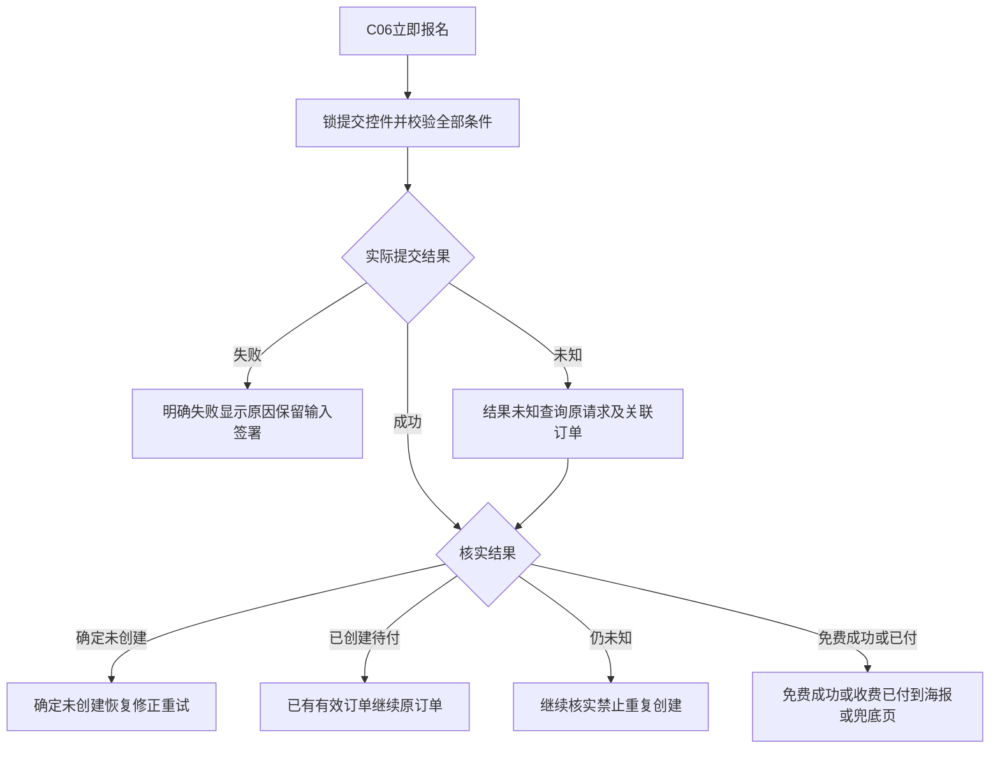
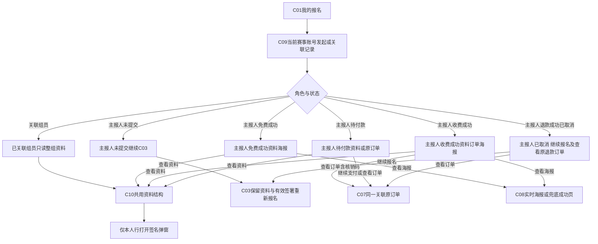
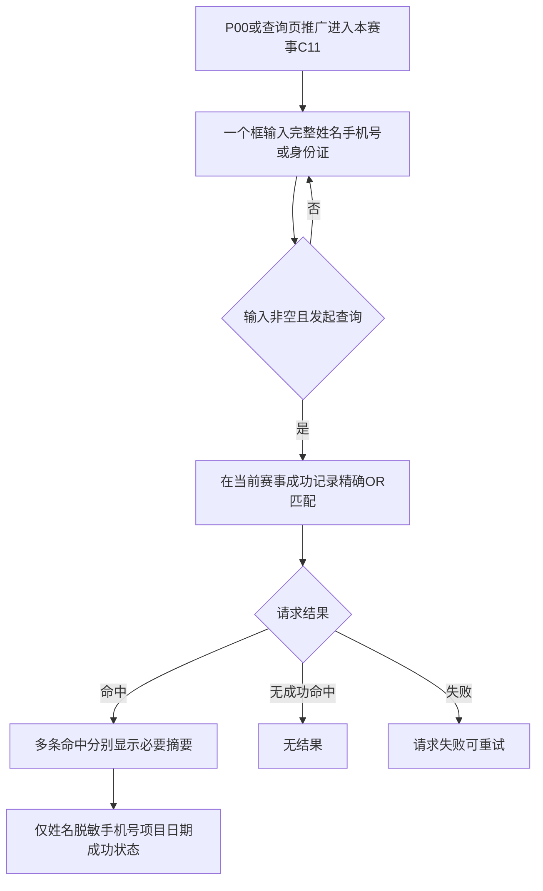
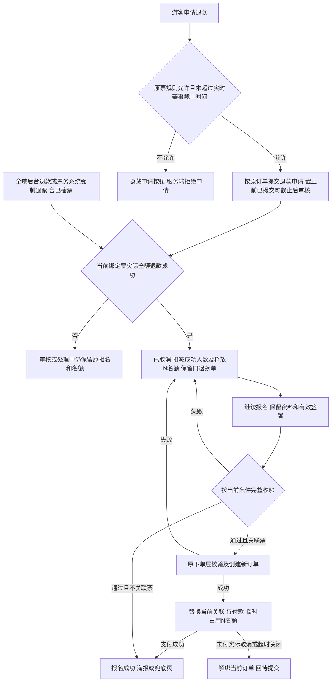
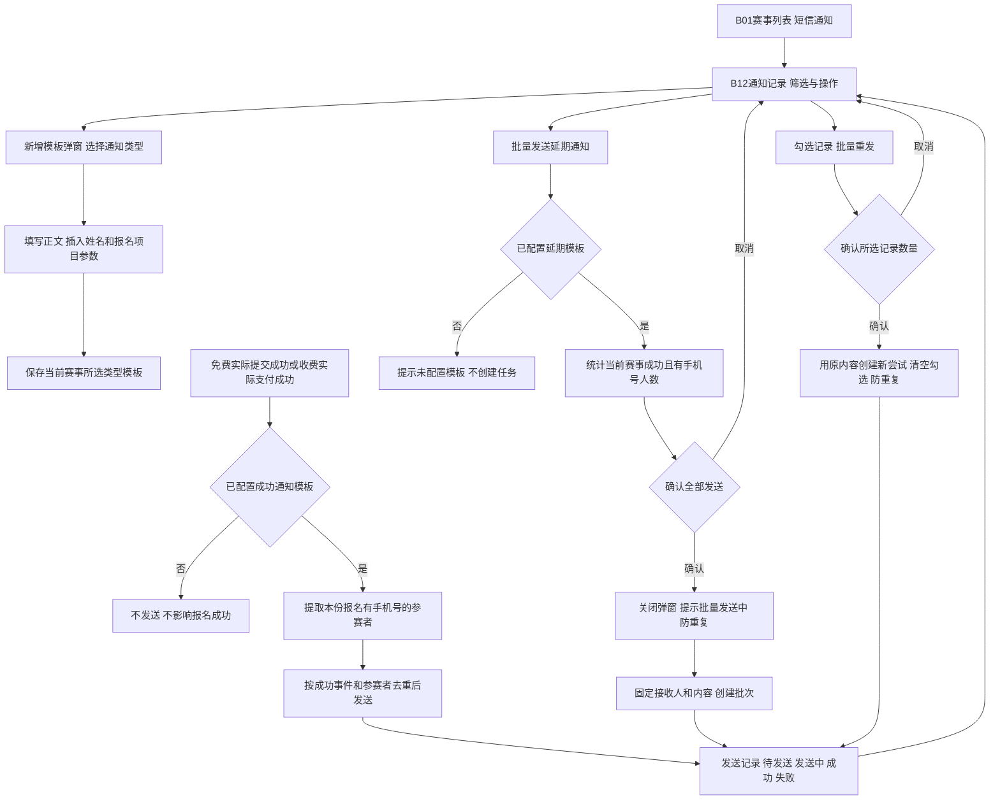

# 赛事活动报名｜全程流程图

页面编号与[页面清单](01-页面清单.md)一致。C04集成C03、C06为提交节点、C07复用原订单。图中未决接口不视为已实现。

## F01｜后台配置到游客入口

> **项目内迭代新增V1.1**：V11-01双推广入口；V11-06名额增额规则见B07。

每一步下一步只保存本步；最终完成标记等真实接口语义见U10c。推广不增加报名管理入口。

## F02｜选择到成功的主流程

> **项目内迭代新增V1.1**：V11-02先暂存再签署/分享；未签署项目直接提交规则原已存在。

无需签署项目不要求先暂存才能最终提交；需签项目必须先成功暂存再签署/分享。最后一人签完不自动下单。提交失败/未知另见F05。

## F03｜指定分享签署与重签

> **项目内迭代新增V1.1**：V11-02分享从已成功暂存资料发起。

接收者不能修改资料、看他人签名、分享给他人或提交付款。短信触发颗粒度与重签去重见U08d，不代表图中已连接发送服务。

## F04｜支付取消、订单取消与继续报名

> **项目内迭代新增V1.1**：V11-07资料页继续支付入口；原订单关闭恢复原则不是本次新建。

**取消收银台不等于取消订单。**报名截止前已建且有效的订单仍可续付；实际关闭后已截止不得重新下单。原订单界面及超时能力保持原有，报名不另建任务。

## F05｜提交失败、未知及重复请求

前端禁用与服务端幂等都需要，跨系统部分成功不能用重下单掩盖。失败不自动保存普通输入，之前已成功保存的数据仍保留。

## F06｜我的报名、详情、订单及海报

> **项目内迭代新增V1.1**：V11-04组员从记录进入共用全部资料详情及本人签名弹窗。

**项目内迭代新增V1.1 · V11-14（规则细化）**：海报仅报名成功可访问；退款实际成功转已取消后隐藏入口，直接查看/保存/分享同样拦截；重新报名实际成功后恢复。

签名弹窗只读、关闭留原详情；其他人签名不能打开。收费成功的核销仍用原订单二维码，不是海报推广码。

## F07｜公开报名查询

> **项目内迭代新增V1.1**：V11-05一个框，只成功，手机号脱敏。

查询完整手机号，展示前三后四中间****；不返回身份证、其他人员、详情、签名、支付或核销码，不自动认领。与C09账号记录分开。

## F08｜退款成功取消与重新报名

**项目内迭代新增V1.1 · V11-13（业务变化）**

退款审核中、拒绝或失败不释放名额、不变更为已取消；仅实际全额退款成功生效。赛事退款截止时间可不填且随时修改，不填沿原票规则；游客申请时读取实时配置。已取消保留旧退款订单关联，新订单创建成功才替换；未付款订单关闭则解绑并回待提交，两者不得混用。

## F09｜短信通知配置、成功触发与批量发送

> **项目内迭代新增V1.1 · V11-16（业务变化、规则细化）**：仅向成功报名且填写手机号的参赛者发送；同号不同人分别计数。未接真实短信服务。

缺少手机号不进入人数统计、不创建发送记录；失败不回退报名状态。批量延期不受记录筛选影响；重发仅处理勾选记录，发送中不可勾选。签完提醒发起人仍为独立待核事项。
