# 赛事活动报名｜后台逐页功能方案

整理评审稿｜2026-11-10。按页面号定位；跨页判断统一见[公共业务规则](06-公共业务规则.md)。后台原型：<a href="../../preview/event-admin/index.html" target="_blank" rel="noopener noreferrer">打开</a>。

## B01｜赛事列表与推广
**原型：**<a href="../../preview/event-admin/index.html" target="_blank" rel="noopener noreferrer">打开原型：赛事列表</a>。直接进入赛事列表；推广及报名查询页点对应行按钮。

后台原型共用一个入口，暂不支持按页面参数直达；以上路径为实际操作路径。

> **项目内迭代新增V1.1 · V11-01**：移除报名管理；推广指报名首页C01，新增报名查询页指C11；复用同一推广弹窗。

查看截图：本轮赛事列表截图，含报名成功海报配置入口；本地示例数据，不代表真实统计

<a href="../../preview/event-admin/设计依据/20261110-V11-14-赛事列表入口.png" target="_blank">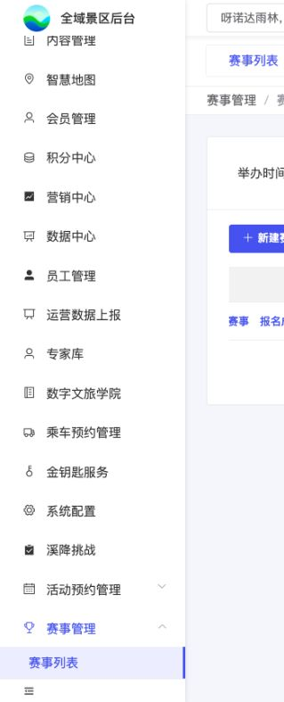</a>

本轮赛事列表截图，含报名成功海报配置入口；本地示例数据，不代表真实统计。截图用于定位和布局参考；现行逻辑以本节正文及V1.1标记为准。

查看截图：已有本地截图：报名查询页推广弹窗，真实推广值尚未接入

<a href="../../preview/event-admin/设计依据/20261110-报名查询页推广弹窗.png" target="_blank">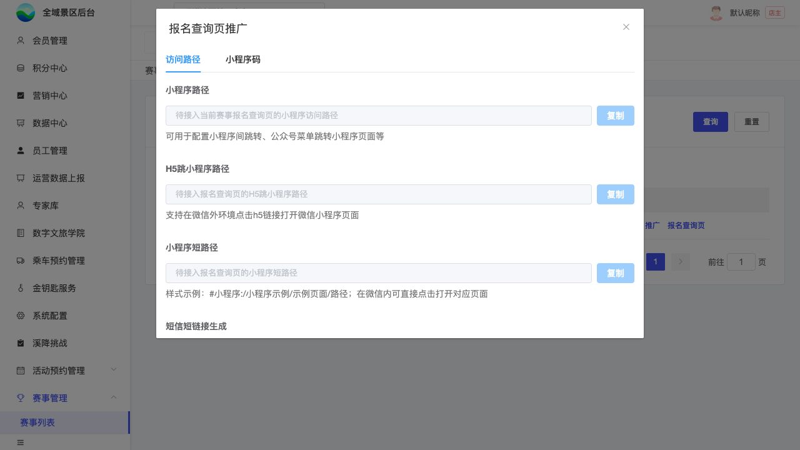</a>

已有本地截图：报名查询页推广弹窗，真实推广值尚未接入。截图用于定位和布局参考；现行逻辑以本节正文及V1.1标记为准。

### 入口和字段

赛事管理与活动预约管理并列。列表筛选为举办时间范围、赛事名称；保留查询、重置、新建赛事和分页，不增加项目数量筛选。

| 列/操作 | 来源与行为 |
| --- | --- |
| 赛事名称 | 已保存赛事名称 |
| 举办时间 | 赛事举办起止，单日只显示一天 |
| 报名人数 | 各项目成功人数/总名额汇总，按K01 |
| 项目数量 | 当前赛事下项目数量 |
| 编辑赛事 | 进入B02，带当前赛事上下文 |
| 报名成功海报配置 **项目内迭代新增V1.1 · V11-14（业务变化）** | 位于“编辑赛事”之后；进入B11独立页签，带当前赛事；上传背景并拖拽配置动态文字 |
| 报名项目 | 进入B03，带当前赛事上下文 |
| 推广 | 当前赛事C01报名首页推广，不指向C11 |
| 报名查询页 | 当前赛事C11查询页推广，不混用报名首页链接 |

移除“报名管理”按钮。编辑、详情和记录沿现有内部页签，可切换/关闭，不因切换清空已有表单。

### 推广弹窗

复用现有推广能力，两入口共用同一弹窗，只更换当前赛事及目标页。访问路径、小程序码两个标签。

| 内容 | 行为与来源 |
| --- | --- |
| 小程序路径 | 原推广服务返回当前赛事及目标页路径，可复制 |
| H5跳小程序路径 | 原能力返回，复制后沿原环境跳转 |
| 小程序短路径 | 原能力返回，可复制 |
| 短信短链接 | 首次生成、已有链接续期、复制及有效期沿原行为 |
| 小程序码 | 原推广能力返回，绑定同一赛事/目标；不重建码规则 |

未返回值不得复制伪造地址/二维码。当前原型为空值及待接入提示，不代表真实推广服务已连接。此弹窗提供的两类页面链接可供P00原页面配置使用。

## B02｜新增与编辑赛事

> **项目内迭代新增V1.1 · V11-14（业务变化）**：新增“联系电话”，保存于当前赛事，海报联系电话读取此字段，不读取游客手机号。原有举办地点继续作为海报“比赛地点”来源。

**原型：**<a href="../../preview/event-admin/index.html" target="_blank" rel="noopener noreferrer">打开原型：赛事列表 → 编辑赛事</a>。在赛事行点编辑赛事；也可点新建赛事查看新增态。

后台原型共用一个入口，暂不支持按页面参数直达；以上路径为实际操作路径。

查看截图：本轮编辑赛事截图，含联系电话与退款截止时间，本地已保存配置回显

<a href="../../preview/event-admin/设计依据/20261110-V11-14-赛事联系电话.png" target="_blank">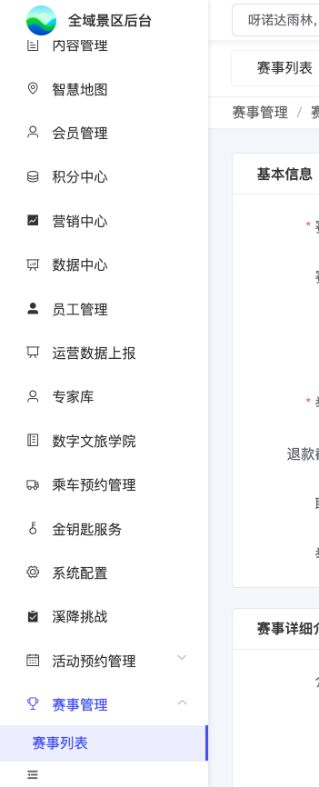</a>

本轮编辑赛事截图，含联系电话与退款截止时间，本地已保存配置回显。截图用于定位和布局参考；现行逻辑以本节正文及V1.1标记为准。

### 字段与显示

| 字段 | 配置及用途 |
| --- | --- |
| 赛事名称 | 当前赛事名称，列表及游客页面同源 |
| 赛事封面 | 该赛事图片，可上传/移除；不借项目图片替代 |
| 举办时间 | 起止日期，开始不晚于结束；单日摘要合并显示 |
| 举办地点 | 当前赛事地点原文；B11海报“比赛地点”读取此字段 |
| 联系电话 **项目内迭代新增V1.1 · V11-14（业务变化）** | 当前赛事咨询联系电话；新增/编辑时填写，随赛事保存并回显；B11海报“联系电话”读取此值，不读取游客手机号。必填、格式和长度限制尚未确认，不新增推定校验 |
| 退款截止时间 **项目内迭代新增V1.1 · V11-13（业务变化）** | 配置日期与小时，随赛事保存并回显；关联订单实时读取，在原票允许退款的基础上限制主动申请入口。非必填，可随时修改；空值不叠加赛事退款时间限制 |
| 赛事详细介绍 | 可编辑富文本，支持图片/排版；在C01下方展示 |

赛事层不增加统一报名时间。前置推广说明页与C01赛事介绍职责不同，不能因有P00而省略本页介绍。

### 操作

保存成功更新赛事及返回/页签上下文；取消不提交本次改动。必填及控件沿当前后台基线，不自行增加长度、发布审批或认证要求。失败不得伪报成功，真实上传与保存接口待接。当前日期、封面、介绍样例不是正式运营内容批准。

### 赛事退款截止时间

> **项目内迭代新增V1.1 · V11-13（业务变化）**：赛事级新增“退款截止时间”，日期与小时，由业务配置，不根据旧退费文档的开赛前天数或报名关闭时间自动推算。

**项目内迭代新增V1.1 · V11-13（规则细化）**：退款截止时间非必填、不预设默认截止值，可随时修改或清空；存量空值同未设置，均只按订单存储的门票退款规则判断。订单详情及申请提交通过当前订单关联报名项目找到所属赛事，读取当下最新时间，不固化在下单快照；配置修改后实时生效。读取失败不能当空值。截止前已受理申请在截止后仍可审核，通过后继续退款。该配置限制游客主动申请，不改变全域后台及票务系统已有退款权限。具体入口判定见C07，实际退款成功的状态、人数与关联联动见K06。后台原型支持清空、保存及回显，真实配置和退款接口待接入。

## B03｜报名项目列表
**原型：**<a href="../../preview/event-admin/index.html" target="_blank" rel="noopener noreferrer">打开原型：赛事列表 → 报名项目</a>。点当前赛事的报名项目。

后台原型共用一个入口，暂不支持按页面参数直达；以上路径为实际操作路径。

查看截图：本轮项目列表截图，含未配置与已有订单示例

<a href="assets/prototype-screens/B03.png" target="_blank">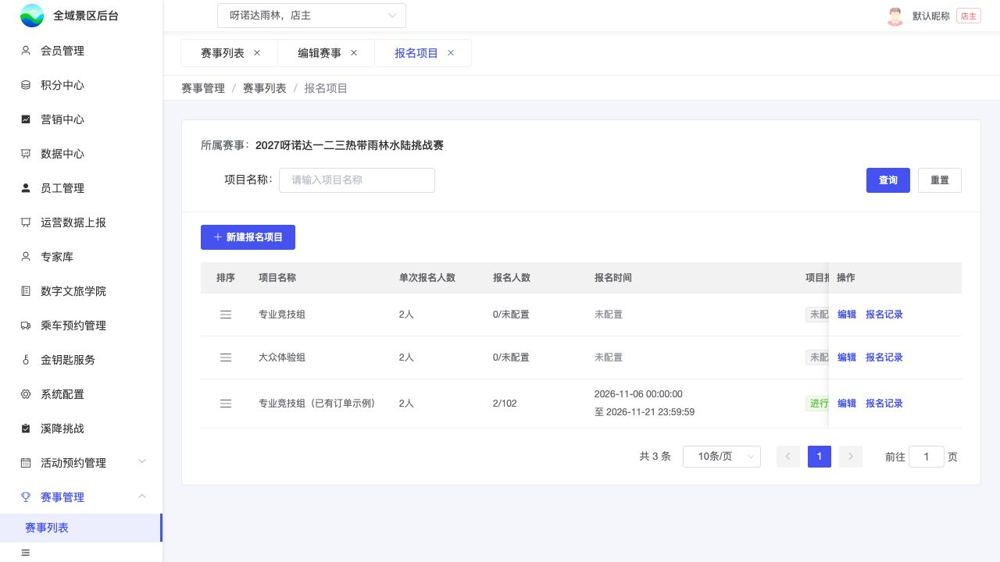</a>

本轮项目列表截图，含未配置与已有订单示例。截图用于定位和布局参考；现行逻辑以本节正文及V1.1标记为准。

### 字段与操作

当前赛事下按项目名称查询、重置、分页，保留所属赛事上下文。

| 列 | 取值 |
| --- | --- |
| 排序 | 左侧手柄拖动；拖后预览，保存排序确认，取消恢复 |
| 项目名称 | 本项目配置 |
| 单次报名人数 | 固定N；缺配置显示未配置 |
| 报名人数 | 成功人数/项目总名额，按K01 |
| 报名时间 | 本项目窗口，完整起止 |
| 项目报名状态 | 未开始、进行中、已截止；缺时间未配置，按K02 |
| 签署要求 | 需要签署、无需签署；未配置不猜默认 |
| 收费方式 | 关联门票、免费；未配置不猜默认 |
| 配置状态 | 已配置或待完善；完成语义见下文 |
| 操作 | 新增/编辑项目、报名记录；无记录也可进入B09空列表 |

项目排序保存后用于C01展示。字段和材料同样用手柄排序，随对应步骤保存。

### 项目编辑的步骤保存

B04基本信息→B05报名资料→需签署时B06→B07人数→收费时B08。免费跳过B08，不需签署跳过B06。关闭签署保留材料草稿，重新开启可继续；关闭时不展示、不校验材料。这是当前制作基线，真实保存语义待U10c核实。

下一步只校验并保存当前步骤，不等于整项目完成；当前步骤必填仍须完整。最终完成校验所有适用步骤、最新票匹配，保存成功才显示已配置。

当前原型：已配置且未改动逐步查看不降级；修改只存中间步骤则回待完善；无完成标记旧数据需重新完成。此处配置标记、降级和迁移是**待研发核准的制作基线**，不据有无订单推断配置完成，不当成已确定生产迁移政策。

## B04｜项目基本信息

> **项目内迭代新增V1.1 · V11-14（业务变化）**：新增“集合地点”，与当前报名项目保存、编辑回显；不同项目独立配置，海报的集合地点读取本字段。不得替代赛事举办地点。

**原型：**<a href="../../preview/event-admin/index.html" target="_blank" rel="noopener noreferrer">打开原型：报名项目 → 编辑 → 基本信息</a>。选择已有订单示例行编辑，默认基本信息。

后台原型共用一个入口，暂不支持按页面参数直达；以上路径为实际操作路径。

查看截图：本轮基本信息截图，含集合地点，本地已保存配置回显

<a href="../../preview/event-admin/设计依据/20261110-V11-14-项目集合地点.png" target="_blank">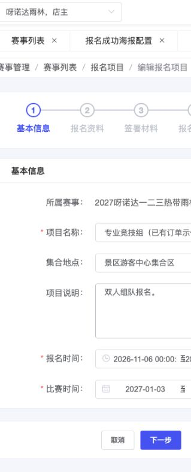</a>

本轮基本信息截图，含集合地点，本地已保存配置回显。截图用于定位和布局参考；现行逻辑以本节正文及V1.1标记为准。

| 字段 | 来源、配置和影响 |
| --- | --- |
| 所属赛事 | 从B03带入当前赛事 |
| 项目名称 | 本项目名称，列表和游客卡片同源 |
| 集合地点 **项目内迭代新增V1.1 · V11-14（业务变化）** | 当前报名项目的集合地点，位于项目名称之后；随项目保存并编辑回显，各项目独立。B11海报“集合地点”读取此字段，不替代赛事举办地点；必填及格式限制尚未确认 |
| 项目说明 | 可选运营备注，可长文；C01单独段落展示，不从N自动生成双人报名文案 |
| 报名时间 | 本项目报名起止，先于比赛时间排列；作为免费窗口及收费交集外框 |
| 比赛时间 | 本项目比赛起止；单日可用于原票日历报价及游玩日传参 |

开始不晚于各自结束；不额外要求报名截止早于比赛首日。报名窗口修改按K05影响未提交记录和原有效订单；比赛延期、取消及已出票日期变更留后，不从此页自行推断。

## B05｜报名资料与填写项
**原型：**<a href="../../preview/event-admin/index.html" target="_blank" rel="noopener noreferrer">打开原型：报名项目 → 编辑 → 报名资料</a>。从基本信息点下一步；该按钮会按原型规则保存当前步骤，请勿修改示例后随意保存。

后台原型共用一个入口，暂不支持按页面参数直达；以上路径为实际操作路径。

查看截图：已有配置页截图，展示字段和签署要求布局；不作为本次数据存储验收

<a href="../../preview/event-admin/设计依据/当前报名资料提示.png" target="_blank">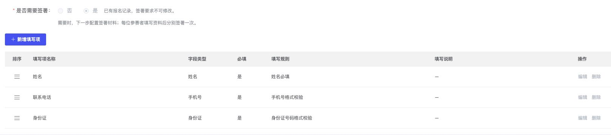</a>

已有配置页截图，展示字段和签署要求布局；不作为本次数据存储验收。截图用于定位和布局参考；现行逻辑以本节正文及V1.1标记为准。

### 页面配置

| 字段/区域 | 规则 |
| --- | --- |
| 报名须知 | 可选富文本，支持文字、图片、长文排版；在C03标签展示，不是签署材料 |
| 是否需要签署 | 必选；无需签署直接填资料，需签署先按序读材料，再填资料并逐人签署；不另设是否阅读开关 |
| 锁定提示 | “已有报名记录，签署要求不可修改。”紧随是否签署选项，不单独散落表单下方 |
| 填写项列表 | 排序、名称、类型、必填、填写规则、填写说明、操作 |
| 新增填写项 | 先选类型，再配置名称、必填、规则、可选填写说明 |

> **项目内迭代新增V1.1 · V11-12（规则细化）**：仅打开页面、阅读或完成全部材料阅读，不生成报名记录，不触发后台配置锁定；阅读进度独立保存。首次主动暂存成功（包括半填暂存）产生报名记录后，才按K05限制后台配置修改。

在项目尚无报名记录时，游客仅阅读不妨碍运营按原规则修改人数、签署要求及资料项；已有其他报名记录时仍执行既有配置限制。

每个项目一套资料模板，生成N份。运营页不常驻解释逐人份数、全部迁移和快照技术规则，这些保留在方案。已有报名后填写项改动按K03/K05。

### 字段类型及校验基线

| 类型 | 配置与前端规则 |
| --- | --- |
| 姓名 | 固定必填且不可删除；展示名可在允许编辑时修改，语义唯一 |
| 手机号 | 同一语义每人最多一项，是否收集/必填由项目及原票需要决定；按手机号格式校验 |
| 身份证 | 本期唯一证件类型，不选证件种类；格式校验不等于联网实名 |
| 单行文本 | 配置最多字数，范围1—50 |
| 多行文本 | 配置最多字数，范围1—200 |
| 数字 | 非负整数，最多位数1—15 |
| 单选 | 至少两个文字选项，游客下拉选择 |
| 多选 | 至少两个文字选项；配置最少/最多数量，必填按下限；非必填可全不选，选择后按数量范围校验 |
| 日期 | 年月日 |
| 填写说明 | 每项可选，游客在该字段下方看；空则不显示，不为每个选项另配说明 |

这些数字和控件是当前配置基线，不补写为用户逐数值验收。姓名/手机号/身份证按系统语义映射，不因显示名称变动丢失含义。没有上传字段，不把参考赛事的邮箱、尺码、紧急联系人强制纳入。本页不做后台模拟游客填表预览。

> **项目内迭代新增V1.1 · V11-11（规则细化）**：区分后台项目配置限制与游客已填资料的修改权限；暂存产生记录不等于游客资料只读，不改变已确认业务。

已有资料项不可改删，指运营不能在本后台配置页修改或删除既有字段定义（名称、类型、必填、填写规则等）；后台页面禁用对应配置操作，后台保存接口同样复核。不是禁止游客修改已经填写的姓名、手机号等数据。游客未提交时，主报人仍可修改整份参赛资料，见C03；下单待付款及报名成功后的限制另按K06执行。新增项保存前可编辑移除，保存后按已有项限制；新增后未提交补项、已提交快照不追补，见K05。

## B06｜签署说明与材料
**原型：**<a href="../../preview/event-admin/index.html" target="_blank" rel="noopener noreferrer">打开原型：报名项目 → 编辑 → 签署材料</a>。在需要签署的项目中，按步骤进入签署材料。

后台原型共用一个入口，暂不支持按页面参数直达；以上路径为实际操作路径。

查看截图：已有后台签署说明截图；正式配置保存未接入

<a href="../../preview/miniapp/设计依据/20261110-后台签署说明.jpg" target="_blank">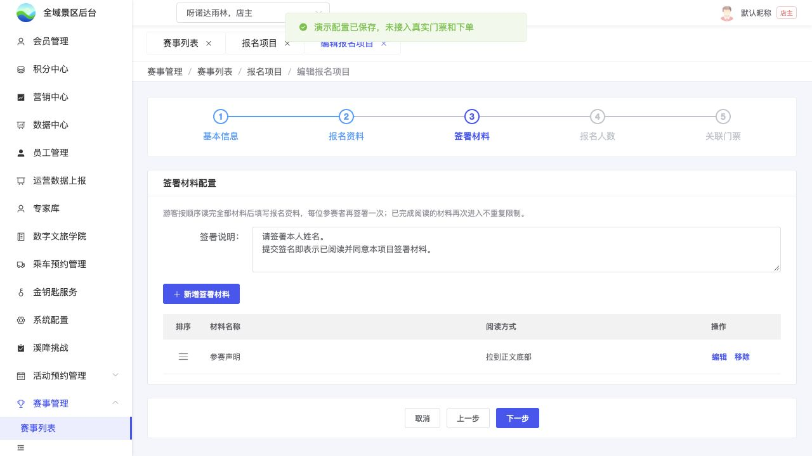</a>

已有后台签署说明截图；正式配置保存未接入。截图用于定位和布局参考；现行逻辑以本节正文及V1.1标记为准。

仅需签署项目出现；至少保留一份材料，不固定份数或种类，不设必读/可选开关，不做跨项目公共材料库。

| 配置 | 规则 |
| --- | --- |
| 签署说明 | 项目级选填多行纯文本，在材料列表上方配置；整套材料和全部人员共用，不逐材料填写 |
| 材料名称 | 每份独立维护，阅读页标题使用 |
| 正文 | 每份富文本，支持完整图片与排版 |
| 阅读方式 | 不限制、等待正整数N秒、滚动到底三选一，不叠加倒计时和滚动 |
| 排序 | 手柄排序，游客按保存顺序逐份确认；支持新增、编辑和删除 |

签署说明在C05画布下方、按钮上方展示，留空隐藏、保留换行、长文内部滚动，操作可达。“请签署本人姓名”也由该说明维护，不加一段重复固定提示。说明不加倒计时、强制到底或勾选，不替代姓名识别。

介绍、须知、材料正文更新及材料增删按K05执行：正文更新保留已读已签，未提交新增材料补读但不重签，已提交不追补。不做完整历史原文版本。

## B07｜人数、名额与收费方式
**原型：**<a href="../../preview/event-admin/index.html" target="_blank" rel="noopener noreferrer">打开原型：报名项目 → 编辑 → 报名人数</a>。进入已有报名示例的报名人数步骤，可看有限名额增额规则。

后台原型共用一个入口，暂不支持按页面参数直达；以上路径为实际操作路径。

> **项目内迭代新增V1.1 · V11-06**：有限总名额只增不减且仍须N整数倍；限制/不限模式与N仍锁定，不改票库存及旧占用。

查看截图：已有本地增额检查截图，真实服务端校验未接入

<a href="../../preview/event-admin/设计依据/20261110-总名额只增不减.png" target="_blank">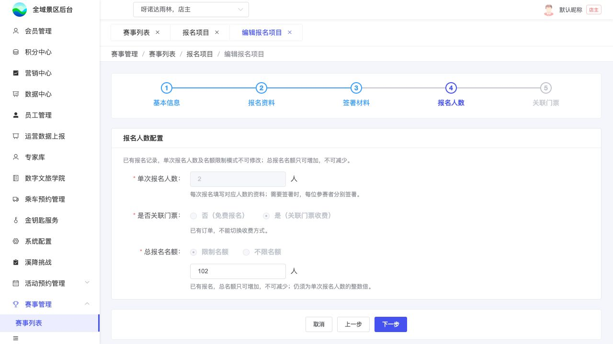</a>

已有本地增额检查截图，真实服务端校验未接入。截图用于定位和布局参考；现行逻辑以本节正文及V1.1标记为准。

| 配置 | 保存规则 |
| --- | --- |
| 单次报名人数N | 正整数，免费同样必填，一项目一种固定N |
| 总名额模式 | 限制 / 不限，免费收费均独立配置 |
| 限制名额值 | N整数倍；不限时不使用输入框保留旧值 |
| 是否关联门票 | 关联则收费并进入B08；不关联则免费，跳过B08，不是无票收款 |

**项目内迭代新增V1.1 · V11-12（规则细化）**：仅阅读不触发本页配置限制；首次主动暂存成功产生报名记录后，才按已有报名判断。已有报名后有限总名额只增不减，限制/不限和N仍锁；无订单可切免费/收费，有订单不能切。完整边界见K05。增额不改票库存、不影响旧订单占用，报名仍同时检查项目剩余和选中票库存。

## B08｜关联门票
**原型：**<a href="../../preview/event-admin/index.html" target="_blank" rel="noopener noreferrer">打开原型：报名项目 → 编辑 → 关联门票</a>。关联门票项目的最后步骤；免费跳过。点击添加关联门票看选票弹窗。

后台原型共用一个入口，暂不支持按页面参数直达；以上路径为实际操作路径。

查看截图：已有报名项级限制说明截图

<a href="../../preview/event-admin/设计依据/当前报名限制条件.png" target="_blank">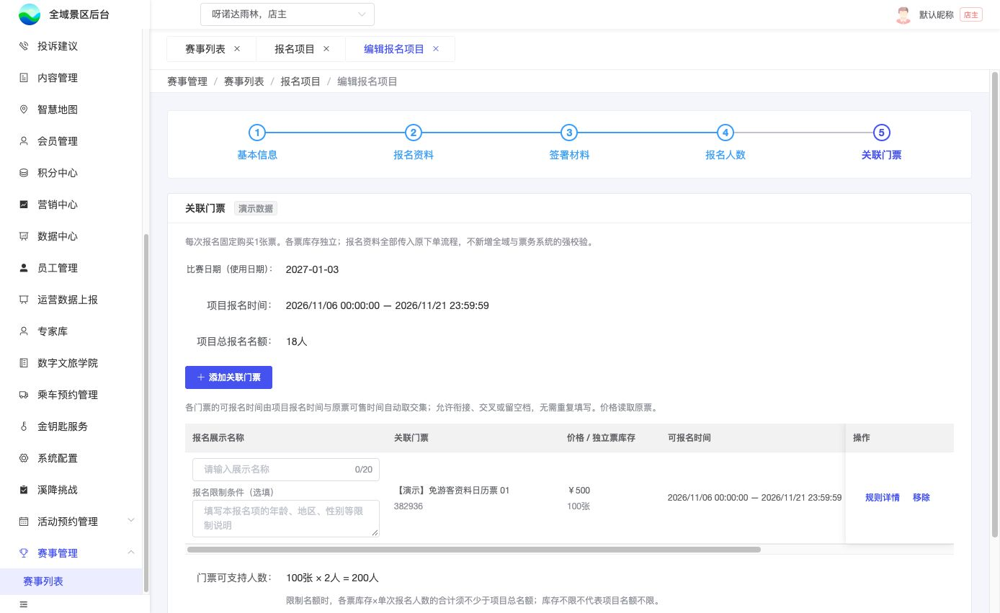</a>

已有报名项级限制说明截图。截图用于定位和布局参考；现行逻辑以本节正文及V1.1标记为准。

查看截图：已有选择门票弹窗截图

<a href="../../preview/event-admin/设计依据/当前选择关联门票.png" target="_blank">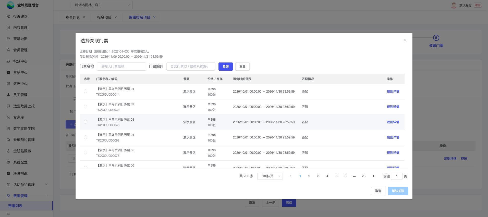</a>

已有选择门票弹窗截图。截图用于定位和布局参考；现行逻辑以本节正文及V1.1标记为准。

### 关联表及选票

| 字段 | 来源、显示与操作 |
| --- | --- |
| 报名展示名称 | 每行必填，最多20字；游客选择的名称，不用原票名替代 |
| 报名限制条件 | 每行选填多行纯文本，年龄/地区/性别等供运营说明；归该报名项，不是项目公共说明 |
| 关联门票 | 名称与编码；自营取自营门票ID，三方取票务系统编码 |
| 价格 / 独立票库存 | 按比赛日或固定期读取原票数据；不可在此改价改库存 |
| 可报名时间 | 项目窗口与本票可售窗口交集，只读，精确到秒 |
| 匹配情况 | 当前兼容结果及具体原因；关联后下架/不匹配保留后台回显，不自动删除 |
| 操作 | 规则详情、移除；无单独更换入口，允许变更时移除重加 |
| 门票可支持人数 | 总票库存×N折算，首次容量校验按K02；不是可编辑名额 |

点添加打开名称/编码查询、分页、单选弹窗，同项目不可重复关联同票。默认候选只已上架票，可关联优先，再按可售开始、截止升序；不匹配不可选。规则详情展示原票要求与当前匹配原因，包括发码类型，关联主表不单独展示发码类型。

### 匹配与保存

完整矩阵见K07，覆盖预订资料模式、每券人数、字段必填、比赛日期、有效期、价格库存和售卖窗口。无交集提示“报名时间与门票可售时间不匹配”，不偷偷改项目时间。

进入/重开编辑、打开选票、最终完成读取最新票配置；不匹配说明原因并阻止完成。实际下架、不匹配或无交集项在C01隐藏，后台保留原因；正常未开始/截止/售罄展示状态，不混淆。

限制说明由业务维护并与实际票务限制一致，不解析文案自动判年龄或地区。实际下单传入全部N人资料，按原票实际规则拦截；说明未填不等于无限制。关联后有过订单的票不能换/移除，名称和说明可改，旧提交名称留快照；其他票及新增按K05处理。

## B09｜报名记录列表

**项目内迭代新增V1.1 · V11-13（业务变化）**：B09报名状态筛选、列表和B10详情增加“已取消”。当前绑定门票在任一退款端实际退款成功后更新此状态及已退款订单，保留订单入口；报名成功人数只统计成功状态，已取消不计入。旧单解绑后晚到的退款通知不得取消新订单对应的报名。
**原型：**<a href="../../preview/event-admin/index.html" target="_blank" rel="noopener noreferrer">打开原型：报名项目 → 报名记录</a>。在已有订单示例项目行点报名记录。

后台原型共用一个入口，暂不支持按页面参数直达；以上路径为实际操作路径。

查看截图：已有列表截图；实际字段以本页正文为准

<a href="../../preview/event-admin/设计依据/当前报名记录列表.png" target="_blank">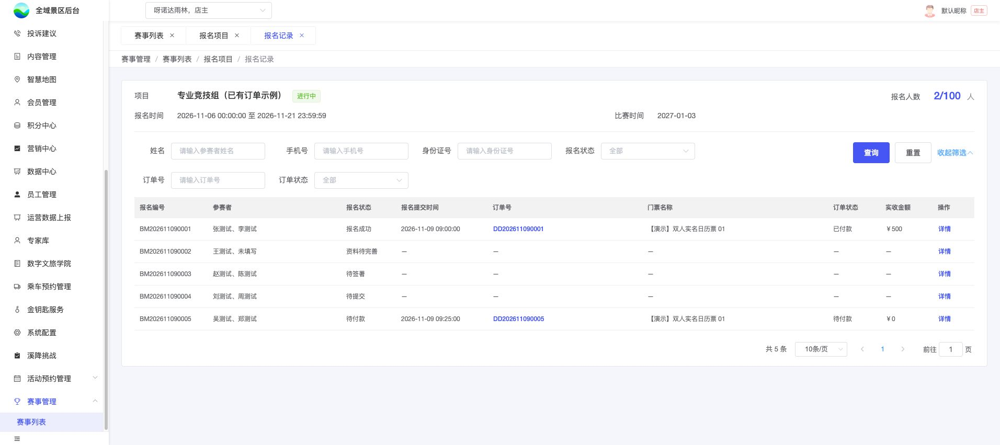</a>

已有列表截图；实际字段以本页正文为准。截图用于定位和布局参考；现行逻辑以本节正文及V1.1标记为准。

### 顶部与筛选

一份报名一行，包含成功暂存的未提交记录。指定项目的记录可独立页签打开，允许空列表。

| 区域 | 字段及行为 |
| --- | --- |
| 顶部摘要 | 项目名称＋项目时间状态、项目报名时间、项目比赛时间、成功人数/总名额；不以某个报名项替代项目 |
| 默认筛选 | 姓名、手机号、身份证、报名状态 |
| 展开后筛选 | 订单号、订单状态 |
| 按钮位置 **项目内迭代新增V1.1（页面调整）** | 默认一行：姓名、手机号，右侧查询/重置/展开筛选；展开显示身份证号、报名状态、订单号、订单状态，查询/重置/收起移至全部条件下方右侧。收起保留条件，有隐藏条件提示“含更多筛选” |
| 重置与页签 | 重置全部条件含折叠项；切换页签保留展开状态 |
| 人员多条件 | 必须由同一参赛者同时命中，不跨人拼接；只匹配实际收集字段 |

### 列与数据口径

| 顺序 | 列 | 取值 |
| --- | --- | --- |
| 1 | 报名编号 | 正式规则U01待给；示例BM号不作正式规则；列宽140px |
| 2 | 参赛者 | 本份姓名摘要，不虚构未填写姓名 |
| 3 | 报名状态 | K06六种主状态（含退款成功后的已取消） |
| 4 | 报名提交时间 | 实际提交时间；未提交“—” |
| 5 | 订单号 | 最新实际关联订单；自营系统号、三方票务系统号，未返回显示待返回 |
| 6 | 门票名称 | 紧跟订单号，来自实际订单 |
| 7 | 订单状态 | 原订单实际状态 |
| 8 | 实收金额 | 已实际收取；待付款为0，不用应付冒充实收 |
| 9 | 操作 | 详情进入B10；订单号入口沿原订单能力，真实跳转待接 |

无订单时，订单号、票名、订单状态、实收金额均“—”，不从项目最新票配置补票名或写0。底层保留历史订单关联，列表只展示最新订单，不增加历史交易列表。

## B10｜后台报名详情

**项目内迭代新增V1.1 · V11-13（业务变化）**：实际退款成功显示已取消及当前已退款订单；审核中/退款中仍保持原报名状态，原提交资料快照保留。再次下单成功后显示新关联订单。
**原型：**<a href="../../preview/event-admin/index.html" target="_blank" rel="noopener noreferrer">打开原型：报名记录 → 详情</a>。从任一报名行点详情；不同状态显示实际已有数据。

后台原型共用一个入口，暂不支持按页面参数直达；以上路径为实际操作路径。

查看截图：已有详情结构截图；非本次真实接口验收

<a href="../../preview/event-admin/设计依据/20261109-接续核对/报名详情.png" target="_blank">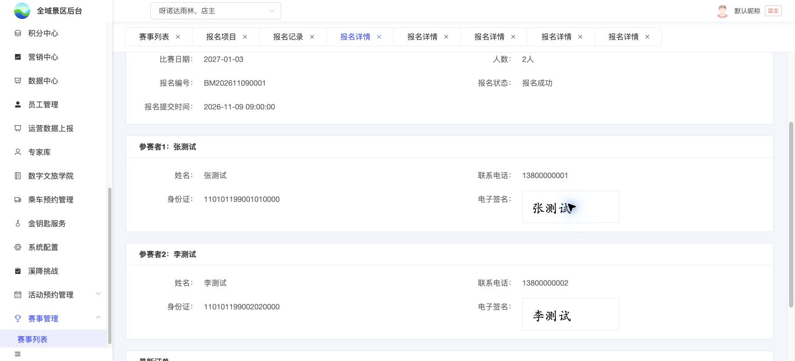</a>

已有详情结构截图；非本次真实接口验收。截图用于定位和布局参考；现行逻辑以本节正文及V1.1标记为准。

### 字段与来源

整份展示赛事、项目、比赛日期、固定人数、已有编号、报名状态、报名提交时间及实际已有数据。逐人按实际收集字段显示，未填“未填写”；已提交读提交快照，不用新配置追改。

| 区块 | 展示边界 |
| --- | --- |
| 逐人资料 | 各人配置字段和值，完整展示已有数据，不新增发起人专属区 |
| 签署 | 需签时逐人已签/未签，实际签名可放大；不需签不虚构签名 |
| 最新订单 | 仅有实际订单才展示订单号、门票名称、状态、实收；无订单不展示该卡，也不额外显示票选项名称 |
| 不展示 | 个人阅读进度/时间、材料正文、原订单全量字段、历次历史订单 |

游客签名权限不影响后台原权限下查看签名。当前后台示例SVG不是游客真实签名。样式沿标签120px、正文14px、行高32px；宽屏双列，1100px及以下单列。列表和详情的实际提交时间一致。返回/切换保留原列表上下文，不重开整项目设计。

**本轮检查（2026-11-11，V1.1）**：后台报名记录存在已取消/已退款示例，详情保留原提交资料和订单；项目成功人数仍为2，未把取消记录加进统计。[查看截图](../../preview/event-admin/设计依据/20261111-V11-13-退款已取消详情.png)。三端退款数据同步尚未接入。

## B11｜报名成功海报配置

> **项目内迭代新增V1.1 · V11-14（业务变化、规则细化）**：赛事级配置报名成功海报，上传背景并拖拽安排动态文字；本节为本轮讨论收敛后的现行页面方案，覆盖此前零散样例及辅助按钮说明。文档整理属于文档完善，不另算新增功能。

**原型：**<a href="../../preview/event-admin/index.html" target="_blank" rel="noopener noreferrer">赛事列表 → 报名成功海报配置</a>。原型在新浏览器页打开；配置页在后台内部独立页签打开。

### 1. 入口、作用范围与关联页面

| 页面/对象 | 配置或行为 | 标记 |
| --- | --- | --- |
| B01赛事列表 | 操作列在“编辑赛事”后增加“报名成功海报配置”；点击带入本行赛事，打开B11 | 项目内迭代新增V1.1 · V11-14（业务变化） |
| B02新增/编辑赛事 | 新增“联系电话”，随赛事保存、编辑回显；海报电话读取此字段。举办地点仍为比赛地点来源 | 项目内迭代新增V1.1 · V11-14（业务变化） |
| B04项目基本信息 | 项目名称后新增“集合地点”，随项目保存、编辑回显，各项目独立 | 项目内迭代新增V1.1 · V11-14（业务变化） |
| B11模板 | 一场赛事共用一套背景与内容布局，各报名项目使用该赛事模板，生成时替换为各自数据 | 项目内迭代新增V1.1 · V11-14（业务变化） |
| C08成功海报 | 免费最终提交成功、收费实际支付成功后使用所属赛事模板；一份报名一张海报，多人共用 | 项目内迭代新增V1.1 · V11-14（规则细化） |

同一赛事重复打开进入同一内部配置页签，不串用其他赛事模板。“预览报名项目”只改变后台取值预览，不改变模板归属，不分别保存成多套项目模板。

### 2. 页面结构与初始展示

| 区域 | 内容与行为 |
| --- | --- |
| 顶部 | 页面名、所属赛事名；“预览海报”“保存配置”按钮 |
| 左侧 | 背景上传/更换、尺寸提示、七类内容添加按钮、预览报名项目选择 |
| 中间 | 背景按原比例显示；文字直接显示当前配置值，可点击选中、拖动位置、拖动左右手柄调整文字区域宽度 |
| 右侧 | 未选中时提示选中内容；选中后显示该项的类型、数据来源或自定义文字、样式设置及删除操作 |

已有模板进入时回显已保存的背景、内容项、位置、宽度与样式。无模板时显示上传背景空态；未上传背景点击添加内容或预览，提示先上传背景，不伪造配置成功。项目下拉仅列当前赛事已保存的项目，默认第一项；没有项目时不编造项目数据。

页面不显示“使用示例背景图”、背景下载链接、“排版样例/应用参考排版”、样例数据输入区、项目下方取值长说明、X/Y坐标输入、宽度数字输入，也不新增“查看效果（无边框）”按钮。原有顶部“预览海报”承担成品查看。

### 3. 背景图上传与推荐尺寸

| 项目 | 规则 |
| --- | --- |
| 格式 | JPG、PNG、WebP；无法识别或读取失败时提示失败并保留原背景 |
| 上传提示 | **建议尺寸：1500 × 2668 px（竖版约9:16），JPG / PNG / WebP。请预留文字区域。** |
| 尺寸性质 | 推荐值，不限制必须9:16；上传其他比例仍使用整图，不裁剪、不拉伸 |
| 更换背景 | 保留已有内容及相对位置、宽度和样式；运营需预览检查新图上的位置及遮挡 |
| 输出 | 宽1500px，高度按背景原比例计算并取整；预览、下载使用同一合成结果 |
| 清晰度 | 背景应使用原始高清文件；放大低清原图不能恢复细节。设计字号按750px基准配置，生成时等比放大2倍 |

参考马拉松图仅为本地试排资料，图上自带名称、日期等属于背景像素，不会因拖拽动态字段而自动更新；正式背景由业务提供，不能拿参考图默认充当正式赛事海报。

### 4. 可添加内容及实际取值

| 内容项 | 数据来源 | 编辑画布与生成规则 |
| --- | --- | --- |
| 参赛人姓名 | 当前这份成功报名的全部N位参赛者姓名，依资料顺序顿号连接 | 单人一个姓名，多人同一张海报；不是登录昵称，也不只取主报名人。后台无真实报名人时用于定位，不生成虚假报名 |
| 自定义标签 | 业务输入的文字 | 新增默认“成功报名{项目名称}”；变量替换为本次报名项目名称。可改为固定文字、删除变量、添加多段标签 |
| 报名项目名称 | 本份报名关联的项目名称 | 不是报名选项展示名、票名或赛事名 |
| 比赛日期 | 该报名项目的比赛开始/结束日期 | 同日显示2027-01-03；多日显示2027-01-03 至 2027-01-04；跨年保留完整年份；不读报名窗口或赛事整体举办日期 |
| 比赛地点 | 当前赛事举办地点 | 读取B02举办地点，不用项目集合地点替代 |
| 集合地点 | 当前报名项目集合地点 | 读取B04集合地点，不同项目分别取值 |
| 联系电话 | 当前赛事联系电话 | 读取B02联系电话，不取主报人或组员手机号 |

**实际内容与占位符：**有配置值就直接显示实际值，例如“0898-12345678”，不会只印“联系电话”四字。缺值在编辑画布以单层花括号提示，例如“{联系电话}”“{集合地点}”“{报名项目名称}”。这只是定位占位，不表示已有数据；成品不打印这些缺值占位。已有本地姓名定位示例不代表真实报名，真正生成必须读取本份报名姓名。

自定义文字中的“{项目名称}”是本轮明确支持的变量；编辑字段中保留变量写法，画布/成品显示替换后的项目名。兼容此前本地双花括号写法。不自动把所有花括号文本都识别成任意业务字段，也不自动加“联系电话：”等前缀；需要固定标题时可另加自定义文字。

切换“预览报名项目”时，项目名、比赛日期、集合地点及自定义文字中的项目变量即时更新；赛事地点与电话保持同一赛事配置。切换只换数据，不移动内容、不清空布局，不把预览选择写成本次报名的实际项目。

### 5. 拖拽、选中、宽度与删除

| 操作 | 结果 |
| --- | --- |
| 点击左侧内容项 | 添加一项到画布，显示实际配置值或缺值占位，可重复添加；每项独立编辑 |
| 从左侧拖到画布 | 在放下位置添加该类型内容，保存的是相对背景坐标 |
| 点击画布内容 | 选中该项，显示蓝色辅助框及左右宽度手柄，右侧切换到该项属性 |
| 拖动文字 | 移动整项，宽度、字号等样式保持；不需要在属性区输入坐标 |
| 拖动左右手柄 | 改变文字区域宽度；右侧手柄改变右边界，左侧手柄改变左边界并保持右边界；文字换行，高度自动增长；不缩放字号 |
| 点击画布空白/其他非属性区，或按Esc | 取消选中，蓝框与手柄消失；鼠标悬停辅助边线也不进入成品 |
| 调整右侧属性 | 保留当前选中项，便于连续调节 |
| 删除此项 | 只删除当前选中的内容，不删除背景或其他项 |

所有位置与文字宽度按背景相对比例保存，改变编辑区显示宽度时等比换算。长姓名、长项目名、多日日期在区域内换行，不静默省略；字号由独立字号控件调整。当前原型有10%最小区域宽度及边界限制，是操作保护，不代表已完成长文避让验收。背景比例变化后、文字过长时可能重叠或超出底部，当前没有自动避让；长文处理与最终边界校验仍需明确，不把裁掉的内容当作完整成功输出。

### 6. 右侧属性与样式

| 属性 | 配置及生效规则 |
| --- | --- |
| 内容类型/来源 | 动态项展示绑定来源，不在此改成其他项目/赛事；自定义标签展示可编辑文本 |
| 字号 | 按750px设计宽度设置，编辑预览等比显示，1500px成品放大2倍绘制 |
| 文字颜色 | 仅文字与随文字显示的小图标颜色 |
| 文字背景开关/颜色 | 开启后显示选定底色，关闭不画底色，文字和边框仍保留 |
| 背景不透明度 | 0—100%；0完全透明、100完全不透明。只影响该文字底色，不影响文字、图标、边框或整张背景图；旧模板未设置默认100% |
| 边框粗细/颜色 | 粗细0为无边框；大于0时可设颜色，沿文字区域绘制，不等同编辑蓝框 |
| 圆角 | 0为直角，大于0为圆角；用于该项背景/边框 |
| 内边距 | 控制文字与背景、边框之间留白，参与换行宽度和区域高度计算 |
| 小图标 | 可选无图标、日期、地点、电话；随文字同色同级显示，不替代实际文字。不提供独立小图片上传图层 |
| 加粗 | 单项开关，不修改其他内容项 |
| 对齐 | 左、中、右，按该项文字区域对齐 |

颜色、底色、不透明度、边框、圆角、字号与排版均须带入实际合成结果。编辑蓝框、手柄、鼠标悬停线、缺值定位占位不带入成品。

### 7. 保存、预览与失败处理

| 场景 | 页面与数据行为 |
| --- | --- |
| 保存配置 | 保存当前赛事模板：背景引用及比例、各项类型/自定义文字、相对位置、区域宽度、样式。绑定来源随类型保存，不把当前预览项目的显示值固化为所有人的固定值 |
| 保存校验 | 背景存在、至少一个内容项、自定义标签非空；必填字段缺值策略另见待确认，不擅自扩大校验 |
| 保存成功 | 提示成功，后续重新进入恢复已保存模板；只影响当前赛事 |
| 保存失败 | 提示失败，保留当前编辑内容，不显示成功、不清空画布 |
| 顶部预览海报 | 使用当前编辑配置及当前预览项目生成图片，可预览尚未保存的编辑；不等于保存模板、不创建报名或订单 |
| 预览弹窗 | 展示实际合成图；没有蓝框/手柄；关闭回到编辑，不改变原配置 |
| 生成失败 | 提示失败、允许后续重试，不把空图片或旧图误认新成品 |

只有点击保存配置才保存模板。关闭页签/离开时未保存内容的恢复、提示策略尚未确认，不承诺已接入自动保存。保存与预览的权限、上传体积/容量上限、接口字段名由研发结合实际能力落实，方案不编造既有接口。

### 8. 成功触发、查看、下载及分享

免费最终提交成功、收费订单实际支付成功后先读取成功结果，有可用海报则直接展示海报，无可用海报则展示C08普通报名成功兜底页；后续补付款成功也衔接同一逻辑。待付款不生成成功海报。生成时匹配本份报名所属赛事模板与项目，不得读取其他赛事模板。

本份报名的N人姓名、项目及对应日期/地点/电话按本节取值；海报生成失败不改变报名成功状态，不要求再次报名或支付。我的报名保留查看资料、查看海报；收费报名还保留原订单入口与原核销二维码，海报不是核销凭据。

预览、保存、分享使用同一张成品。支持保存及微信好友/群聊、朋友圈等既定分享路径；真实相册授权、分享调用及平台能力按C08实施，不把本地下载或分享示意当作已发送。

### 9. 不同手机显示一致性

正式实现须在统一生成环境使用固定字体与版本、统一换行和绘制规则合成单张1500px宽图片。相同模板、数据与生成版本得到一致坐标和换行。字体加载完成再生成，不能无提示换成其他字体继续输出。

游客手机只按原图比例显示、保存和分享，不根据各手机屏宽重新排文字，不在背景上叠加手机端HTML文字。手机屏幕不同只改变整体显示大小，不改变文字相对背景位置；不得裁切或拉伸。编辑画布是操作工具，最终效果以成品图片为准。

本地原型使用浏览器Canvas和系统sans-serif，尚未接统一字体/生成服务；跨系统分别生成仍可能存在字形、字宽差异。不能宣称生产跨手机一致性已经验收。

### 10. 已定范围、待确认与实际实现

已定：赛事级背景/布局、七类内容来源、单日/日期范围、拖拽位置和宽度、单层花括号缺值占位、底色不透明度等样式、去掉辅助演示入口、预览/保存、成功合成及图片等比显示要求。

本轮明确：不新增赛事上架状态，不因未配海报阻断报名；未配置/生成失败使用C08普通成功页。海报生成后保存为图片快照，查看、下载、分享沿用该图，模板后续修改不实时改写已生成图片。

仍待确认：无海报成功记录在后续补配模板后是否补生成、关键动态字段缺值时是否阻止生成、首次生成时赛事/项目配置字段快照来源、长文越界及层级最终策略。剩余事项见U03。

本地制作已实现配置存储、编辑回显、样式及Canvas合成；服务端上传/存储/权限、统一字体生成、真实相册分享尚未接入。旧研发评审包保持不动，所有本轮调整完成后再统一打包。

**实际文件：**preview/event-admin/poster-config.js、poster-config.css、index.html、app.js、tab-navigation.js；共享渲染preview/poster-common.js；游客联看preview/miniapp/poster-config-preview.js。

**检查边界：**本地已观察新增字段回显、入口、合成宽1500px、配置保存、宽度手柄的键盘调节、60%背景不透明度、取消选中及多余按钮移除；不据此宣称鼠标拖拽所有边界、移动端真机、字体一致性、长文和真实分享全部验收。

查看当前原型截图：花括号占位、无额外效果按钮

<a href="../../preview/event-admin/设计依据/20261110-V11-14-花括号占位.png" target="_blank" rel="noopener noreferrer">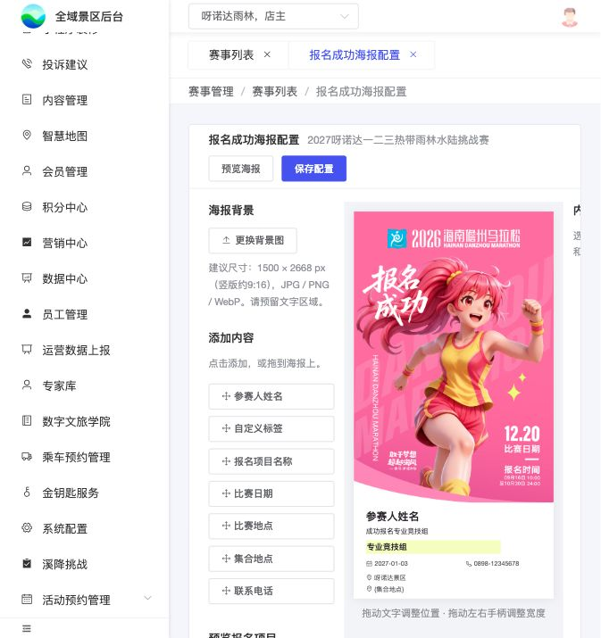</a>

本地原型截图仅证明所示界面；完整需求以本节各表和C08、U03为准。

> **项目内迭代新增V1.1 · V11-14（业务变化）**：增加C08普通报名成功兜底页；海报不作为报名可用性前置门槛，不新增上架操作。成功页分支与海报图片快照规则见C08。

