# 赛事活动报名｜小程序逐页功能方案

整理评审稿｜2026-11-10。<a href="../../preview/miniapp/index.html" target="_blank" rel="noopener noreferrer">打开结构原型</a>。字段来源为业务对象，不是正式API字段约定。页面号与流程、验收一致。

## P00｜配置化赛事前置页
**原型对应：**复用现有页面配置，尚未接入本赛事真实配置，无独立原型或截图。操作关系：B01推广/报名查询页取得链接后，在系统配置页分别配置报名与查询入口；不以C01截图冒充P00。

复用全域现有页面配置搭建赛事说明/推广页，不新建赛事装修体系。每场分别配置：立即报名→本赛事C01，报名查询→本赛事独立C11。查询不要求先进入总览。链接来源B01两类推广入口，实际路由与配置接入待核实；不增加员工身份验证或未经确认的倒计时组件。

## C01｜赛事总览与报名项选择

> **项目内迭代新增V1.1 · V11-08（规则细化）**：本轮补充本页名额与票库存的取值、状态判断表和具体显示示例，详见下方“本页判断使用的数据”至“双人项目的具体显示示例”。
**原型：**<a href="../../preview/miniapp/index.html" target="_blank" rel="noopener noreferrer">打开原型：赛事总览与报名项选择</a>。直接进入；外部审阅控件可切场景。

查看截图：已有总览截图；项目名与价格等均为示例

已有总览截图；项目名与价格等均为示例。截图用于定位和布局参考；现行逻辑以本节正文及V1.1标记为准。

### 取值与展示

| 内容 | 来源与显示 |
| --- | --- |
| 封面、赛事名、举办时间、地点 | 本赛事配置；单日日期一天，多日范围；长名称可换行；无封面正式兜底待定 |
| 我的报名 | 当前赛事＋当前微信账号发起/已关联记录，进入C09；不是全赛事名单 |
| 项目名称 | 本赛事项目名，按后台保存顺序；不是票名或报名项名 |
| 项目备注 | 项目基本说明，非空独立段落可换行，不自动拼单人/双人报名 |
| 签署要求 | 项目配置；需逐人签署或无需签署，用于后续去向，不从收费方式推断 |
| 比赛时间 | 本项目起止，单日一天，不用赛事日期覆盖不同项目 |
| 收费报名项名称 | B08报名展示名称，一条关联行一项，最多20字；按关联顺序，不按价格重排 |
| 报名时间 | 收费每项取自己的交集窗口；免费取项目窗口；“报名时间：YY/MM/DD HH:mm–YY/MM/DD HH:mm”，两端带年份到分钟且单行，项目外层不重复范围 |
| 报名限制条件 | B08该项自己的纯文本，非空才显示；不提升到项目、不同项不互相继承，不自动计算资格 |
| 费用 | 所选票按比赛日/有效期取价格；N=1“¥300/人”，N=2“¥500/2人”；金额是本次买1张总价，不乘N、不除N、不写人均 |
| 免费项目 | 不显示价格区或“免费”价格字样、不造票选项名；N>1提示每次需N位参赛者，N=1省略数量 |
| 状态 | 报名中绿、未开始蓝、已截止灰、已满员/已售罄橙，保留文字，不只靠颜色；不重复在按钮再写同状态 |
| 报名入口 | 整项点击，可报时右侧“报名 ›”；不可报无箭头，无独立胶囊按钮，不加悬停/按下背景 |
| 详细介绍 | 当前赛事自己的富文本，位于总览下方，不用项目备注或签署材料替代 |

不新增已报名数、剩余名额和票库存的游客展示。价格/人数中的N是本次固定人数，不是当前报名数。

### 本页判断使用的数据

> **项目内迭代新增V1.1**：补充C01列表状态的完整判断条件、优先级与示例；为既有规则细化说明，不代表原型或真实服务已同步实现。标记范围至本节C01结束。

本页使用[公共规则K02：时间、可用性、名额与占用](06-公共业务规则.md#K02-时间-可用性-名额与占用)，具体显示按下面的顺序与判断表执行。这里是列表显示判断，不是报名提交；最终提交另见C06。

| 数据 | 本页取值与含义 |
| --- | --- |
| 单次报名人数N | 当前项目配置的固定人数，例如双人项目N=2；不是票库存张数 |
| 项目总名额T | 当前项目配置的总人数，或不限；同项目所有收费报名项共用这一个上限，不为每张票分别计算一份总名额 |
| 已成功人数S | 当前项目收费支付成功及免费提交成功的人数，一份成功计N人 |
| 待付款临时占用人数H | 当前项目有效待付款订单已经临时占用的人数，一份占N人；不计入S，但必须从可用名额扣除 |
| 项目剩余可用人数R | 有限名额时R=max(T−S−H,0)。项目不限时跳过人数不足判断；票库存不限不等于项目不限 |
| 当前报名项票库存Q | 本项所关联票当前可用张数，按比赛日／有效期及原票库存规则读取；不是所有关联票库存合计，也不是库存乘N。原票可用库存已含自身锁定扣减时，不再重复扣一次H |
| 本项有效报名窗口 | 收费：项目窗口与本项原票可售窗口交集；免费：项目窗口。不同项独立判断 |

阅读、填写、暂存、签署均不占用R或Q。上述数据用于本页状态判断，按现有要求不向游客新增成功人数、剩余名额或库存数字。

### 显示与判断顺序

1. 未配置完成的项目隐藏。收费票下架、不匹配、窗口无交集时，隐藏对应报名项；后台关联保留。这些异常项不显示成“已售罄”。
2. 收费全部项隐藏时隐藏项目空卡；全部项目无可展示项时显示“暂无报名项目”，保留赛事资料、介绍、我的报名。数据加载失败显示失败及重试，不能当作空项目、满员或售罄。
3. 对其余可展示项，按以下表格从上到下判断，命中一行即停止。本项目名额不足优先于本项票库存不足；时间状态优先于这两者。

| 顺序 | 判断条件 | 游客看到什么 | 能否进入报名 |
| --- | --- | --- | --- |
| 1 | 当前时间早于本项有效开始时刻，无论剩余名额和库存多少 | 未开始（蓝色），保留名称、报名时间及原有信息 | 不可点，无“报名 ›”入口及箭头 |
| 2 | 当前时间晚于本项有效截止时刻，无论剩余名额和库存多少 | 已截止（灰色），保留该项 | 不可点，无入口及箭头 |
| 3 | 在本项有效窗口内，项目限制名额且R<N；即使Q还有很多张或不限也一样 | 已满员（橙色）；同项目其他处于报名窗口内的可展示项也按此判断 | 不可点，无入口及箭头 |
| 4 | 在本项有效窗口内，项目不限或R≥N，但本收费项Q不足1张 | 已售罄（橙色），只影响该收费报名项；其他项按各自Q判断 | 不可点，无入口及箭头 |
| 5 | 在本项有效窗口内，项目不限或R≥N，且本收费项Q≥1张或票库存不限 | 报名中（绿色），右侧“报名 ›” | 可点，需签署进入C02，否则进入C03 |
| 6 | 免费项目在项目窗口内，且项目不限或R≥N | 报名中（绿色），右侧“报名 ›”；不检查票库存，不造收费选项 | 可点，按签署要求进入C02或C03 |

起止时刻按K02当前包含边界的口径；正式接入须与服务端及票务时间语义一致。报名中只表示本页时间、名额、库存条件满足，不代表所有人员资格、限购或最终提交校验已经通过。点击不建订单、不占名额和票库存，不再选票、选游玩日或增减购票数量。

### 双人项目的具体显示示例

以下均假设本项配置有效、当前在有效报名窗口内、N=2；Q为当前所选报名项的票库存。

| 项目剩余可用人数R | 本项票库存Q | 本页显示 | 原因 |
| --- | --- | --- | --- |
| 2人 | 100张 | 报名中，可点击 | 刚好够一份双人报名；票库存大于项目名额不影响判断 |
| 0人 | 100张 | 已满员，不可点击 | 项目人数上限先限制，不能因票多继续报名 |
| 2人 | 0张 | 已售罄，不可点击 | 项目还有名额，但本项没有可购买的票 |
| 0人 | 0张 | 已满员，不可点击 | 两项都不足，按判断顺序优先显示项目已满员 |
| 不限 | 0张 | 已售罄，不可点击 | 项目不限不绕过所选票库存 |
| 2人 | 不限 | 报名中，可点击 | 票不限不解除项目上限；仍只够一份双人报名 |

例如总名额100人，已成功98人、没有待付款占用，R=2，票还有100张时显示“报名中”。另一份双人报名下单成功待付款后，H=2，R=0：本页读取最新数据时显示“已满员”，不是“已售罄”。该订单实际取消／超时关闭并释放占用后，R恢复2；若本项仍在报名窗口且有票，本页读取最新数据时恢复“报名中”。仅退出微信支付、订单仍有效待付时不释放。

本页状态只是读取当时结果，不为访问者预留名额。已经停留在本页或资料页的人仍可能看到旧状态，不能依靠前端禁用防超额；其最终提交由C06服务端重新检查并控制同一项目并发占用，条件已不满足则不继续创建有效订单。真实数据刷新、占用及释放接入核对见U07b，原型不代表已实现。

例如项目26/11/06—26/11/21，A票售到11/15则A显示到11/15；B票11/16开始则B显示11/16—11/21，不能合并成一个项目连续售期。日历游玩日自动取比赛日，最终提交仍按K07实时校验。

## C02｜报名前材料阅读
**原型：**<a href="../../preview/miniapp/index.html" target="_blank" rel="noopener noreferrer">打开原型：报名项 → 阅读材料</a>。选择需要签署项目的可报名项，进入阅读页；已读进度可能影响首次位置。

查看截图：已有阅读结构截图，阅读持久化尚未接入

<a href="../../preview/miniapp/设计依据/C02结构交互检查.jpg" target="_blank">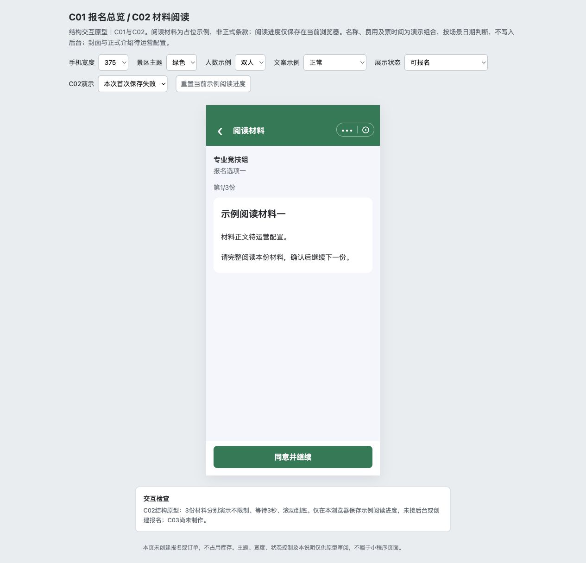</a>

已有阅读结构截图，阅读持久化尚未接入。截图用于定位和布局参考；现行逻辑以本节正文及V1.1标记为准。

### 内容与动作

仅项目需签署时进入。一个页面按材料保存顺序逐份切换；顶部阅读材料，下方项目及收费报名项，显示第X/Y份、当前标题和完整富文本。无需签署直接C03，不因免费跳过所需阅读。

| 阅读方式 | 继续条件 |
| --- | --- |
| 不限制 | 不要求等待或滚到底，仍须点击确认继续 |
| 等待N秒 | 正整数配置，按钮显示剩余秒且禁用，到时可继续 |
| 滚动到底 | 到正文底部才可继续，短于一屏视为到底 |

底部固定“同意并继续”，正文预留底栏安全区。每份只采用一种方式，不叠加，不提供跳过/可选材料开关。

### 保存、恢复与失败

满足条件并确认，保存成功再切下一份，最后一份成功进入C03；保存中防重复点。已完成材料不重复限制，可回看；退出再进从第一份未完成接续，不要求保存未完成倒计时的秒级跨设备进度。

阅读进度保存失败不提示、不记已读，停留当前份重新阅读，其他已保存进度保留；不显示“阅读完成后，点击下方按钮继续”的冗余说明。材料加载失败/异常为空仍提示重新加载，不擅自当免签直接跳过。阅读不等于签名或报名，不下单、不占库存。

> **项目内迭代新增V1.1 · V11-12（规则细化）**：仅打开页面、阅读或完成全部材料阅读，不生成报名记录，不触发后台配置锁定；阅读进度独立保存。首次主动暂存成功（包括半填暂存）产生报名记录后，才按K05限制后台配置修改。

配置正文/材料变更按K05。

## C03｜参赛资料与暂存

**项目内迭代新增V1.1 · V11-13（业务变化）**：已取消记录继续报名恢复本份资料和有效签署，主报人可修改；齐全后显示立即报名。暂存或签署仍保持已取消，直到重新提交成功。旧退款订单保持关联；完整重报判断见C06、C07。
**原型：**<a href="../../preview/miniapp/index.html" target="_blank" rel="noopener noreferrer">打开原型：预览需签署资料页</a>。外部审阅区点预览需签署资料页；或按报名流程读完材料进入。默认参赛资料标签。

> **项目内迭代新增V1.1 · V11-02**：全员资料齐且底部暂存成功才开放签署/分享；改资料后再用同一暂存按钮。首次暂存建记录的方向原已存在，本轮补齐本地同一记录保存及恢复。
> **项目内迭代新增V1.1 · V11-03**：暂存成功短暂浮层约2秒，不占底栏；不新增上方保存按钮。
> **项目内迭代新增V1.1 · V11-07**：主报人资料页底部继续支付进入同一有效原订单；组员/免费无按钮。原未付订单实际关闭才恢复立即报名，取消收银台不恢复；订单关闭回退原则原已存在，本轮补足该按钮衔接。

查看截图：已有A标签布局截图；较早截图不代表最新底部状态

<a href="../../preview/miniapp/设计依据/C03-A标签版.jpg" target="_blank">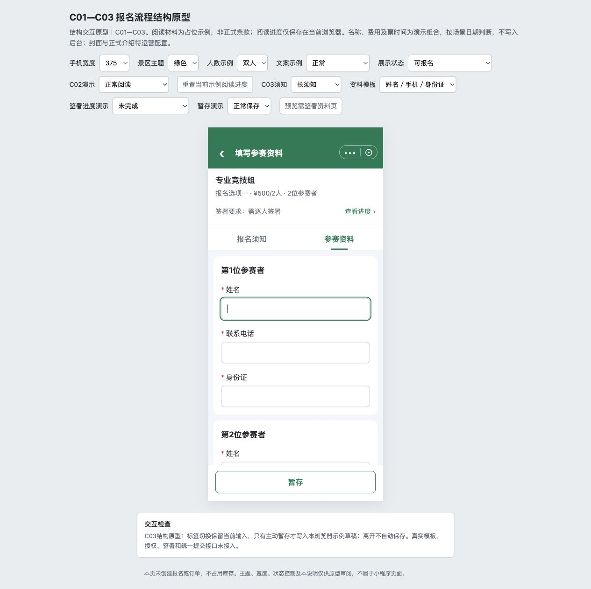</a>

已有A标签布局截图；较早截图不代表最新底部状态。截图用于定位和布局参考；现行逻辑以本节正文及V1.1标记为准。

查看截图：本轮迭代已有截图：先暂存再签署/分享

<a href="../../preview/miniapp/设计依据/20261110-签署前保存门槛.png" target="_blank">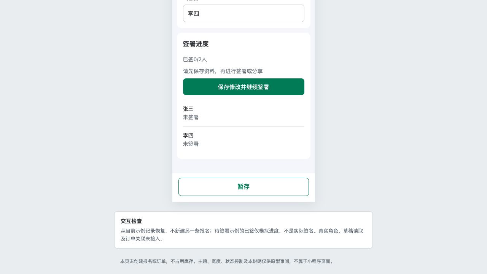</a>

本轮迭代已有截图：先暂存再签署/分享。截图用于定位和布局参考；现行逻辑以本节正文及V1.1标记为准。

查看截图：本轮迭代已有截图：待付款发起人继续支付

<a href="../../preview/miniapp/设计依据/20261110-待付款继续支付.png" target="_blank">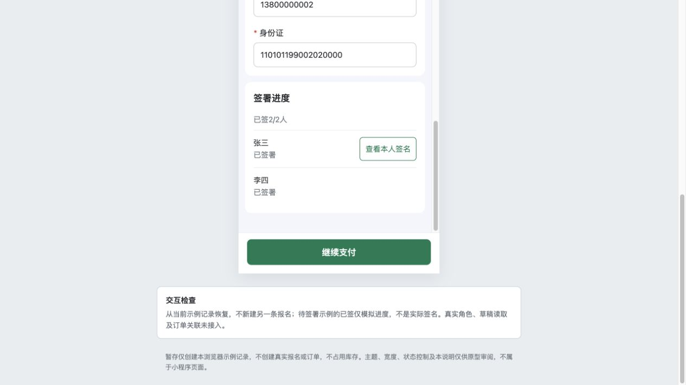</a>

本轮迭代已有截图：待付款发起人继续支付。截图用于定位和布局参考；现行逻辑以本节正文及V1.1标记为准。

### 结构与字段

采用A方案“报名须知／参赛资料”标签，默认参赛资料，B方案删除。标签切换不销毁输入、不自动暂存，各保留滚动位置。未配置须知直接显示表单，不留空标签；长须知完整富文本展示，不加倒计时、强制到底、同意勾选。

顶部简要回显项目、收费报名项和价格/固定人数；免费不造票/价格。需签时显示签署要求和查看进度定位入口，不显示“签署要求：无需签署”。下方按N纵向生成参赛者卡，同套字段/排序/规则/说明，无人数增减和填写方式选择。

姓名固定必填，其余按B05模板和K07票要求。手机号不自动给所有人灌发起人号码；身份证为唯一证件类型。字段校验沿B05，最终检查全部N人并定位人员与字段。主报人填写全部资料，分享不开放其他人自行填写。

> **项目内迭代新增V1.1 · V11-11（规则细化）**：区分后台项目配置限制与游客已填资料的修改权限；暂存产生记录不等于游客资料只读，不改变已确认业务。

### 游客修改资料与后台配置限制的区别

后台不能改删既有填写项，只限制运营修改资料模板，不会把已暂存的游客资料变成只读。主报人在资料待完善、待签署、待提交阶段，仍可修改全部N人的已填资料；普通修改后重新暂存，改姓名仅使对应人员签名失效。收费成功下单后（包括待付款）或免费提交成功后，资料才按提交快照只读。原未付订单实际取消或关闭后，保留资料及有效签署，恢复未提交阶段，可继续修改。组员从分享或查看资料进入时只读，属于身份权限限制，不是暂存导致锁定。

### 底部按钮和签署门槛

| 当前情况 | 显示/行为 |
| --- | --- |
| 需签但资料未齐 | 只提供暂存，签署区统一提示“请先完善全部参赛者资料，再进行签署”；具体错误放字段旁，不在进度区逐人罗列 |
| 资料齐但未成功暂存 / 暂存后又修改 | 提示“请先暂存资料，再进行签署或分享”，隐藏签署/分享入口；只用底部一个暂存，无上方保存按钮 |
| 暂存成功且全部资料有效 | 开放逐人签署/分享；未全签时底部仍仅暂存 |
| 全部资料有效且全部必要签署有效 | 出现立即报名；无签署项目保留暂存/立即报名，提交时再校验 |
| 姓名变更导致某人签名失效 | 隐藏立即报名，重新暂存后该人签署；其他人有效签名保留 |
| 待付款，发起人查看资料 | 全部资料及签署锁定，底部继续支付→关联原订单，无暂存/重复提交 |
| 原未付订单实际取消/关闭 | 保留资料/有效签署，恢复未提交，满足当前报名条件后立即报名；不以关闭收银台触发 |
| 已成功 / 只读组员 | 无暂存和立即报名，组员也无继续支付 |

未填完也可暂存。成功首次产生记录，后续保存同一条；成功提示已暂存用约2秒浮层，不占底部布局留白，失败保留错误与重试。普通填写、页面内切换、直接离开按K03，不增加保存并离开/直接离开/继续填写三按钮。

## C04｜签署进度组件
**原型：**<a href="../../preview/miniapp/index.html" target="_blank" rel="noopener noreferrer">打开原型：C03参赛资料 → 签署进度</a>。本组件集成C03，填齐资料并暂存后看去签署/分享，不建立独立页。

> **项目内迭代新增V1.1 · V11-02**：全员资料齐且底部暂存成功才开放签署/分享；改资料后再用同一暂存按钮。首次暂存建记录的方向原已存在，本轮补齐本地同一记录保存及恢复。
> **项目内迭代新增V1.1 · V11-04**：有效关联组员从我的报名也可看全部N人只读资料；双方共用详情结构，仅本人行有查看本人签名，弹窗显示本人快照；组员不能修改、提交或付款。

查看截图：组件暂存门槛状态；完整进度按原型实际签署显示

组件暂存门槛状态；完整进度按原型实际签署显示。截图用于定位和布局参考；现行逻辑以本节正文及V1.1标记为准。

集成C03资料下方，显示已签X/N人、各人姓名和有效状态。全员资料通过并已保存后才开放操作。无签署项目不显示此区。

- 未签人员显示去签署、分享签署；已签人员隐藏分享，未下单有权本人入口改为重签署。
- 同机是每个人亲自签本人，不允许主报人代签全部；主报人无需先签，最后一人完成不自动提交或下单。
- 查看资料的只读上下文中，在当前访问者本人行显示查看本人签名，点击弹窗。其他人仅状态、无打开入口；用户不需区分不同资料布局。
- 只有修改已签人的姓名使该人失效；非姓名改动不重签，仍需暂存，仍校验实际资料。进度取已成功保存的签署，不把分享完成当签完。

## C05｜纯签署、重签与分享接收
**原型：**<a href="../../preview/miniapp/index.html?view=signature" target="_blank" rel="noopener noreferrer">打开原型：本人签署／重签署</a>。该链接使用现有签署专用审阅入口，自动装入虚构已暂存资料并打开签署画布；分享接收从C03点分享签署。

> **项目内迭代新增V1.1 · V11-02**：全员资料齐且底部暂存成功才开放签署/分享；改资料后再用同一暂存按钮。首次暂存建记录的方向原已存在，本轮补齐本地同一记录保存及恢复。

查看截图：已有纯签署页结构截图

<a href="../../preview/miniapp/设计依据/20261110-C05纯签署页.jpg" target="_blank">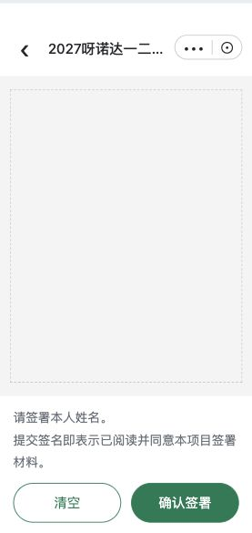</a>

已有纯签署页结构截图。截图用于定位和布局参考；现行逻辑以本节正文及V1.1标记为准。

查看截图：已有分享接收页截图，与纯签署页分开

<a href="../../preview/miniapp/设计依据/20261110-分享接收只读资料.jpg" target="_blank">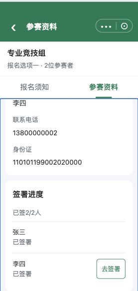</a>

已有分享接收页截图，与纯签署页分开。截图用于定位和布局参考；现行逻辑以本节正文及V1.1标记为准。

### 纯签署页

从去签署/重签署打开同一纯画布页。顶部赛事名称，不用本人签署当导航标题；不放人员资料卡、其他参赛者或材料列表，不让用户先滚过这些内容才能签名。

画布下方、按钮上方直接显示B06项目签署说明，留空隐藏、换行保留、长文可滚动且按钮可达。清空、确认签署两个动作；已签进入回显原有效签名。清空只改当前画布，未确认退出不覆盖旧签名；有效新签名确认保存成功才替换。

最后一次成功确认覆盖对应人员的签署快照，包含本次签名、姓名和确认时间，不保留多版本，不覆盖其他人。保存失败保留旧签，不假报已签。需要手写签名与姓名一致识别，空画布校验不能冒充识别。下单成功后签署锁定，不允许重签。

### 分享接收流程

主报人在已保存全员有效资料上分享指定人员。接收者按C02顺序阅读本项目全部材料，阅读进度按其本人记录，不直接借用主报人已读。之后进入须知/参赛资料A标签，默认资料，全部N人资料只读。

签署进度只开放指定接收者本人的去签署/重签署，其他人的签署/分享入口隐藏，全部分享按钮隐藏；不提供暂存、立即报名或支付。本人确认后回接收者资料页更新进度，不自动提交整份。

资料读取实际成功暂存的记录，不能分享内存未保存表单；身份和关系按K04校验，不以链接可见或姓名相同授权整组管理。真实跨设备持久化与微信分享未接入。

### 完成反馈与通知

签署保存成功后回对应资料页，提示签署成功并更新状态。发起人接收他人签完提醒采用短信；发送接口、模板、触发颗粒度及重签去重待U08d落实。保存失败不触发短信，不将本地提示称为已发送。

## C06｜立即报名与一次提交

**项目内迭代新增V1.1 · V11-13（规则细化）**：待提交和已取消均须按提交当时重新校验全部资料、阅读/签署、报名时间与N名额。未关联票按项目条件；关联票同时检查当前报名项窗口，并由原下单层校验全员资格、限购、价格及票库存。失败保留原状态和旧退款单，未知先回查；新订单创建成功才替换关联、转待付款并临时占N名额，付款成功才计成功人数。
**原型：**<a href="../../preview/miniapp/index.html?view=records" target="_blank" rel="noopener noreferrer">打开原型：我的报名 → 待提交 → 继续报名 → 立即报名</a>。本项是C03提交动作，没有独立核对页；用虚构待提交示例操作。

查看截图：已有提交后锁定状态截图，仅模拟下单

<a href="../../preview/miniapp/设计依据/20261110-C06收费下单锁定.jpg" target="_blank">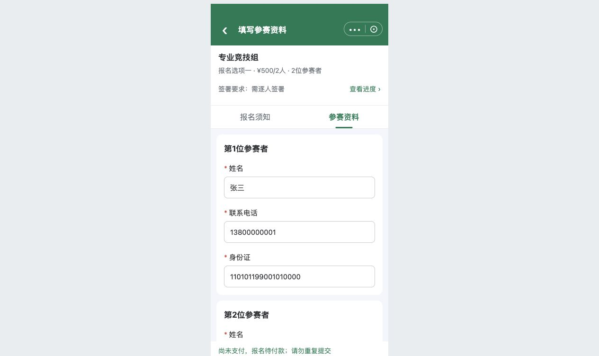</a>

已有提交后锁定状态截图，仅模拟下单。截图用于定位和布局参考；现行逻辑以本节正文及V1.1标记为准。

本节点在C03完成，不另建最终核对页、不再提交一次订单。主报人操作，其输入是当前报名对象、全部N人资料、有效阅读/签署和当前配置。

### 提交校验

> **项目内迭代新增V1.1**：本次细化以下第4—5项的最新名额／票库存复核、失败提示及并发占用要求；其余原有校验保留。

1. 主报人有权管理该记录，所选赛事/项目/项对应有效。
2. 固定N人资料满足模板、必填、类型和原票要求，不只校验首人。
3. 需要时全部材料已读、全员有效签署；未提交新增材料已补读，姓名失效签名不算有效。
4. 使用[公共规则K02](06-公共业务规则.md#K02-时间-可用性-名额与占用)重新读取当前有效窗口及项目可用人数R：有限名额R=总名额−成功人数−有效待付款占用人数，须R≥本次固定人数N；收费还须所选原票当前可用库存≥1张或库存不限，并通过票可用性、比赛日／有效期、价格检查；免费不查票库存。不能沿用C01进入时的数据。
5. 项目名额不足时本次提交失败并显示“已满员”；项目名额足够但本项票库存不足时显示“已售罄”，保留资料和有效签署，不继续创建有效订单。时间已过则按截止原因处理，不由库存提示覆盖。服务端必须在并发请求下保证占用不超过项目总名额，不能仅前端先查询后放行；同一报名重复请求不重复占用。收费下单、占用与失败释放的衔接见K02、K06及U07b。
6. 收费固定买1张、传全部N人资料和发起人授权手机号；原资格、限购、起售量等执行真实校验，人工限制说明不是通过凭证。

### 结果处理

| 情形 | 页面和业务结果 |
| --- | --- |
| 提交中 | 提交中…；禁重复提交、暂存、资料/签署修改 |
| 明确失败 | 当前页显示实际原因，恢复操作，保留当前输入和有效签署供修正；不因失败偷偷暂存 |
| 结果未知 | 正在核实，查询原请求/订单；没查明不开第二次下单 |
| 收费成功下单 | 报名待付款、锁定全部资料/签署、直接调微信支付；不提前计成功或出海报 |
| 免费提交成功 | 保存提交快照，报名成功，直接C08；不生成订单或走付款 |

前端禁用不是服务端幂等。实际两系统事务、部分成功和回查由研发接入验证，不能把“一次操作”当已经具备跨系统原子事务。

## C07｜微信支付与原订单
**原型：**<a href="../../preview/miniapp/index.html?view=records" target="_blank" rel="noopener noreferrer">打开原型：我的报名 → 待付款 → 查看订单</a>。可从待付款查看资料的继续支付进入同一原订单；首次提交自动弹模拟微信收银台。

> **项目内迭代新增V1.1 · V11-07**：主报人资料页底部继续支付进入同一有效原订单；组员/免费无按钮。原未付订单实际关闭才恢复立即报名，取消收银台不恢复；订单关闭回退原则原已存在，本轮补足该按钮衔接。

查看截图：已有微信收银台模拟，非真实支付

<a href="../../preview/miniapp/设计依据/20261110-微信收银台模拟.png" target="_blank">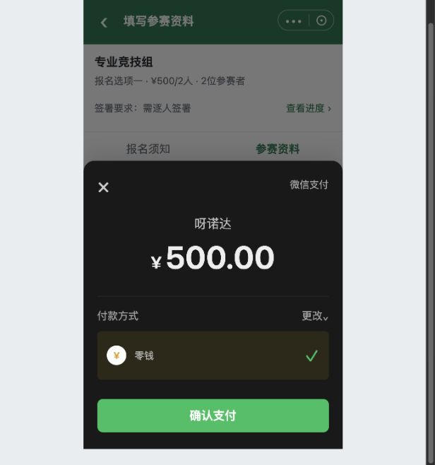</a>

已有微信收银台模拟，非真实支付。截图用于定位和布局参考；现行逻辑以本节正文及V1.1标记为准。

查看截图：依据用户截图还原的原订单页示意，原系统界面不改

<a href="../../preview/miniapp/设计依据/20261110-原订单详情还原-手机.png" target="_blank">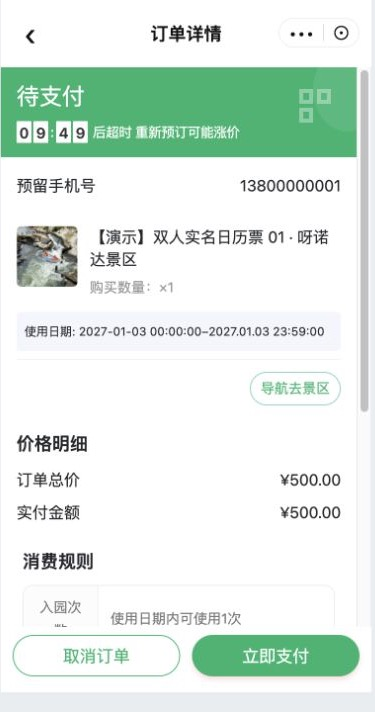</a>

依据用户截图还原的原订单页示意，原系统界面不改。截图用于定位和布局参考；现行逻辑以本节正文及V1.1标记为准。

### 进入和复用

> **项目内迭代新增V1.1 · V11-10（规则细化）**：明确完全复用原订单页的范围、主报人入口，以及订单关闭后的“报名状态回退”与“页面跳转”的区别；不新增赛事订单页或自动返回要求。

首次收费提交成功直接微信支付；C03待付款继续支付、C09查看订单进入本份当前有效原订单。订单号、金额、有效期、票券均取原订单实际数据，不在报名页编造。

原订单详情完全复用呀诺达原系统，包括取消订单、立即支付、二维码和既有返回。除本轮V11-13叠加赛事退款截止时间对“申请退款”入口及提交的判断外，报名不改其页面、字段和其他既有按钮，不增加赛事报名字段或查看报名入口，不要求从我的订单列表自行找单。报名资料在C03/C10查看，票券与核销码在原订单查看。报名侧仅向有权限的主报人提供对应订单入口；组员无查看订单或付款入口，不因参与报名新增原订单访问权限。原型还原截图仅帮助串流程，不是原系统改造稿。

### 事件处理

| 事件 | 报名侧结果 |
| --- | --- |
| 取消/未付微信收银台 | 展示原待付订单；仍待付款且锁资料，原有效订单不重复建 |
| 首次付款或后续原订单付款成功 | 实际核实后报名成功，直接C08海报 |
| 原未付订单人工取消/系统关闭 | 报名状态恢复未提交，资料/有效签署保留，按K06重新判断完整性及报名条件；这是状态变化，不要求订单页自动跳回报名详情 |
| 报名已截止但原订单仍有效 | 仍可在原订单有效期内付，实际成功即成功 |
| 订单关闭且报名已截止 | 保留记录，不允许新订单；不自动换票或转正价 |
| 支付/关闭未知或冲突 | 先查真实结果，未查明不重下、不重复释放；已付不回退未提交 |

**项目内迭代新增V1.1 · V11-10（规则细化）**：订单取消、关闭后的停留页面与返回行为沿用原订单系统，不增加自动跳回报名详情的要求。用户后续进入或返回“我的报名／报名资料”时，读取实际订单结果并显示恢复后的报名状态；条件满足时可继续报名。支付成功出海报是已明确的独立衔接要求，不由订单关闭规则推导。订单直达、支付结果衔接及关闭同步的技术接入见U07b，不能再把“是否完全复用订单页”列为待产品确认。

超时使用原订单配置及任务，不新增固定时长。演示09:49是静态示例。收费成功核销使用原订单二维码；海报码不能当核销码，免费不造二维码。

### 赛事订单申请退款

**原型：**<a href="../../preview/miniapp/index.html?view=refund" target="_blank" rel="noopener noreferrer">打开原型：已支付原订单 → 申请退款</a>。顶部审阅区可切原票规则、是否审核、时间、模拟退款结果与重新提交。

查看截图：V1.1 原订单退款入口与售后申请

<a href="../../preview/miniapp/设计依据/20261110-V11-13原订单退款入口.png" target="_blank" rel="noopener noreferrer">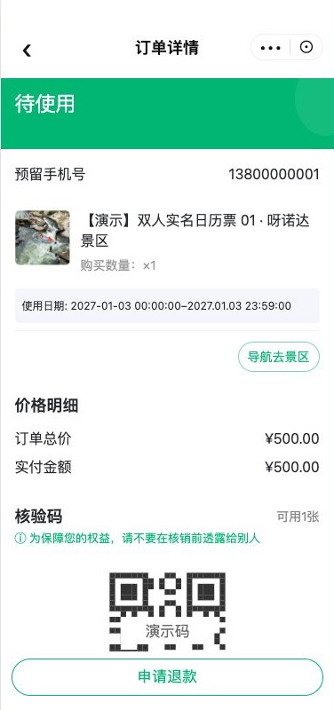</a>

<a href="../../preview/miniapp/设计依据/20261110-V11-13售后申请.png" target="_blank" rel="noopener noreferrer">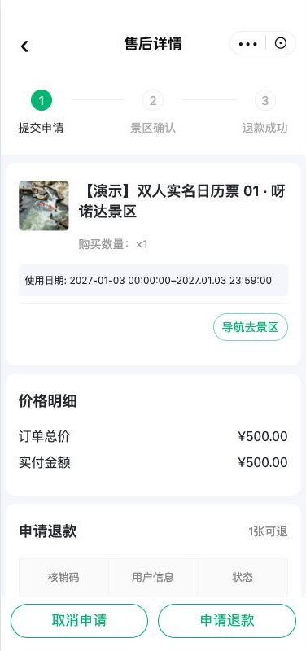</a>

> **项目内迭代新增V1.1 · V11-13（业务变化）**：复用截图中的原订单详情及售后流程，只新增赛事退款时间限制、全额退款后的名额和关联处理。

| 判断步骤 | 页面与处理 |
| --- | --- |
| 原订单不满足退票条件 | 不显示申请退款，赛事截止时间不能放开原本不可退的订单 |
| 原订单允许退款，未关联赛事 | 沿现有规则处理，不新增赛事限制 |
| 原订单允许退款且关联赛事，未到赛事退款截止时间 | 主报人可见申请退款，进入原售后流程，整单全额申请；审核配置沿原票 |
| 已设置时间且到达或超过赛事退款截止时间 | 隐藏申请退款；已提前打开售后页也须在提交时校验，不能仅隐藏按钮 |
| 原票允许退款、赛事未设置截止时间（含存量空值） | 仅按订单存储的原票退款规则展示申请按钮，不叠加赛事时间限制 |
| 读取截止时间或退款资格失败 | 不能当作允许退款；提示失败并可重试，实际接口及异常接入由研发核实 |

原票“不可退”“未消费且有效期内可退”“未消费均可退款（过期也可申请）”继续分别生效；未消费指尚未检票，不能统一把票过期写成不可退。本次业务计划使用未消费均可退款，再由赛事配置的截止时间限制游客主动申请。非主报人不新增订单/退款权限。

全额退款实际成功才释放N个项目名额；申请或退款中不释放。未重报时C09查看订单仍进入旧退款订单；新订单创建成功才替换报名关联，旧单保留在小程序我的订单。项目名额、票库存及当前订单关联按K06分别处理。退款成功后变已取消，提供继续报名并保留查看旧退款订单；海报行为仍见U03。本地原型已补原订单/售后页、审核与免审核场景、名额占用及新旧订单关联演示；未接真实退款、订单与库存接口。审核中的订单展示以真实原系统为准，当前仅结构示意。

### 退款成功、状态与重新报名联动

**项目内迭代新增V1.1 · V11-13（业务变化、规则细化）**：退款成功状态由原先未定明确为“已取消”，不使用“待提交”。

| 页面/触发 | 最新处理 |
|---|---|
| C07原订单申请按钮 | 先按订单存储的门票退款规则，再通过当前订单关联的报名项目实时读取其赛事退款截止时间；非必填、可随时改/清空，未配只用原票规则。读取失败与未配区分；到达截止隐藏按钮，申请提交再次检查最新值 |
| C07截止前已提交申请 | 截止后仍可审核，审核通过照常退款；审核中、退款中不改变报名成功或释放名额，沿原订单展示 |
| 游客／全域后台／票务系统退款结果 | 包括已检票后的强制退票，只有当前绑定票实际退款成功才改已取消、扣减N成功人数并释放N项目名额；历史旧单和重复通知不影响新报名，不重复释放 |
| C09我的报名 | 已取消卡片保留资料摘要、旧报名时间、已退款订单，主报人显示继续报名及查看订单，不当作成功记录；C11仅成功的查询结果排除该记录 |
| C03/C10继续报名 | 从原已取消记录进入，保留资料/有效签署，可按未提交规则修改；数据仍齐且签署有效时显示立即报名，不要求重填全部内容。普通暂存/签署不把已取消改为待提交 |
| C06重新提交 | 待提交和已取消均走完整实时校验。未关联票检查项目条件、资料、阅读/签署及N名额；关联票同时检查报名项当前有效时间，并在原下单层校验全员资格/限购/价格/票库存。截止、满员、售罄等失败仍保留已取消与旧退款单 |
| 新下单成功 | 替换当前关联为新订单，旧退款单保留在我的订单，报名变待付款并临时占用N名额；支付成功才计成功人数。下单失败不解绑，结果未知回查 |
| 未付款订单取消/实际超时关闭 | 解除当前关联、回待提交，资料/有效签署保留；不变已取消。取消微信支付弹窗仍为待付款 |

本地原型可切换退款来源、审核、空截止时间及当前报名时间/库存场景演示；真实退款回调、查询最新配置、订单原校验、并发及权限须研发接入。退款后海报体验见U03待确认。

**本轮交互检查（2026-11-11，V1.1）**：本地实际操作验证空截止可申请、申请后审核仍占2人、截止后已受理申请退款成功释放2人、已检票强退成功和重复结果不重复释放、已取消继续报名及截止拦截、重报新订单替换且旧订单保留、未付款主动取消回待提交。截图：[已取消及继续报名](../../preview/miniapp/设计依据/20261111-V11-13-退款已取消.png)、[继续报名资料页](../../preview/miniapp/设计依据/20261111-V11-13-退款继续报名.png)。320/360/375/390/414宽卡片未出现横向溢出，三主题可切换。以上是本地模拟，真实三端退款通知、系统超时、并发和票务校验仍须联调。

## C08｜报名成功：海报、兜底页与分享
**原型：**<a href="../../preview/miniapp/index.html?view=records" target="_blank" rel="noopener noreferrer">打开原型：我的报名 → 成功记录 → 查看海报</a>。或沿免费提交/模拟付款成功直接展示。**项目内迭代新增V1.1 · V11-14（业务变化）**：海报模板与字段配置见B11；正式底图由业务上传。

查看截图：已有参考海报展示截图，不能作为正式海报设计

已有参考海报展示截图，不能作为正式海报设计。截图用于定位和布局参考；现行逻辑以本节正文及V1.1标记为准。

收费实际付款成功、免费最终提交成功后进入C08：有可用海报直接显示海报；没有可用海报进入本节兜底成功页，不先经过另一层成功卡片或资料页底部重复报名成功提示。后续补付款也衔接海报，成功状态不依本地弹窗猜测。

**项目内迭代新增V1.1 · V11-14（业务变化）**：一份成功报名一张，多人共用。使用所属赛事B11保存的背景图和文字配置，将本份全部参赛者姓名、当前项目名称和比赛日期、赛事举办地点、项目集合地点、赛事联系电话替换到指定位置；自定义标签使用业务配置的文字。日期起止同日只显示单日，不同日显示完整范围。每项字号、颜色与位置沿模板配置，保存图片与预览使用同一合成结果，不再下载固定参考图片。不自动做性别模板或新核销码。自定义变量{项目名称}按本次项目替换；缺值编辑占位不打印到成品。输出宽1500px，高度按背景比例；底色不透明度、边框、圆角等沿B11。游客端仅等比显示同一张合成图，不依手机屏宽重新排文字；统一字体与生成环境要求见B11第9节。已生成图片保留原快照；无图记录补生成及首次生成的字段来源等见U03。

海报支持保存及微信好友/群聊、朋友圈等分享路径。真实海报生成、相册及分享能力待接入，不声称已发送或发布朋友圈。生成失败不改变报名成功，不要求重报/重付，转入普通报名成功兜底页。我的报名成功记录可再次查看海报，并保留查看资料；收费还需查看订单。

### C08｜海报分享弹层

**项目内迭代新增V1.1 · V11-14（规则细化、页面调整）**：游客点击海报页“分享海报”，以当前已生成的完整海报图片打开微信图片分享面板。采用底部弹层结构，三个图标入口依次为“发送给朋友”“分享到朋友圈”“保存图片”，底部单独“取消”；关闭后仍停留在原海报页。正式端复用微信原生面板，原型仅模拟结构，图标、项目顺序和具体外观以微信客户端为准，不另做一套强制覆盖原生样式。

| 操作 | 处理与边界 |
|---|---|
| 发送给朋友 | 分享当前海报图片，进入微信选择朋友或群聊；不把完整海报替换成小程序页面卡片 |
| 分享到朋友圈 | 微信基础库3.8.2及以上支持图片面板直接分享至朋友圈；进入微信朋友圈编辑，由用户确认发布，不自动发布。分享图片不携带订单核销二维码 |
| 保存图片 | 保存同一张海报图片到相册；正式端处理保存权限及失败反馈，浏览器原型为文件下载 |
| 低版本或能力不可用 | 提供保存图片到相册，再由用户自行发朋友圈的兼容路径；不展示不可执行的直接分享能力 |
| 取消／关闭 | 返回当前海报，不改变报名、订单或海报快照，不将关闭面板认定为分享成功 |

依据：[微信官方API类型说明：showShareImageMenu](https://github.com/wechat-miniprogram/api-typings/blob/master/types/wx/lib.wx.api.d.ts)；官方明确自基础库3.8.2支持分享朋友圈。该能力是图片分享，与右上角菜单的页面分享不同。真实好友选择、朋友圈编辑、相册保存及不同微信版本真机验证待研发接入。

**原型检查**：分享弹层在320、360、375、390、414px均无横向溢出；朋友圈入口反馈和取消返回已检查，真实分享仍需真机接入。[查看分享弹层截图](../../preview/miniapp/设计依据/20261110-V11-14-海报分享弹层.png)。

### C08｜普通报名成功兜底页与调用逻辑

> **项目内迭代新增V1.1 · V11-14（业务变化、规则细化）**：本轮增加无海报时的普通成功页。不新增赛事上架操作，不将海报配置作为游客报名门槛。

| 判断顺序/场景 | 展示与行为 |
| --- | --- |
| 尚未确认报名成功/收费仍待付款 | 不进入成功页，仍走C06/C07原状态核实与支付路径，不能因海报存在推定成功 |
| 免费最终提交成功、收费实际支付成功（含原订单补付成功） | 读取本份报名成功结果，进入以下海报/兜底判断 |
| 已有该份报名海报图片快照且可读取 | 直接展示该图片，不因后台模板变化重排字或自动重生成 |
| 没有图片快照，但所属赛事已保存有效模板 | 统一生成图片快照，成功后直接展示海报；生成期间短暂显示正在生成海报，不要求再点击报名 |
| 未配模板、模板没有可用背景或内容项 | 直接展示普通报名成功页，不使用参考图、其他赛事模板或空白海报 |
| 图片生成/读取失败 | 展示普通报名成功页；不得转成报名失败，不重复创建报名或订单，不要求再次支付 |

**兜底页字段和操作**：页标题“报名成功”，成功图形及主文案“报名成功”；说明“可在我的报名中查看报名资料”。显示本份报名的项目名称、选项展示名称（有则展示）、全部N位参赛者姓名，读取已提交报名快照，不展示后台变量占位。只提供“我的报名”按钮，进入C09；再从记录查看资料，收费记录按既定权限查看原订单。该页不显示保存/分享海报按钮，不展示不存在的海报，也不新增核销二维码。

海报模式仍保留保存海报、分享海报，及原有我的报名查看入口；普通成功页与海报页是同一成功节点的互斥结果，不叠加显示两次成功页。兜底页不提示游客“后台没有配置”或暴露技术失败原因；技术原因仅放审阅说明/日志，不作为游客主文案。

**图片快照**：成功合成一次保存图片结果，查看、下载与分享使用同一张图。后台改模板只影响后续新生成图片，不自动改变已生成海报。游客端只等比显示，不按手机屏宽重新排字。已成功但当时走兜底的记录，后续补配模板是否补生成，仍留待确认，不把它默认为已有海报必须重做。退款后的海报处理仍按U03未决边界，不由兜底规则推导。

**本地原型演示**：左侧“提交与支付”→“成功展示”可选按当前配置、未配置海报兜底、海报生成失败兜底；从成功记录查看海报或模拟提交/支付成功进入同一分支。该控件在手机外，仅用于评审。本地已接分支，不代表已接服务端图片快照持久化。

## C09｜我的报名
**原型：**<a href="../../preview/miniapp/index.html?view=records" target="_blank" rel="noopener noreferrer">打开原型：我的报名</a>。现有直达审阅入口；查看身份可切发起人/已关联组员；场景可切免费。

> **项目内迭代新增V1.1 · V11-04**：有效关联组员从我的报名也可看全部N人只读资料；双方共用详情结构，仅本人行有查看本人签名，弹窗显示本人快照；组员不能修改、提交或付款。

查看截图：已有五状态列表截图，非真实账号数据

<a href="../../preview/miniapp/设计依据/20261110-C09我的报名列表.png" target="_blank">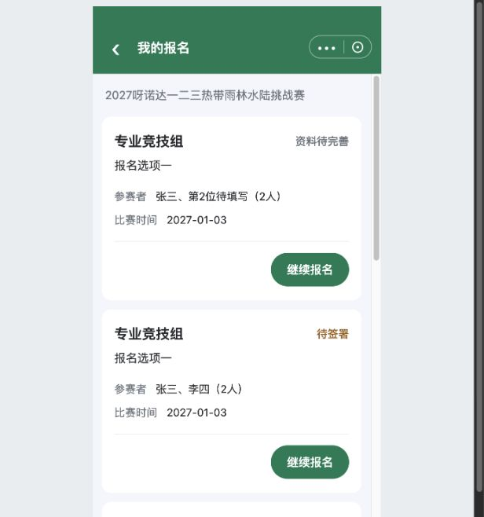</a>

已有五状态列表截图，非真实账号数据。截图用于定位和布局参考；现行逻辑以本节正文及V1.1标记为准。

### 范围与卡片

C01我的报名进入，限定当前赛事和当前账号发起或有效关联的记录，包含六种主状态（增加已取消）。不是全赛事名单，不因同名、同机、仅打开分享自动收录。每份报名一张卡，N人不拆N条，无一人只能报名一次的新增限制。

| 字段 | 来源 |
| --- | --- |
| 项目、收费报名项 | 记录归属和所选项，已提交按快照；免费不造票名 |
| 人员摘要与N | 已成功保存姓名及固定人数，不用未保存输入冒充已存 |
| 比赛时间 | 本项目对应日期，单日合并 |
| 报名时间 | 最终报名提交时间，未提交不显示；不是付款或暂存时间 |
| 状态 | K06六种主状态，项目已截止不替换它 |

卡片沿小程序现有主题，状态在标题右侧，长名称允许换行。当前按钮基线36px高、14px字、左右12px、间距8px，透明扩展约44px触控范围；不是最终Figma尺寸批准。无列表身份证、手机、签名；排序/分页尚未确定正式契约。

### 入口矩阵

| 状态 | 主报人 | 已关联组员 |
| --- | --- | --- |
| 资料待完善/待签署/待提交 | 继续报名，恢复原记录，不新建 | 有效关联范围内查看资料，只读，不提交 |
| 收费待付款 | 查看资料、查看订单；资料页底部继续支付 | 查看资料，无付款入口 |
| 收费报名成功 | 查看资料、查看订单、查看海报 | 查看资料，本人签名弹窗 |
| 免费报名成功 | 查看资料、查看海报，无订单/付款逻辑 | 查看资料，只读 |
| 已取消（当前绑定票实际退款成功） **项目内迭代新增V1.1 · V11-13** | 继续报名，恢复原资料及有效签署；查看订单仍打开旧退款单 | 查看资料，只读，不提供重报、订单或支付权限 |

组员在分享签署入口处理本人签署；不能从记录权限推出统一提交或代付款。无记录和加载失败分开，失败可重试。历史所选项在C01被隐藏不删除旧记录，截止仍保留资料，继续行为按K06。

## C10｜共用查看资料与本人签名

**项目内迭代新增V1.1 · V11-13（业务变化）**：退款成功后的已取消记录，主报人从继续报名进入同一资料结构，可修改并重新提交；组员仍只读。旧退款订单继续可查；只有新订单创建成功才替换关联。未付款订单实际关闭则解绑回待提交，与已取消区分。
**原型：**<a href="../../preview/miniapp/index.html?view=records" target="_blank" rel="noopener noreferrer">打开原型：我的报名 → 查看资料</a>。主报人/组员用同一详情；切身份后分别点成功记录查看资料。

> **项目内迭代新增V1.1 · V11-04**：有效关联组员从我的报名也可看全部N人只读资料；双方共用详情结构，仅本人行有查看本人签名，弹窗显示本人快照；组员不能修改、提交或付款。
> **项目内迭代新增V1.1 · V11-07**：主报人资料页底部继续支付进入同一有效原订单；组员/免费无按钮。原未付订单实际关闭才恢复立即报名，取消收银台不恢复；订单关闭回退原则原已存在，本轮补足该按钮衔接。

查看截图：已有组员共用详情及本人行按钮截图

<a href="../../preview/miniapp/设计依据/20261110-统一详情组员签名位置.png" target="_blank">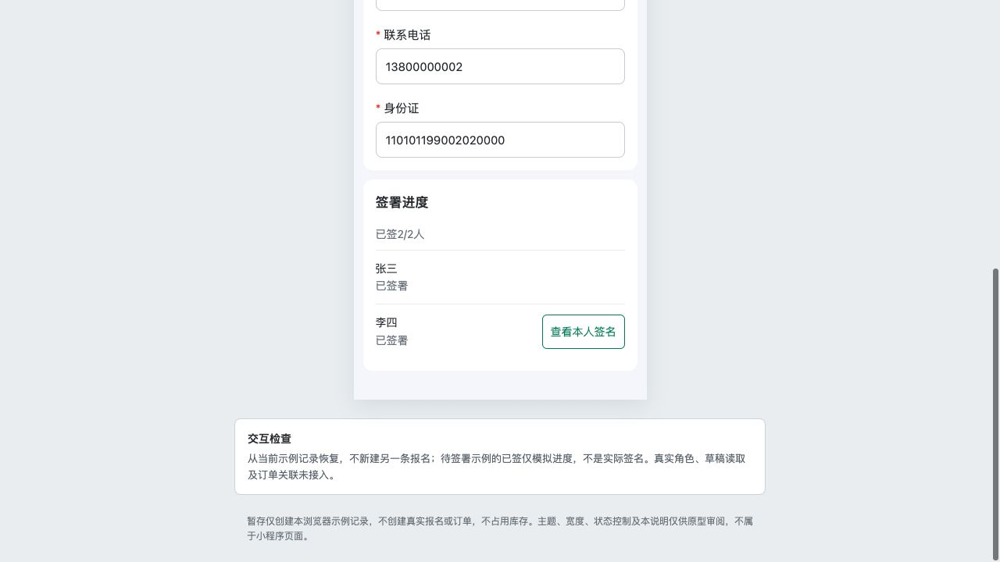</a>

已有组员共用详情及本人行按钮截图。截图用于定位和布局参考；现行逻辑以本节正文及V1.1标记为准。

查看截图：已有本人签名弹窗截图

<a href="../../preview/miniapp/设计依据/20261110-本人签名弹窗.png" target="_blank">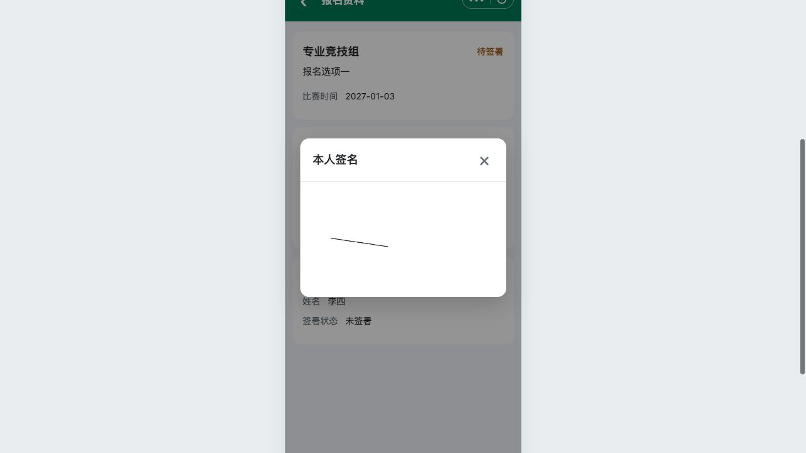</a>

已有本人签名弹窗截图。截图用于定位和布局参考；现行逻辑以本节正文及V1.1标记为准。

主报人和有效关联组员从C09查看资料进入同一C03资料详情结构：A标签、全部N人资料、全员签署进度。不同的是读写权限、底部动作及本人签名按钮所在行，不另做组员卡片布局。

- 未提交取成功暂存及适用模板；已提交含待付款读取字段和值的提交快照，不追补新增项。
- 免费无订单；收费待付款主报人底部继续支付进入原订单。成功只读，不显示立即报名/暂存，订单和海报仍从C09入口可达。
- 当前有效本人签名用弹窗只读显示最后确认快照，关闭留原详情；他人只显示签署状态。本人依据真实关系定位，不默认第一人就是当前账号，原型第1/2位身份开关仅示例。
- 只读组员看整组资料，但不能修改、替主报人提交或付款。C11查询命中不能跳到此完整详情。
- 有效订单锁全部资料/签署，实际未付订单关闭才按K06回退；不可通过改页面地址或隐藏按钮绕过服务端校验。

## C11｜独立报名查询
**原型：**<a href="../../preview/miniapp/index.html?view=query" target="_blank" rel="noopener noreferrer">打开原型：独立报名查询</a>。现有直达查询入口；张三或13800000001可命中虚构成功示例。

> **项目内迭代新增V1.1 · V11-05**：新增C11结构原型：一个框按姓名/手机号/身份证精确OR匹配，只返回成功记录，结果手机号前三后四、中间****。仅C11适用。

查看截图：已有最新查询口径截图：只成功、结果手机号脱敏

<a href="../../preview/miniapp/设计依据/20261110-C11仅成功手机号脱敏.png" target="_blank">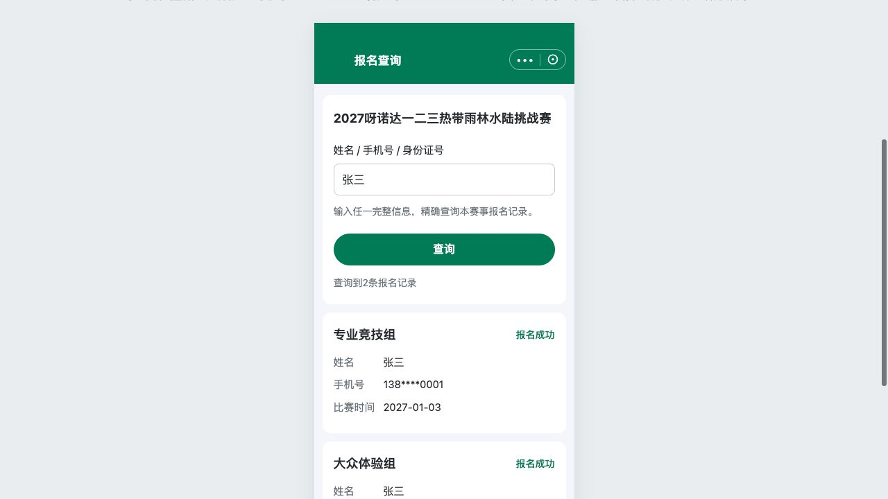</a>

已有最新查询口径截图：只成功、结果手机号脱敏。截图用于定位和布局参考；现行逻辑以本节正文及V1.1标记为准。

### 入口、条件、结果

P00本赛事报名查询或B01查询页推广直达，独立于C01和C09，绑定一场赛事。初始不展示全部人员名单。

| 内容 | 规则 |
| --- | --- |
| 输入 | 一个框，完整姓名/完整手机号/完整身份证号任一，精确OR匹配，不选查询类型，不要求组合 |
| 匹配来源 | 实际收集并成功保存资料；不反向强制收集手机号/证件，不用发起人授权号冒充参赛者手机号 |
| 状态范围 | 只查报名成功，其他四状态匹配也不返回 |
| 多条命中 | 同名或多份成功报名分别展示，不猜哪条本人 |
| 摘要 | 命中人员完整姓名、已收集手机号脱敏、项目、比赛时间、报名成功状态 |
| 手机号 | 输入完整号查，结果前三后四、中间****；例如138****0001；未收集不造号码 |
| 身份证 | 仅输入条件，结果不展示完整或脱敏身份证 |
| 权限 | 无整组详情、签名、修改、报名提交、付款、票码或自动认领/关联 |

只返回命中人员的摘要，不附带不相关同行资料。无输入不返回全量；无结果与请求失败分开，失败可重试，修改输入清旧结果。不增加未确认的验证码、实名或新认证流程。

### 可查的虚构用例

姓名张三、手机号13800000001、身份证110101199001010000，任一在现有原型命中两份成功示例；结果号码138****0001。输入“不存在的测试姓名”无结果。以上只用于本地交互演示，不是正式人员数据或生产查询验收。

**本轮原型检查（V1.1）**：未配置海报进入普通成功页；“我的报名”返回原列表并保留成功记录。兜底页面截图：[查看截图](../../preview/miniapp/设计依据/20261110-V11-14-普通成功兜底.png)。真实图片生成、存储及微信支付回调仍需研发接入。
