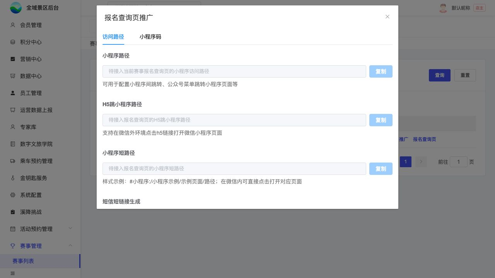

# B01｜赛事列表与推广

编辑源：[03-后台逐页功能方案.md](../../03-后台逐页功能方案.md)。本文件自动生成，请修改编辑源后重建。

**原型：**<a href="../../../../preview/event-admin/index.html" target="_blank" rel="noopener noreferrer">打开原型：赛事列表</a>。直接进入赛事列表；推广及报名查询页点对应行按钮。

后台原型共用一个入口，暂不支持按页面参数直达；以上路径为实际操作路径。

> **项目内迭代新增V1.1 · V11-01**：移除报名管理；推广指报名首页C01，新增报名查询页指C11；复用同一推广弹窗。

查看截图：本轮赛事列表截图，含报名成功海报配置入口；本地示例数据，不代表真实统计

本轮赛事列表截图，含报名成功海报配置入口；本地示例数据，不代表真实统计。截图用于定位和布局参考；现行逻辑以本节正文及V1.1标记为准。

查看截图：已有本地截图：报名查询页推广弹窗，真实推广值尚未接入

已有本地截图：报名查询页推广弹窗，真实推广值尚未接入。截图用于定位和布局参考；现行逻辑以本节正文及V1.1标记为准。

### 入口和字段

赛事管理与活动预约管理并列。列表筛选为举办时间范围、赛事名称；保留查询、重置、新建赛事和分页，不增加项目数量筛选。

| 列/操作 | 来源与行为 |
| --- | --- |
| 赛事名称 | 已保存赛事名称 |
| 举办时间 | 赛事举办起止，单日只显示一天 |
| 报名人数 | 各项目成功人数/总名额汇总，按K01 |
| 项目数量 | 当前赛事下项目数量 |
| 编辑赛事 | 进入B02，带当前赛事上下文 |
| 报名成功海报配置 **项目内迭代新增V1.1 · V11-14（业务变化）** | 位于“编辑赛事”之后；进入B11独立页签，带当前赛事；上传背景并拖拽配置动态文字 |
| 报名项目 | 进入B03，带当前赛事上下文 |
| 推广 | 当前赛事C01报名首页推广，不指向C11 |
| 报名查询页 | 当前赛事C11查询页推广，不混用报名首页链接 |

移除“报名管理”按钮。编辑、详情和记录沿现有内部页签，可切换/关闭，不因切换清空已有表单。

### 推广弹窗

复用现有推广能力，两入口共用同一弹窗，只更换当前赛事及目标页。访问路径、小程序码两个标签。

| 内容 | 行为与来源 |
| --- | --- |
| 小程序路径 | 原推广服务返回当前赛事及目标页路径，可复制 |
| H5跳小程序路径 | 原能力返回，复制后沿原环境跳转 |
| 小程序短路径 | 原能力返回，可复制 |
| 短信短链接 | 首次生成、已有链接续期、复制及有效期沿原行为 |
| 小程序码 | 原推广能力返回，绑定同一赛事/目标；不重建码规则 |

未返回值不得复制伪造地址/二维码。当前原型为空值及待接入提示，不代表真实推广服务已连接。此弹窗提供的两类页面链接可供P00原页面配置使用。

本节直接引用的公共规则：[K01](K01.md)。

需要跨页核对时见[公共规则](../../06-公共业务规则.md)；[待确认与实施边界](../../07-待确认与实施边界.md)另列，不把未决当既定要求。
