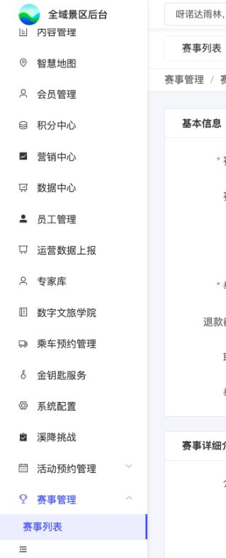

# B02｜新增与编辑赛事

编辑源：[03-后台逐页功能方案.md](../../03-后台逐页功能方案.md)。本文件自动生成，请修改编辑源后重建。

> **项目内迭代新增V1.1 · V11-14（业务变化）**：新增“联系电话”，保存于当前赛事，海报联系电话读取此字段，不读取游客手机号。原有举办地点继续作为海报“比赛地点”来源。

**原型：**<a href="../../../../preview/event-admin/index.html" target="_blank" rel="noopener noreferrer">打开原型：赛事列表 → 编辑赛事</a>。在赛事行点编辑赛事；也可点新建赛事查看新增态。

后台原型共用一个入口，暂不支持按页面参数直达；以上路径为实际操作路径。

查看截图：本轮编辑赛事截图，含联系电话与退款截止时间，本地已保存配置回显

本轮编辑赛事截图，含联系电话与退款截止时间，本地已保存配置回显。截图用于定位和布局参考；现行逻辑以本节正文及V1.1标记为准。

### 字段与显示

| 字段 | 配置及用途 |
| --- | --- |
| 赛事名称 | 当前赛事名称，列表及游客页面同源 |
| 赛事封面 | 该赛事图片，可上传/移除；不借项目图片替代 |
| 举办时间 | 起止日期，开始不晚于结束；单日摘要合并显示 |
| 举办地点 | 当前赛事地点原文；B11海报“比赛地点”读取此字段 |
| 联系电话 **项目内迭代新增V1.1 · V11-14（业务变化）** | 当前赛事咨询联系电话；新增/编辑时填写，随赛事保存并回显；B11海报“联系电话”读取此值，不读取游客手机号。必填、格式和长度限制尚未确认，不新增推定校验 |
| 退款截止时间 **项目内迭代新增V1.1 · V11-13（业务变化）** | 配置日期与小时，随赛事保存并回显；关联订单实时读取，在原票允许退款的基础上限制主动申请入口。非必填，可随时修改；空值不叠加赛事退款时间限制 |
| 赛事详细介绍 | 可编辑富文本，支持图片/排版；在C01下方展示 |

赛事层不增加统一报名时间。前置推广说明页与C01赛事介绍职责不同，不能因有P00而省略本页介绍。

### 操作

保存成功更新赛事及返回/页签上下文；取消不提交本次改动。必填及控件沿当前后台基线，不自行增加长度、发布审批或认证要求。失败不得伪报成功，真实上传与保存接口待接。当前日期、封面、介绍样例不是正式运营内容批准。

### 赛事退款截止时间

> **项目内迭代新增V1.1 · V11-13（业务变化）**：赛事级新增“退款截止时间”，日期与小时，由业务配置，不根据旧退费文档的开赛前天数或报名关闭时间自动推算。

**项目内迭代新增V1.1 · V11-13（规则细化）**：退款截止时间非必填、不预设默认截止值，可随时修改或清空；存量空值同未设置，均只按订单存储的门票退款规则判断。订单详情及申请提交通过当前订单关联报名项目找到所属赛事，读取当下最新时间，不固化在下单快照；配置修改后实时生效。读取失败不能当空值。截止前已受理申请在截止后仍可审核，通过后继续退款。该配置限制游客主动申请，不改变全域后台及票务系统已有退款权限。具体入口判定见C07，实际退款成功的状态、人数与关联联动见K06。后台原型支持清空、保存及回显，真实配置和退款接口待接入。

本节直接引用的公共规则：[K06](K06.md)。

需要跨页核对时见[公共规则](../../06-公共业务规则.md)；[待确认与实施边界](../../07-待确认与实施边界.md)另列，不把未决当既定要求。
