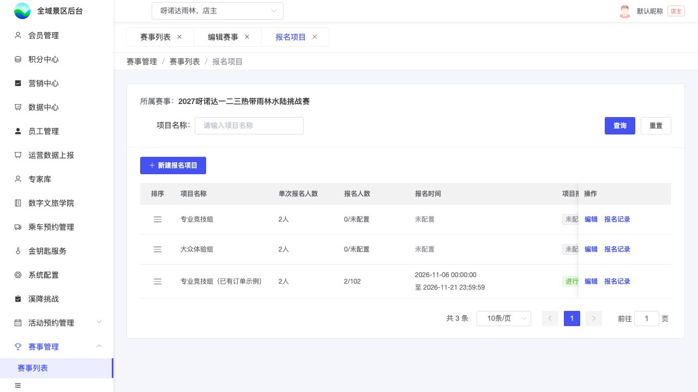

# B03｜报名项目列表

编辑源：[03-后台逐页功能方案.md](../../03-后台逐页功能方案.md)。本文件自动生成，请修改编辑源后重建。

**原型：**<a href="../../../../preview/event-admin/index.html" target="_blank" rel="noopener noreferrer">打开原型：赛事列表 → 报名项目</a>。点当前赛事的报名项目。

后台原型共用一个入口，暂不支持按页面参数直达；以上路径为实际操作路径。

查看截图：本轮项目列表截图，含未配置与已有订单示例

本轮项目列表截图，含未配置与已有订单示例。截图用于定位和布局参考；现行逻辑以本节正文及V1.1标记为准。

### 字段与操作

当前赛事下按项目名称查询、重置、分页，保留所属赛事上下文。

| 列 | 取值 |
| --- | --- |
| 排序 | 左侧手柄拖动；拖后预览，保存排序确认，取消恢复 |
| 项目名称 | 本项目配置 |
| 单次报名人数 | 固定N；缺配置显示未配置 |
| 报名人数 | 成功人数/项目总名额，按K01 |
| 报名时间 | 本项目窗口，完整起止 |
| 项目报名状态 | 未开始、进行中、已截止；缺时间未配置，按K02 |
| 签署要求 | 需要签署、无需签署；未配置不猜默认 |
| 收费方式 | 关联门票、免费；未配置不猜默认 |
| 配置状态 | 已配置或待完善；完成语义见下文 |
| 操作 | 新增/编辑项目、报名记录；无记录也可进入B09空列表 |

项目排序保存后用于C01展示。字段和材料同样用手柄排序，随对应步骤保存。

### 项目编辑的步骤保存

B04基本信息→B05报名资料→需签署时B06→B07人数→收费时B08。免费跳过B08，不需签署跳过B06。关闭签署保留材料草稿，重新开启可继续；关闭时不展示、不校验材料。这是当前制作基线，真实保存语义待U10c核实。

下一步只校验并保存当前步骤，不等于整项目完成；当前步骤必填仍须完整。最终完成校验所有适用步骤、最新票匹配，保存成功才显示已配置。

当前原型：已配置且未改动逐步查看不降级；修改只存中间步骤则回待完善；无完成标记旧数据需重新完成。此处配置标记、降级和迁移是**待研发核准的制作基线**，不据有无订单推断配置完成，不当成已确定生产迁移政策。

本节直接引用的公共规则：[K01](K01.md)、[K02](K02.md)。

需要跨页核对时见[公共规则](../../06-公共业务规则.md)；[待确认与实施边界](../../07-待确认与实施边界.md)另列，不把未决当既定要求。
