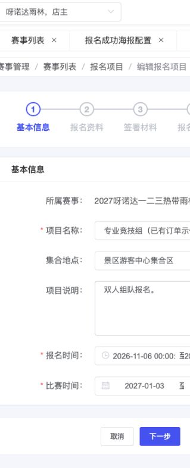

# B04｜项目基本信息

编辑源：[03-后台逐页功能方案.md](../../03-后台逐页功能方案.md)。本文件自动生成，请修改编辑源后重建。

> **项目内迭代新增V1.1 · V11-14（业务变化）**：新增“集合地点”，与当前报名项目保存、编辑回显；不同项目独立配置，海报的集合地点读取本字段。不得替代赛事举办地点。

**原型：**<a href="../../../../preview/event-admin/index.html" target="_blank" rel="noopener noreferrer">打开原型：报名项目 → 编辑 → 基本信息</a>。选择已有订单示例行编辑，默认基本信息。

后台原型共用一个入口，暂不支持按页面参数直达；以上路径为实际操作路径。

查看截图：本轮基本信息截图，含集合地点，本地已保存配置回显

本轮基本信息截图，含集合地点，本地已保存配置回显。截图用于定位和布局参考；现行逻辑以本节正文及V1.1标记为准。

| 字段 | 来源、配置和影响 |
| --- | --- |
| 所属赛事 | 从B03带入当前赛事 |
| 项目名称 | 本项目名称，列表和游客卡片同源 |
| 集合地点 **项目内迭代新增V1.1 · V11-14（业务变化）** | 当前报名项目的集合地点，位于项目名称之后；随项目保存并编辑回显，各项目独立。B11海报“集合地点”读取此字段，不替代赛事举办地点；必填及格式限制尚未确认 |
| 项目说明 | 可选运营备注，可长文；C01单独段落展示，不从N自动生成双人报名文案 |
| 报名时间 | 本项目报名起止，先于比赛时间排列；作为免费窗口及收费交集外框 |
| 比赛时间 | 本项目比赛起止；单日可用于原票日历报价及游玩日传参 |

开始不晚于各自结束；不额外要求报名截止早于比赛首日。报名窗口修改按K05影响未提交记录和原有效订单；比赛延期、取消及已出票日期变更留后，不从此页自行推断。

本节直接引用的公共规则：[K05](K05.md)。

需要跨页核对时见[公共规则](../../06-公共业务规则.md)；[待确认与实施边界](../../07-待确认与实施边界.md)另列，不把未决当既定要求。
