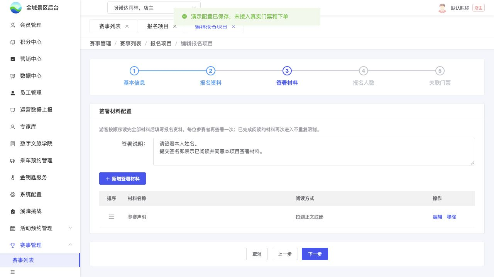

# B06｜签署说明与材料

编辑源：[03-后台逐页功能方案.md](../../03-后台逐页功能方案.md)。本文件自动生成，请修改编辑源后重建。

**原型：**<a href="../../../../preview/event-admin/index.html" target="_blank" rel="noopener noreferrer">打开原型：报名项目 → 编辑 → 签署材料</a>。在需要签署的项目中，按步骤进入签署材料。

后台原型共用一个入口，暂不支持按页面参数直达；以上路径为实际操作路径。

查看截图：已有后台签署说明截图；正式配置保存未接入

已有后台签署说明截图；正式配置保存未接入。截图用于定位和布局参考；现行逻辑以本节正文及V1.1标记为准。

仅需签署项目出现；至少保留一份材料，不固定份数或种类，不设必读/可选开关，不做跨项目公共材料库。

| 配置 | 规则 |
| --- | --- |
| 签署说明 | 项目级选填多行纯文本，在材料列表上方配置；整套材料和全部人员共用，不逐材料填写 |
| 材料名称 | 每份独立维护，阅读页标题使用 |
| 正文 | 每份富文本，支持完整图片与排版 |
| 阅读方式 | 不限制、等待正整数N秒、滚动到底三选一，不叠加倒计时和滚动 |
| 排序 | 手柄排序，游客按保存顺序逐份确认；支持新增、编辑和删除 |

签署说明在C05画布下方、按钮上方展示，留空隐藏、保留换行、长文内部滚动，操作可达。“请签署本人姓名”也由该说明维护，不加一段重复固定提示。说明不加倒计时、强制到底或勾选。

介绍、须知、材料正文更新及材料增删按K05执行：正文更新保留已读已签，未提交新增材料补读但不重签，已提交不追补。不做完整历史原文版本。

本节直接引用的公共规则：[K05](K05.md)。

需要跨页核对时见[公共规则](../../06-公共业务规则.md)；[待确认与实施边界](../../07-待确认与实施边界.md)另列，不把未决当既定要求。
