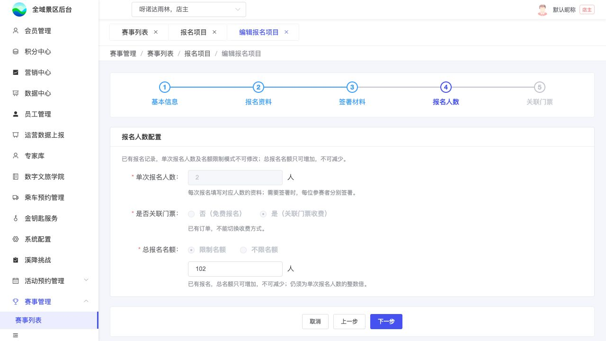

# B07｜人数、名额与收费方式

编辑源：[03-后台逐页功能方案.md](../../03-后台逐页功能方案.md)。本文件自动生成，请修改编辑源后重建。

**原型：**<a href="../../../../preview/event-admin/index.html" target="_blank" rel="noopener noreferrer">打开原型：报名项目 → 编辑 → 报名人数</a>。进入已有报名示例的报名人数步骤，可看有限名额增额规则。

后台原型共用一个入口，暂不支持按页面参数直达；以上路径为实际操作路径。

> **项目内迭代新增V1.1 · V11-06**：有限总名额只增不减且仍须N整数倍；限制/不限模式与N仍锁定，不改票库存及旧占用。

查看截图：已有本地增额检查截图，真实服务端校验未接入

已有本地增额检查截图，真实服务端校验未接入。截图用于定位和布局参考；现行逻辑以本节正文及V1.1标记为准。

| 配置 | 保存规则 |
| --- | --- |
| 单次报名人数N **项目内迭代新增V1.1 · V11-19（业务变化）** | 必填，1～10人的整数（含1和10），免费/收费同样适用，一项目一种固定N；为空、非整数、小于1或大于10时提示“请输入1～10的整数”，阻止下一步及保存。前后端均校验；已有报名后的N锁定规则不变。此上限不限制项目总报名名额 |
| 总名额模式 | 限制 / 不限，免费收费均独立配置 |
| 限制名额值 | N整数倍；不限时不使用输入框保留旧值 |
| 是否关联门票 | 关联则收费并进入B08；不关联则免费，跳过B08，不是无票收款 |

**项目内迭代新增V1.1 · V11-12（规则细化）**：仅阅读不触发本页配置限制；首次主动暂存成功产生报名记录后，才按已有报名判断。已有报名后有限总名额只增不减，限制/不限和N仍锁；无订单可切免费/收费，有订单不能切。完整边界见K05。增额不改票库存、不影响旧订单占用，报名仍同时检查项目剩余和选中票库存。

本节直接引用的公共规则：[K05](K05.md)。

需要跨页核对时见[公共规则](../../06-公共业务规则.md)；[待确认与实施边界](../../07-待确认与实施边界.md)另列，不把未决当既定要求。
