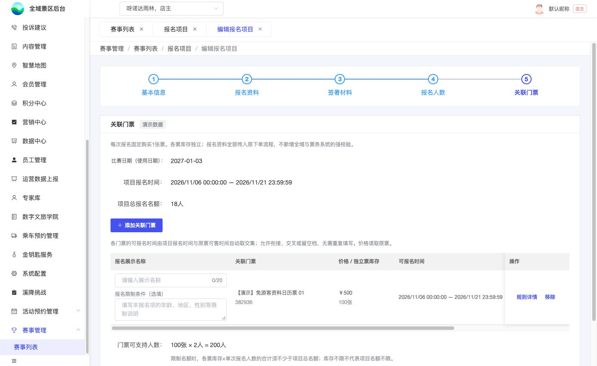
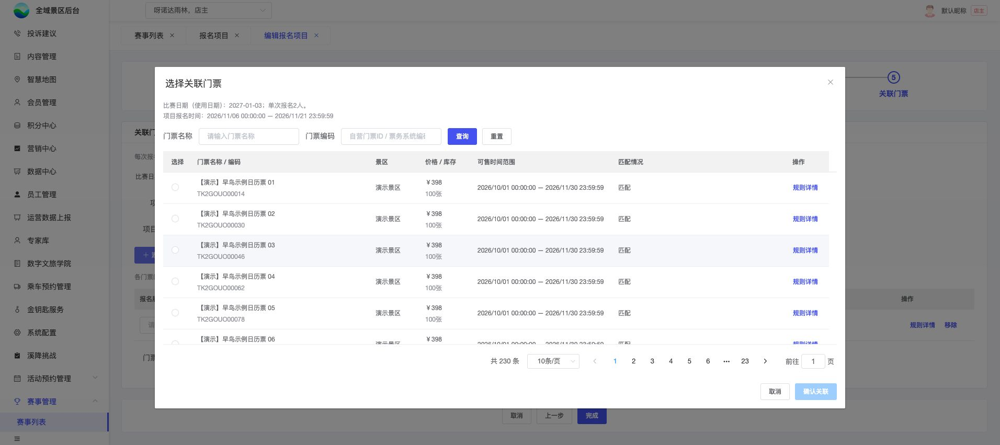

# B08｜关联门票

编辑源：[03-后台逐页功能方案.md](../../03-后台逐页功能方案.md)。本文件自动生成，请修改编辑源后重建。

**原型：**<a href="../../../../preview/event-admin/index.html" target="_blank" rel="noopener noreferrer">打开原型：报名项目 → 编辑 → 关联门票</a>。关联门票项目的最后步骤；免费跳过。点击添加关联门票看选票弹窗。

后台原型共用一个入口，暂不支持按页面参数直达；以上路径为实际操作路径。

查看截图：已有报名项级限制说明截图

已有报名项级限制说明截图。截图用于定位和布局参考；现行逻辑以本节正文及V1.1标记为准。

查看截图：已有选择门票弹窗截图

已有选择门票弹窗截图。截图用于定位和布局参考；现行逻辑以本节正文及V1.1标记为准。

### 关联表及选票

| 字段 | 来源、显示与操作 |
| --- | --- |
| 报名展示名称 | 每行必填，最多20字；游客选择的名称，不用原票名替代 |
| 报名限制条件 | 每行选填多行纯文本，年龄/地区/性别等供运营说明；归该报名项，不是项目公共说明 |
| 关联门票 | 名称与编码；自营取自营门票ID，三方取票务系统编码 |
| 门票状态 | 位于关联门票之后、价格/独立票库存之前；只读取该行原票当前上下架状态，显示“已上架”“已下架”或原票实际“待上架”等状态，不从匹配情况或报名时间推断。非上架状态突出显示；原票失效或状态未取得显示“—”，匹配情况说明对应原因，不伪装成已上架。重开编辑、重新校验时同步最新状态；已关联票下架仍保留本行和状态，不自动移除，不新增上下架操作 |
| 价格 / 独立票库存 | 按比赛日或固定期读取原票数据；不可在此改价改库存 |
| 可报名时间 | 项目窗口与本票可售窗口交集，只读，精确到秒 |
| 匹配情况 | 当前兼容结果及具体原因；关联后下架/不匹配保留后台回显，不自动删除 |
| 操作 | 规则详情、移除；无单独更换入口，允许变更时移除重加 |
| 门票可支持人数 | 总票库存×N折算，首次容量校验按K02；不是可编辑名额 |

点添加打开名称/编码查询、分页、单选弹窗，同项目不可重复关联同票。默认候选只已上架票，可关联优先，再按可售开始、截止升序；不匹配不可选。规则详情展示原票要求与当前匹配原因，包括发码类型，关联主表不单独展示发码类型。

### 原票规则详情弹窗：字段取值与匹配提示

本节是B08“规则详情”的完整页面约定，补全原有页面说明，不新增业务功能。开发应同时实现原票要求和具体匹配解释，不能将以下各行统一替换为“匹配”。K02、K07维护跨页计算原则；本节明确这些结果在本弹窗的取值与文字。原型的演示数据、变量名与“演示”标题不是正式接口契约或正式业务数据。

#### 入口、结构与读取时机

- 关联表或选票弹窗中的“规则详情”均查看所点原票，结合当前项目的单次报名人数N、资料字段必填配置、比赛日期和报名时间判断；不能串用其他候选票或其他项目的数据。
- 弹窗采用原型的上方摘要、下方“规则／原票要求／匹配情况”三列表格及关闭按钮。顶部依次为完整票名、发码类型/门票编码、价格/独立票库存、开放时间、截止时间。规则行顺序为：预定信息、输入信息、预定限制、性别限制、允许购买区域、允许购买年龄、上下架状态、使用日期、可售时间。
- 正式标题为“原票规则详情”。“原票要求”只读展示原票配置，不混入报名项目的要求；“匹配情况”写当前项目与该要求如何对应，异常原因突出显示。原票要求使用已有配置页的业务字段名、选项原文及实际值，不自行简化为“原门票详情”。
- 编辑项目重开、打开选票及最终完成时按最新原票重新校验；打开详情时使用本次最新校验的同一份票数据。读取失败不得继续展示旧结果为匹配。
- 弹窗只解释，不编辑原票、项目人数或资料字段，不因打开详情自动改配置。关闭回原入口并保留原选择。

#### 顶部摘要：逐字段取值

| 字段 | 数据来源及显示 | 无值、异常及适用边界 |
| --- | --- | --- |
| 门票名称 | 当前所点原票的完整名称；不取报名展示名称或项目名称 | 无法取得时显示“—”，不得使用其他票名补齐 |
| 发码类型/门票编码 | 取当前票实际发码类型；自营取自营门票ID，三方系统发码取对应票务系统门票编码；格式“自营发码 / 编码”或“三方系统发码 / 编码” | 类型、编码各自缺失的位置显示“—”；不拿数据库内部ID冒充三方编码 |
| 价格 / 独立票库存 | 单日比赛的日历票取该比赛当天真实价格及自身库存；固定有效期免选日票取该票价格、总库存配置；格式“￥金额；库存张数张” | 0元是有效价格，0张是实际库存；库存明确为不限时显示“不限”。缺记录显示“—”，不能补0、不限、99999或其他日价格；共享库存不冒充独立库存。价格库存正确不等于可售窗口匹配或现在一定能下单 |
| 开放时间 | 取原票预约开放规则；立即开放显示“上架后立即开放预约”；提前X天显示“游玩日期前X天开放” | 固定有效期免选日票显示“不适用（固定有效期免选日）”，实际可售窗口见“可售时间”；不能把无配置当立即开放 |
| 截止时间 | 取原票预约截止规则及实际参数：提前X天且规定时刻显示“需提前X天，并在H时M分前预定”；可订当日规定时刻显示“可订当日，并在H时M分前预定”；小时模式显示“可订当日，需提前X小时预定” | 固定有效期免选日票显示“不适用（固定有效期免选日）”；小时模式保留原票规则文字，但当前K07计算基线按比赛当日23:59:59，不额外新增小时硬拦截，真实接口语义仍按U06b核实；缺规则显示“—”，不能猜截止时间 |

金额按原票实际精度显示，不将0.03四舍五入成0；时间计算保留秒。原型中的500元、100张、提前1天等仅为对应示例票的配置，不能写死。

#### 规则明细：人数、资料与限制

以下表中“原票要求”“匹配情况”的文字随实际配置代入。多项资料缺失时合并列出，不只提示第一项；同一原票的各项限制均保留，不以一行“匹配”遮盖明细。

| 规则行 | 原票要求取值与展示 | 判断条件 | 匹配情况显示文字 |
| --- | --- | --- | --- |
| 预定信息：无需资料 | 原票“不需要信息”模式原文 | 原票不要求游客资料，仍按报名N人收集报名资料及签署 | “报名N人；原票不要求游客资料” |
| 预定信息：仅一位 | 原票“仅需要一位客人信息”模式原文 | 沿原模式，不要求N=1；全部N人仍传原链路 | “报名N人；原票仅需要一位游客信息，全部报名人员资料仍传原链路” |
| 预定信息：所有游客 | 原票“需要所有客人信息”模式原文 | 沿原模式，不强制N=1，不按旧购票表单框数截取 | “报名N人；全部报名人员资料传原链路，提交沿用原票校验” |
| 预定信息：每券X人 | “每一张券需要X位游客信息”，X取原票配置 | 固定买1张，X=N匹配；X不等于N不匹配，不按X≤N放行 | 相等：“报名N人；与每张票要求X位游客信息一致”；不等：“报名N人；原票每张券要求X位游客信息，人数不一致” |
| 输入信息：满足 | 原票实际要求的必填项，姓名/身份证等按原票配置展示；原票无要求时显示原配置原文 | 每项必需资料均有对应来源，要求由报名字段提供的必须已配置且必填；姓名始终必填，报名额外收集身份证不构成不匹配 | 有要求且满足：“报名资料满足原票要求”；无游客资料要求：“原票不要求游客资料；报名资料仍按项目配置收集” |
| 输入信息：未配置 | 同上，仍展示原票完整要求 | 原票要求的字段在报名模板未配置且无其他既定合法来源 | “报名资料未配置字段名称”，多项用“；”连接；例如“报名资料未配置身份证” |
| 输入信息：仅选填 | 同上 | 已有对应报名字段但不是必填 | “报名字段名称仅选填，原票要求必填”；例如“报名身份证仅选填，原票要求必填” |
| 预定限制：不限 | 原票限购规则明确为不限时显示“不限” | 沿原票规则，不新增限制 | “沿用原票规则” |
| 预定限制：手机号限购 | 按原票实际限购主体、数量及周期完整展示；不能一律写死限购1张 | 购票联系人使用主报人授权手机号；不拿此号码覆盖所有参赛者，不在配置时声称已通过实际限购 | “购票人使用报名发起人授权手机号；提交时沿用原票限购校验” |
| 预定限制：身份证等限购 | 按原票实际主体、数量、周期展示 | 全部N人资料进入原链路；配置兼容检查不替代实际交易次数等校验 | “全部报名人员资料传入；提交时沿用原票限购校验” |
| 性别限制／允许购买区域／允许购买年龄：不限 | 分别取原票对应限制；明确不限时各行显示“不限” | 没有该项额外证件要求 | 各行显示“无额外证件要求” |
| 性别限制／允许购买区域／允许购买年龄：有限制且来源齐 | 原样展示对应性别、地区、年龄区间及含端点等条件，不能从报名限制说明反推原票要求 | 对依赖身份证的限制，报名已配置必填身份证来源；这里只说明资料可支持校验，不等于所有参赛者已符合资格 | “报名资料已配置必填身份证；全部人员资格在提交时按原票规则校验” |
| 性别限制／允许购买区域／允许购买年龄：缺身份证来源 | 同上，保留实际限制值 | 原票限制依赖身份证，但报名缺少必填身份证来源 | “原票限制依赖身份证，缺少必填身份证来源”；不得显示“匹配” |

购票联系人手机号沿K07取发起人授权手机号；原票要求参赛者本人的手机号时，不能以联系人手机号代替。接口不能明确说明字段来源或限制依赖时按下文“数据缺失与待核实”处理，不能凭字段标题猜测。

最低起售量不是本弹窗新增的一条配置禁选规则；最终固定买1张，起售量、真实限购及全员资格仍由原下单链路实时校验。配置详情不得宣称这些交易条件已经验证通过；原票实际拒绝应展示实际返回原因。年龄计算基准、地区判定方式和正式全员参数契约仍按U06b核实，本节不编造接口字段或默认按今天计算年龄。

#### 规则明细：状态、日期与可售时间

| 规则行／情况 | 原票要求取值与展示 | 判断条件 | 匹配情况显示文字 |
| --- | --- | --- | --- |
| 上下架状态 | 当前票实际状态原文 | 已上架；或关联后已下架/待上架 | 已上架：“已上架”；未上架：“关联门票已下架”或“关联门票未上架”，按真实状态区分；不能统一显示匹配 |
| 使用日期：日历票 | 原票“下单选择日期当日可验证使用”等实际使用规则；选择日期起X天有效的，展示实际天数规则 | 本期仅单日比赛可用；真实配置日期集合包含比赛当天，并取得该天价格库存记录 | 成功：“比赛日期：日期；比赛当天已配置价格库存日期”；未配置：“比赛日期：日期；比赛当天未配置价格库存日期”；日期有配置但报价或库存缺失：“比赛日期：日期；比赛当天价格或库存数据缺失”，缺哪项说哪项 |
| 使用日期：固定有效期免选日 | “下单不需要选择日期，固定日期内可使用：开始日期至结束日期”，取真实使用有效期 | 使用期完整覆盖比赛起止；单日也必须覆盖该日 | 覆盖：“比赛日期：起止；完整覆盖比赛日期”；不覆盖：“比赛日期：起止；未完整覆盖比赛日期” |
| 使用日期：多日比赛选日历票或选择日期起X天票 | 仍展示原票真实使用规则，不用项目比赛时间替换原票要求 | 本期多日仅固定有效期票，其他上述类型不匹配 | “比赛日期：起止；多日比赛须选择固定有效期且完整覆盖比赛日期的门票” |
| 使用日期：固定日期且下单后X天生效 | 真实固定有效期及下单后X天生效规则 | 按U06a核实完整计算，不能由原型不支持推导生产永久禁用 | 尚未完成核实时显示“固定日期且下单后X天生效规则待核实”，不得标为已匹配，也不得写成产品永久不支持 |
| 可售时间：有交集 | 原票要求列显示“原票可售时间：开始至截止”，取本次比赛日对应的原票真实可售窗口，精确到秒 | 报名开始与原票开始取较晚值，报名截止与原票截止取较早值；开始≤截止为有交集 | “可报名时间：交集开始至交集截止”，不能只写“匹配”，也不能在原票要求列放项目时间冒充原票时间 |
| 可售时间：无交集 | 仍展示原票真实可售起止，不能因为无交集就清空 | 交集开始晚于交集截止 | “报名时间与门票可售时间不匹配”；该票不可关联，不自动延长或缩短项目时间 |

日历票可售窗口计算：以比赛日为游玩日期，在原票配置的售卖起止范围内叠加适用的预约开放、截止条件；开放取较晚值，截止取较早值。立即开放不额外添加一个提前开放日期；提前X天开放按比赛日向前计算；提前X天且规定时刻截止按比赛日和实际X、时刻计算。小时模式沿K07当前基线，不自行改变既定语义。固定有效期免选日票不套用这些提前预约计算，直接取价格库存配置中的真实可售时间。

**比赛日期取价库存与报名时段交集是两项独立判断。**例如比赛日11月25日有报价和100张库存，只能证明该比赛日的价格库存有数据；仍需原票真实可售窗口与项目报名窗口有交集才能关联。不得因为报价库存正确就显示时间匹配，也不能因无交集将正确报价库存写成错误。

“使用日期”指实际游玩使用范围；“可售时间”指能下单的时间范围；顶部“开放时间／截止时间”指适用的预约规则文字。三者不能混为一列。日期范围展示实际起止，单日只显示该日；时刻按秒计算和展示，不用分钟精度放宽截止。

#### 数据缺失、汇总提示与操作约束

| 情况 | 展示与处理 |
| --- | --- |
| 原票明确不限制可售开始或截止 | 对应端显示“不限开始”或“不限截止”；两端都明确不限显示“不限”。交集计算仍按真实无边界语义，不能展示1971年、9999年等技术占位值冒充运营配置日期。只有接口已明确表示无限期才可转为不限，不能凭日期长相自行认定 |
| 原票关键配置未返回或读取失败 | 缺项显示“—”，匹配情况具体写“原票可售时间未获取，无法判断匹配”“比赛当天价格未获取”或相应缺项原因；不能填不限、0或“匹配”。完整数据恢复前不允许以未知结果完成关联 |
| 项目N、比赛日期或报名时间未配置 | 对应行提示“请先配置单次报名人数”“请先配置比赛日期”“请先配置项目报名时间”；不拿默认N=1或今天日期计算 |
| 单行正常结果 | 显示上述具体说明；正常不等于已经验证未来下单、人员资格或支付，不新增“全部交易条件通过”的承诺 |
| 单行不匹配结果 | 明确指出原票要求和当前项目差异，异常文字突出；其他行继续显示各自实际结果，不全部改成失败或全部改成匹配 |
| 关联表／候选列表汇总 | 全部必要配置兼容时显示“匹配”；存在不匹配则汇总具体原因，以“；”分隔。缺必填身份证同时触发性别/地区/年龄时，汇总为“原票有对应限制，需报名身份证必填”，详情各行仍保留解释；同项目重复选票显示“已关联，请勿重复选择” |
| 最新配置变不匹配 | 已关联票后台保留回显及原因，不自动删除；最终完成阻止保存不兼容结果。游客入口按C01原规则隐藏实际下架、不匹配或无交集项 |

正式接入不能取得原票配置的具体含义时，应先补数据契约，不以技术默认值、“原门票详情”或一排“匹配”替代本节要求。是否已验证真实下单另以验收报告为准。

### 匹配与保存

完整矩阵见K07，覆盖预订资料模式、每券人数、字段必填、比赛日期、有效期、价格库存和售卖窗口。无交集提示“报名时间与门票可售时间不匹配”，不偷偷改项目时间。

进入/重开编辑、打开选票、最终完成读取最新票配置；不匹配说明原因并阻止完成。实际下架、不匹配或无交集项在C01隐藏，后台保留原因；正常未开始/截止/售罄展示状态，不混淆。

限制说明由业务维护并与实际票务限制一致，不解析文案自动判年龄或地区。实际下单传入全部N人资料，按原票实际规则拦截；说明未填不等于无限制。关联后有过订单的票不能换/移除，名称和说明可改，旧提交名称留快照；其他票及新增按K05处理。

本节直接引用的公共规则：[K02](K02.md)、[K07](K07.md)、[K05](K05.md)。

需要跨页核对时见[公共规则](../../06-公共业务规则.md)；[待确认与实施边界](../../07-待确认与实施边界.md)另列，不把未决当既定要求。
