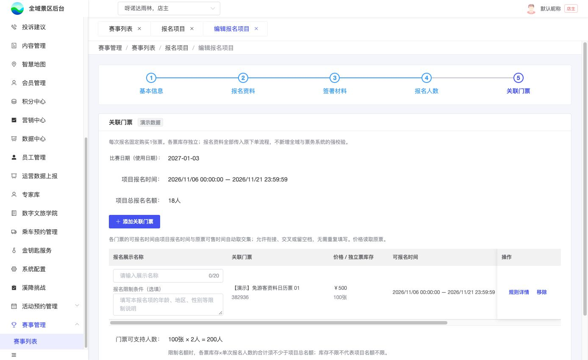
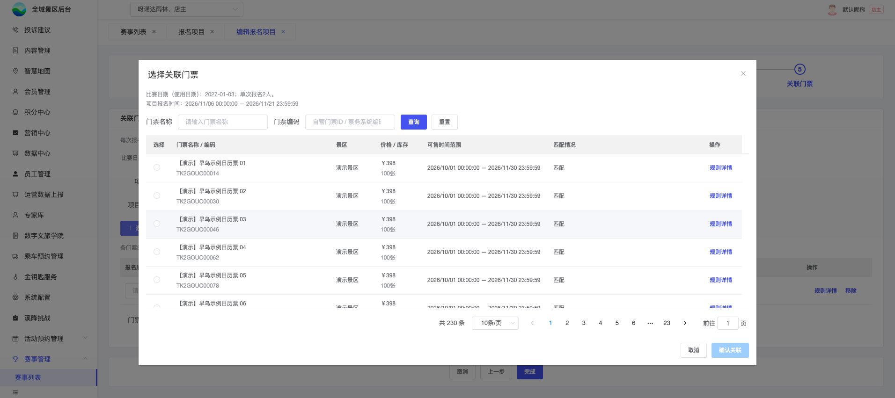

# B08｜关联门票

编辑源：[03-后台逐页功能方案.md](../../03-后台逐页功能方案.md)。本文件自动生成，请修改编辑源后重建。

**原型：**<a href="../../../../preview/event-admin/index.html" target="_blank" rel="noopener noreferrer">打开原型：报名项目 → 编辑 → 关联门票</a>。关联门票项目的最后步骤；免费跳过。点击添加关联门票看选票弹窗。

后台原型共用一个入口，暂不支持按页面参数直达；以上路径为实际操作路径。

查看截图：已有报名项级限制说明截图

已有报名项级限制说明截图。截图用于定位和布局参考；现行逻辑以本节正文及V1.1标记为准。

查看截图：已有选择门票弹窗截图

已有选择门票弹窗截图。截图用于定位和布局参考；现行逻辑以本节正文及V1.1标记为准。

### 关联表及选票

| 字段 | 来源、显示与操作 |
| --- | --- |
| 报名展示名称 | 每行必填，最多20字；游客选择的名称，不用原票名替代 |
| 报名限制条件 | 每行选填多行纯文本，年龄/地区/性别等供运营说明；归该报名项，不是项目公共说明 |
| 关联门票 | 名称与编码；自营取自营门票ID，三方取票务系统编码 |
| 价格 / 独立票库存 | 按比赛日或固定期读取原票数据；不可在此改价改库存 |
| 可报名时间 | 项目窗口与本票可售窗口交集，只读，精确到秒 |
| 匹配情况 | 当前兼容结果及具体原因；关联后下架/不匹配保留后台回显，不自动删除 |
| 操作 | 规则详情、移除；无单独更换入口，允许变更时移除重加 |
| 门票可支持人数 | 总票库存×N折算，首次容量校验按K02；不是可编辑名额 |

点添加打开名称/编码查询、分页、单选弹窗，同项目不可重复关联同票。默认候选只已上架票，可关联优先，再按可售开始、截止升序；不匹配不可选。规则详情展示原票要求与当前匹配原因，包括发码类型，关联主表不单独展示发码类型。

### 匹配与保存

完整矩阵见K07，覆盖预订资料模式、每券人数、字段必填、比赛日期、有效期、价格库存和售卖窗口。无交集提示“报名时间与门票可售时间不匹配”，不偷偷改项目时间。

进入/重开编辑、打开选票、最终完成读取最新票配置；不匹配说明原因并阻止完成。实际下架、不匹配或无交集项在C01隐藏，后台保留原因；正常未开始/截止/售罄展示状态，不混淆。

限制说明由业务维护并与实际票务限制一致，不解析文案自动判年龄或地区。实际下单传入全部N人资料，按原票实际规则拦截；说明未填不等于无限制。关联后有过订单的票不能换/移除，名称和说明可改，旧提交名称留快照；其他票及新增按K05处理。

本节直接引用的公共规则：[K02](K02.md)、[K07](K07.md)、[K05](K05.md)。

需要跨页核对时见[公共规则](../../06-公共业务规则.md)；[待确认与实施边界](../../07-待确认与实施边界.md)另列，不把未决当既定要求。
