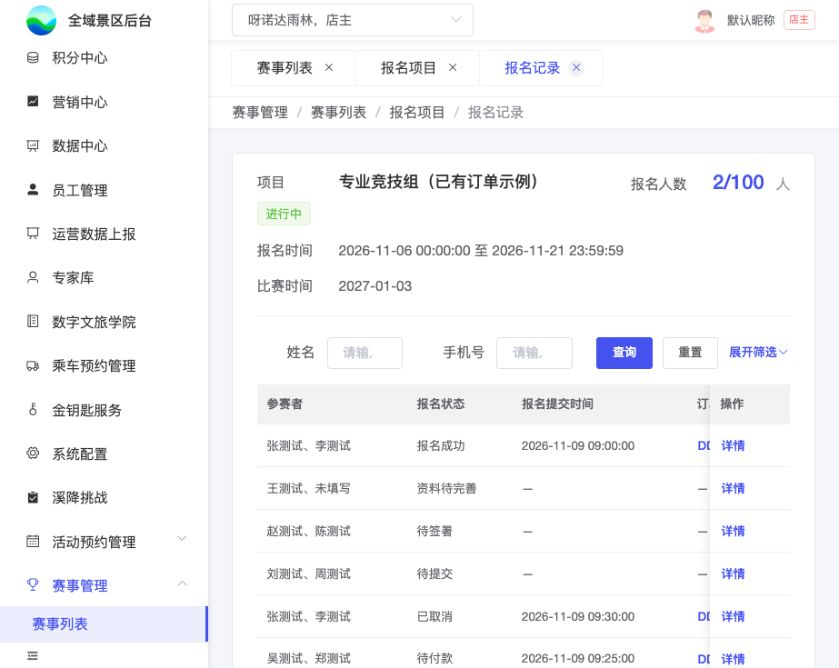

# B09｜报名记录列表

编辑源：[03-后台逐页功能方案.md](../../03-后台逐页功能方案.md)。本文件自动生成，请修改编辑源后重建。

**项目内迭代新增V1.1 · V11-13（业务变化）**：B09报名状态筛选、列表和B10详情增加“已取消”。当前绑定门票在任一退款端实际退款成功后更新此状态及已退款订单，保留订单入口；报名成功人数只统计成功状态，已取消不计入。旧单解绑后晚到的退款通知不得取消新订单对应的报名。
**原型：**<a href="../../../../preview/event-admin/index.html" target="_blank" rel="noopener noreferrer">打开原型：报名项目 → 报名记录</a>。在已有订单示例项目行点报名记录。

后台原型共用一个入口，暂不支持按页面参数直达；以上路径为实际操作路径。

查看截图：本轮当前列表截图：已移除报名编号

本轮当前列表截图：已移除报名编号。截图用于定位和布局参考；现行逻辑以本节正文及V1.1标记为准。

### 顶部与筛选

一份报名一行，包含成功暂存的未提交记录。指定项目的记录可独立页签打开，允许空列表。

| 区域 | 字段及行为 |
| --- | --- |
| 顶部摘要 | 项目名称＋项目时间状态、项目报名时间、项目比赛时间、成功人数/总名额；不以某个报名项替代项目 |
| 默认筛选 **项目内迭代新增V1.1（页面调整）** | 姓名、手机号 |
| 展开后筛选 **项目内迭代新增V1.1（页面调整）** | 身份证号、报名状态、订单号、订单状态 |
| 按钮位置 **项目内迭代新增V1.1（页面调整）** | 默认一行：姓名、手机号，右侧报名导出/查询/重置/展开筛选；展开显示身份证号、报名状态、订单号、订单状态，报名导出/查询/重置/收起移至全部条件下方右侧。收起保留条件，有隐藏条件提示“含更多筛选” |
| 重置与页签 | 重置全部条件含折叠项；切换页签保留展开状态 |
| 人员多条件 | 必须由同一参赛者同时命中，不跨人拼接；只匹配实际收集字段 |

### 列与数据口径

**项目内迭代新增V1.1 · V11-15（业务变化）**：取消独立报名编码，不制定BM等业务编号规则，后台报名列表和详情不展示报名编号。底层使用数据库内部记录ID关联报名资料、签署和订单，内部ID不作为展示字段或新增排序依据；原订单号保留。

| 顺序 | 列 | 取值 |
| --- | --- | --- |
| 1 | 参赛者 | 本份姓名摘要，不虚构未填写姓名 |
| 2 | 报名状态 | K06六种主状态（含退款成功后的已取消） |
| 3 | 报名提交时间 | 实际提交时间；未提交“—” |
| 4 | 订单号 | 最新实际关联订单；自营系统号、三方票务系统号，未返回显示待返回 |
| 5 | 门票名称 | 紧跟订单号，来自实际订单 |
| 6 | 订单状态 | 原订单实际状态 |
| 7 | 实收金额 | 已实际收取；待付款为0，不用应付冒充实收 |
| 8 | 操作 | 详情进入B10；订单号入口沿原订单能力，真实跳转待接 |

无订单时，订单号、票名、订单状态、实收金额均“—”，不从项目最新票配置补票名或写0。底层保留历史订单关联，列表只展示最新订单，不增加历史交易列表。

### V11-23 报名导出

**项目内迭代新增V1.1 · V11-23（业务变化、页面调整）**

- 入口：报名记录页“查询”按钮左侧增加“报名导出”，折叠和展开筛选时均保留此相对位置；沿用原按钮区域，不增加独立页面或导出设置弹窗。
- 范围：导出当前项目下全部报名状态为“报名成功”的记录，覆盖所有报名项和全部分页，不受姓名、手机号、身份证、报名状态、订单等当前查询条件影响。不包含其他项目，以及资料待完善、待签署、待提交、待付款、已取消记录。以点击导出时服务端确认的状态及用户现有项目数据权限为准，不通过订单已付款自行推定报名成功；退款后已取消的记录不导出。
- 格式：真正的Excel `.xlsx` 文件，文件名为“项目名称-报名成功记录-导出时间.xlsx”，表名“报名成功记录”。每位参赛者一行，同一份报名的列表数据在各人员行重复，方便按人员整理和筛选；原列表仍是一份报名一行。
- 固定列按列表顺序包含：参赛者（该份报名全部姓名摘要）、报名状态、报名提交时间、订单号、门票名称、订单状态、实收金额。“操作/详情”按钮不是数据列，不导出链接按钮。订单号、票名、订单状态及实收金额沿用列表同一实际关联订单和取值口径，不用项目当前配置票名替代，不跨订单拼接。无订单时相关列留空。
- 动态列：固定列之后，按当前项目已保存的报名资料字段配置顺序，导出全部字段，含必填及选填、基础和自定义字段，列头直接显示字段名称，不加“报名资料：”前缀；保留姓名列及其他全部字段。姓名、电话、身份证、文本、多行文本、数字、单选、多选、日期等都须覆盖。字段名称重复时按出现次序加序号区分，数据仍以字段ID关联，不按列名猜测。
- 动态数据取本参赛者实际已提交值，不用当前字段默认值或其他参赛者的数据补齐。历史报名未填写、后新增字段无历史值时留空；多选值按原选项内容以“、”连接，多行文本保留换行，数字0保留。仅导出当前已配置字段，详情查看提交快照的现有规则保持不变。
- 手机号、证件号、订单号等文本按原值导出，不用列表脱敏文本替代原值，不丢前导0、不转科学计数法；实收金额以两位小数数值导出。一个报名有多位参赛者时，实收金额为整份报名金额并重复展示，不能直接合计人员行作为收入统计。用户填写内容按文本保存，不能被Excel当作公式执行。
- 反馈：点击后显示导出中并防止重复点击；无报名成功记录时提示“当前项目暂无报名成功记录”，不下载空文件；失败提示并允许重试，不能以当前页、部分数据代替完整导出并提示成功。导出不改变报名、订单、人数或库存。
- 实施：正式开发从服务端获取当前项目完整成功记录与当前字段配置，并稳定关联人员值；原型仅下载本地示例数据，不能据此宣称正式导出接口、数据权限或大数据量导出已验收。

本节直接引用的公共规则：[K06](K06.md)。

需要跨页核对时见[公共规则](../../06-公共业务规则.md)；[待确认与实施边界](../../07-待确认与实施边界.md)另列，不把未决当既定要求。
