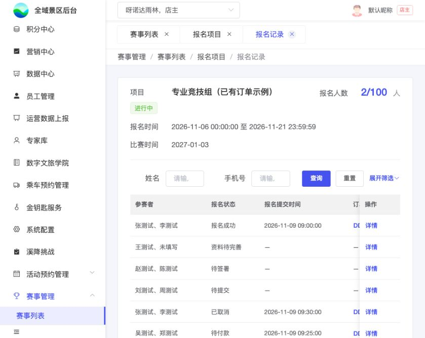

# B09｜报名记录列表

编辑源：[03-后台逐页功能方案.md](../../03-后台逐页功能方案.md)。本文件自动生成，请修改编辑源后重建。

**项目内迭代新增V1.1 · V11-13（业务变化）**：B09报名状态筛选、列表和B10详情增加“已取消”。当前绑定门票在任一退款端实际退款成功后更新此状态及已退款订单，保留订单入口；报名成功人数只统计成功状态，已取消不计入。旧单解绑后晚到的退款通知不得取消新订单对应的报名。
**原型：**<a href="../../../../preview/event-admin/index.html" target="_blank" rel="noopener noreferrer">打开原型：报名项目 → 报名记录</a>。在已有订单示例项目行点报名记录。

后台原型共用一个入口，暂不支持按页面参数直达；以上路径为实际操作路径。

查看截图：本轮当前列表截图：已移除报名编号

本轮当前列表截图：已移除报名编号。截图用于定位和布局参考；现行逻辑以本节正文及V1.1标记为准。

### 顶部与筛选

一份报名一行，包含成功暂存的未提交记录。指定项目的记录可独立页签打开，允许空列表。

| 区域 | 字段及行为 |
| --- | --- |
| 顶部摘要 | 项目名称＋项目时间状态、项目报名时间、项目比赛时间、成功人数/总名额；不以某个报名项替代项目 |
| 默认筛选 **项目内迭代新增V1.1（页面调整）** | 姓名、手机号 |
| 展开后筛选 **项目内迭代新增V1.1（页面调整）** | 身份证号、报名状态、订单号、订单状态 |
| 按钮位置 **项目内迭代新增V1.1（页面调整）** | 默认一行：姓名、手机号，右侧查询/重置/展开筛选；展开显示身份证号、报名状态、订单号、订单状态，查询/重置/收起移至全部条件下方右侧。收起保留条件，有隐藏条件提示“含更多筛选” |
| 重置与页签 | 重置全部条件含折叠项；切换页签保留展开状态 |
| 人员多条件 | 必须由同一参赛者同时命中，不跨人拼接；只匹配实际收集字段 |

### 列与数据口径

**项目内迭代新增V1.1（业务变化）**：取消独立报名编码，不制定BM等业务编号规则，后台报名列表和详情不展示报名编号。底层使用数据库内部记录ID关联报名资料、签署和订单，内部ID不作为展示字段或新增排序依据；原订单号保留。

| 顺序 | 列 | 取值 |
| --- | --- | --- |
| 1 | 参赛者 | 本份姓名摘要，不虚构未填写姓名 |
| 2 | 报名状态 | K06六种主状态（含退款成功后的已取消） |
| 3 | 报名提交时间 | 实际提交时间；未提交“—” |
| 4 | 订单号 | 最新实际关联订单；自营系统号、三方票务系统号，未返回显示待返回 |
| 5 | 门票名称 | 紧跟订单号，来自实际订单 |
| 6 | 订单状态 | 原订单实际状态 |
| 7 | 实收金额 | 已实际收取；待付款为0，不用应付冒充实收 |
| 8 | 操作 | 详情进入B10；订单号入口沿原订单能力，真实跳转待接 |

无订单时，订单号、票名、订单状态、实收金额均“—”，不从项目最新票配置补票名或写0。底层保留历史订单关联，列表只展示最新订单，不增加历史交易列表。

本节直接引用的公共规则：[K06](K06.md)。

需要跨页核对时见[公共规则](../../06-公共业务规则.md)；[待确认与实施边界](../../07-待确认与实施边界.md)另列，不把未决当既定要求。
