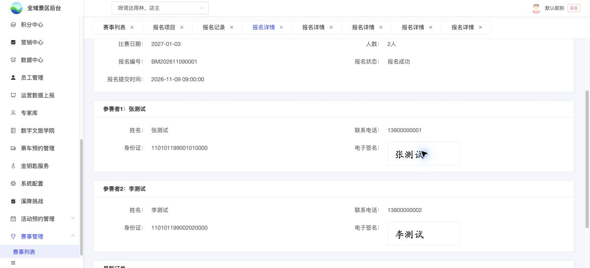

# B10｜后台报名详情

编辑源：[03-后台逐页功能方案.md](../../03-后台逐页功能方案.md)。本文件自动生成，请修改编辑源后重建。

**项目内迭代新增V1.1 · V11-13（业务变化）**：实际退款成功显示已取消及当前已退款订单；审核中/退款中仍保持原报名状态，原提交资料快照保留。再次下单成功后显示新关联订单。
**原型：**<a href="../../../../preview/event-admin/index.html" target="_blank" rel="noopener noreferrer">打开原型：报名记录 → 详情</a>。从任一报名行点详情；不同状态显示实际已有数据。

后台原型共用一个入口，暂不支持按页面参数直达；以上路径为实际操作路径。

查看截图：已有详情结构截图；非本次真实接口验收

已有详情结构截图；非本次真实接口验收。截图用于定位和布局参考；现行逻辑以本节正文及V1.1标记为准。

### 字段与来源

整份展示赛事、项目、比赛日期、固定人数、已有编号、报名状态、报名提交时间及实际已有数据。逐人按实际收集字段显示，未填“未填写”；已提交读提交快照，不用新配置追改。

| 区块 | 展示边界 |
| --- | --- |
| 逐人资料 | 各人配置字段和值，完整展示已有数据，不新增发起人专属区 |
| 签署 | 需签时逐人已签/未签，实际签名可放大；不需签不虚构签名 |
| 最新订单 | 仅有实际订单才展示订单号、门票名称、状态、实收；无订单不展示该卡，也不额外显示票选项名称 |
| 不展示 | 个人阅读进度/时间、材料正文、原订单全量字段、历次历史订单 |

游客签名权限不影响后台原权限下查看签名。当前后台示例SVG不是游客真实签名。样式沿标签120px、正文14px、行高32px；宽屏双列，1100px及以下单列。列表和详情的实际提交时间一致。返回/切换保留原列表上下文，不重开整项目设计。

**本轮检查（2026-11-11，V1.1）**：后台报名记录存在已取消/已退款示例，详情保留原提交资料和订单；项目成功人数仍为2，未把取消记录加进统计。[查看截图](../../../../preview/event-admin/设计依据/20261111-V11-13-退款已取消详情.png)。三端退款数据同步尚未接入。

本节直接引用的公共规则：无单独编号引用。

需要跨页核对时见[公共规则](../../06-公共业务规则.md)；[待确认与实施边界](../../07-待确认与实施边界.md)另列，不把未决当既定要求。
