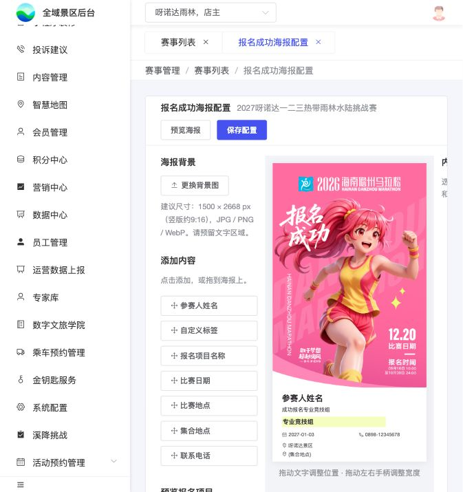

# B11｜报名成功海报配置

编辑源：[03-后台逐页功能方案.md](../../03-后台逐页功能方案.md)。本文件自动生成，请修改编辑源后重建。

> **项目内迭代新增V1.1 · V11-14（业务变化、规则细化）**：赛事级配置报名成功海报，上传背景并拖拽安排动态文字；本节为本轮讨论收敛后的现行页面方案，覆盖此前零散样例及辅助按钮说明。文档整理属于文档完善，不另算新增功能。

**原型：**<a href="../../../../preview/event-admin/index.html" target="_blank" rel="noopener noreferrer">赛事列表 → 报名成功海报配置</a>。原型在新浏览器页打开；配置页在后台内部独立页签打开。

### 1. 入口、作用范围与关联页面

| 页面/对象 | 配置或行为 | 标记 |
| --- | --- | --- |
| B01赛事列表 | 操作列在“编辑赛事”后增加“报名成功海报配置”；点击带入本行赛事，打开B11 | 项目内迭代新增V1.1 · V11-14（业务变化） |
| B02新增/编辑赛事 | 新增“联系电话”，随赛事保存、编辑回显；海报电话读取此字段。举办地点仍为比赛地点来源 | 项目内迭代新增V1.1 · V11-14（业务变化） |
| B04项目基本信息 | 项目名称后新增“集合地点”，随项目保存、编辑回显，各项目独立 | 项目内迭代新增V1.1 · V11-14（业务变化） |
| B11模板 | 一场赛事共用一套背景与内容布局，各报名项目使用该赛事模板，生成时替换为各自数据 | 项目内迭代新增V1.1 · V11-14（业务变化） |
| C08成功海报 | 免费最终提交成功、收费实际支付成功后使用所属赛事模板；一份报名一张海报，多人共用 | 项目内迭代新增V1.1 · V11-14（规则细化） |

同一赛事重复打开进入同一内部配置页签，不串用其他赛事模板。“预览报名项目”只改变后台取值预览，不改变模板归属，不分别保存成多套项目模板。

### 2. 页面结构与初始展示

| 区域 | 内容与行为 |
| --- | --- |
| 顶部 | 页面名、所属赛事名；“预览海报”“保存配置”按钮 |
| 左侧 | 背景上传/更换、尺寸提示、七类内容添加按钮、预览报名项目选择 |
| 中间 | 背景按原比例显示；文字直接显示当前配置值，可点击选中、拖动位置、拖动左右手柄调整文字区域宽度 |
| 右侧 | 未选中时提示选中内容；选中后显示该项的类型、数据来源或自定义文字、样式设置及删除操作 |

已有模板进入时回显已保存的背景、内容项、位置、宽度与样式。无模板时显示上传背景空态；未上传背景点击添加内容或预览，提示先上传背景，不伪造配置成功。项目下拉仅列当前赛事已保存的项目，默认第一项；没有项目时不编造项目数据。

页面不显示“使用示例背景图”、背景下载链接、“排版样例/应用参考排版”、样例数据输入区、项目下方取值长说明、X/Y坐标输入、宽度数字输入，也不新增“查看效果（无边框）”按钮。原有顶部“预览海报”承担成品查看。

### 3. 背景图上传与推荐尺寸

| 项目 | 规则 |
| --- | --- |
| 格式 | JPG、PNG、WebP；无法识别或读取失败时提示失败并保留原背景 |
| 上传提示 | **建议尺寸：1500 × 2668 px（竖版约9:16），JPG / PNG / WebP。请预留文字区域。** |
| 尺寸性质 | 推荐值，不限制必须9:16；上传其他比例仍使用整图，不裁剪、不拉伸 |
| 更换背景 | 保留已有内容及相对位置、宽度和样式；运营需预览检查新图上的位置及遮挡 |
| 输出 | 宽1500px，高度按背景原比例计算并取整；预览、下载使用同一合成结果 |
| 清晰度 | 背景应使用原始高清文件；放大低清原图不能恢复细节。设计字号按750px基准配置，生成时等比放大2倍 |

参考马拉松图仅为本地试排资料，图上自带名称、日期等属于背景像素，不会因拖拽动态字段而自动更新；正式背景由业务提供，不能拿参考图默认充当正式赛事海报。

### 4. 可添加内容及实际取值

| 内容项 | 数据来源 | 编辑画布与生成规则 |
| --- | --- | --- |
| 参赛人姓名 | 当前这份成功报名的全部N位参赛者姓名，依资料顺序顿号连接 | 单人一个姓名，多人同一张海报；不是登录昵称，也不只取主报名人。后台无真实报名人时用于定位，不生成虚假报名 |
| 自定义标签 | 业务输入的文字 | 新增默认“成功报名{项目名称}”；变量替换为本次报名项目名称。可改为固定文字、删除变量、添加多段标签 |
| 报名项目名称 | 本份报名关联的项目名称 | 不是报名选项展示名、票名或赛事名 |
| 比赛日期 | 该报名项目的比赛开始/结束日期 | 同日显示2027-01-03；多日显示2027-01-03 至 2027-01-04；跨年保留完整年份；不读报名窗口或赛事整体举办日期 |
| 比赛地点 | 当前赛事举办地点 | 读取B02举办地点，不用项目集合地点替代 |
| 集合地点 | 当前报名项目集合地点 | 读取B04集合地点，不同项目分别取值 |
| 联系电话 | 当前赛事联系电话 | 读取B02联系电话，不取主报人或组员手机号 |

**实际内容与占位符：**有配置值就直接显示实际值，例如“0898-12345678”，不会只印“联系电话”四字。缺值在编辑画布以单层花括号提示，例如“{联系电话}”“{集合地点}”“{报名项目名称}”。这只是定位占位，不表示已有数据；成品不打印这些缺值占位。已有本地姓名定位示例不代表真实报名，真正生成必须读取本份报名姓名。

自定义文字中的“{项目名称}”是本轮明确支持的变量；编辑字段中保留变量写法，画布/成品显示替换后的项目名。兼容此前本地双花括号写法。不自动把所有花括号文本都识别成任意业务字段，也不自动加“联系电话：”等前缀；需要固定标题时可另加自定义文字。

切换“预览报名项目”时，项目名、比赛日期、集合地点及自定义文字中的项目变量即时更新；赛事地点与电话保持同一赛事配置。切换只换数据，不移动内容、不清空布局，不把预览选择写成本次报名的实际项目。

### 5. 拖拽、选中、宽度与删除

| 操作 | 结果 |
| --- | --- |
| 点击左侧内容项 | 添加一项到画布，显示实际配置值或缺值占位，可重复添加；每项独立编辑 |
| 从左侧拖到画布 | 在放下位置添加该类型内容，保存的是相对背景坐标 |
| 点击画布内容 | 选中该项，显示蓝色辅助框及左右宽度手柄，右侧切换到该项属性 |
| 拖动文字 | 移动整项，宽度、字号等样式保持；不需要在属性区输入坐标 |
| 拖动左右手柄 | 改变文字区域宽度；右侧手柄改变右边界，左侧手柄改变左边界并保持右边界；文字换行，高度自动增长；不缩放字号 |
| 点击画布空白/其他非属性区，或按Esc | 取消选中，蓝框与手柄消失；鼠标悬停辅助边线也不进入成品 |
| 调整右侧属性 | 保留当前选中项，便于连续调节 |
| 删除此项 | 只删除当前选中的内容，不删除背景或其他项 |

所有位置与文字宽度按背景相对比例保存，改变编辑区显示宽度时等比换算。长姓名、长项目名、多日日期在区域内换行，不静默省略；字号由独立字号控件调整。当前原型有10%最小区域宽度及边界限制，是操作保护，不代表已完成长文避让验收。背景比例变化后、文字过长时可能重叠或超出底部，当前没有自动避让；长文处理与最终边界校验仍需明确，不把裁掉的内容当作完整成功输出。

### 6. 右侧属性与样式

| 属性 | 配置及生效规则 |
| --- | --- |
| 内容类型/来源 | 动态项展示绑定来源，不在此改成其他项目/赛事；自定义标签展示可编辑文本 |
| 字号 | 按750px设计宽度设置，编辑预览等比显示，1500px成品放大2倍绘制 |
| 文字颜色 | 仅文字与随文字显示的小图标颜色 |
| 文字背景开关/颜色 | 开启后显示选定底色，关闭不画底色，文字和边框仍保留 |
| 背景不透明度 | 0—100%；0完全透明、100完全不透明。只影响该文字底色，不影响文字、图标、边框或整张背景图；旧模板未设置默认100% |
| 边框粗细/颜色 | 粗细0为无边框；大于0时可设颜色，沿文字区域绘制，不等同编辑蓝框 |
| 圆角 | 0为直角，大于0为圆角；用于该项背景/边框 |
| 内边距 | 控制文字与背景、边框之间留白，参与换行宽度和区域高度计算 |
| 小图标 | 可选无图标、日期、地点、电话；随文字同色同级显示，不替代实际文字。不提供独立小图片上传图层 |
| 加粗 | 单项开关，不修改其他内容项 |
| 对齐 | 左、中、右，按该项文字区域对齐 |

颜色、底色、不透明度、边框、圆角、字号与排版均须带入实际合成结果。编辑蓝框、手柄、鼠标悬停线、缺值定位占位不带入成品。

### 7. 保存、预览与失败处理

| 场景 | 页面与数据行为 |
| --- | --- |
| 保存配置 | 保存当前赛事模板：背景引用及比例、各项类型/自定义文字、相对位置、区域宽度、样式。绑定来源随类型保存，不把当前预览项目的显示值固化为所有人的固定值 |
| 保存校验 | 背景存在、至少一个内容项、自定义标签非空；必填字段缺值策略另见待确认，不擅自扩大校验 |
| 保存成功 | 提示成功，后续重新进入恢复已保存模板；只影响当前赛事 |
| 保存失败 | 提示失败，保留当前编辑内容，不显示成功、不清空画布 |
| 顶部预览海报 | 使用当前编辑配置及当前预览项目生成图片，可预览尚未保存的编辑；不等于保存模板、不创建报名或订单 |
| 预览弹窗 | 展示实际合成图；没有蓝框/手柄；关闭回到编辑，不改变原配置 |
| 生成失败 | 提示失败、允许后续重试，不把空图片或旧图误认新成品 |

只有点击保存配置才保存模板。关闭页签/离开时未保存内容的恢复、提示策略尚未确认，不承诺已接入自动保存。保存与预览的权限、上传体积/容量上限、接口字段名由研发结合实际能力落实，方案不编造既有接口。

### 8. 成功触发、查看、下载及分享

免费最终提交成功、收费订单实际支付成功后先读取成功结果，有可用海报则直接展示海报，无可用海报则展示C08普通报名成功兜底页；后续补付款成功也衔接同一逻辑。待付款不生成成功海报。生成时匹配本份报名所属赛事模板与项目，不得读取其他赛事模板。

本份报名的N人姓名、项目及对应日期/地点/电话按本节取值；海报生成失败不改变报名成功状态，不要求再次报名或支付。我的报名保留查看资料、查看海报；收费报名还保留原订单入口与原核销二维码，海报不是核销凭据。

预览、保存、分享使用同一张成品。支持保存及微信好友/群聊、朋友圈等既定分享路径；真实相册授权、分享调用及平台能力按C08实施，不把本地下载或分享示意当作已发送。

### 9. 不同手机显示一致性

正式实现须在统一生成环境使用固定字体与版本、统一换行和绘制规则合成单张1500px宽图片。相同模板、数据与生成版本得到一致坐标和换行。字体加载完成再生成，不能无提示换成其他字体继续输出。

游客手机只按原图比例显示、保存和分享，不根据各手机屏宽重新排文字，不在背景上叠加手机端HTML文字。手机屏幕不同只改变整体显示大小，不改变文字相对背景位置；不得裁切或拉伸。编辑画布是操作工具，最终效果以成品图片为准。

本地原型使用浏览器Canvas和系统sans-serif，尚未接统一字体/生成服务；跨系统分别生成仍可能存在字形、字宽差异。不能宣称生产跨手机一致性已经验收。

### 10. 已定范围、待确认与实际实现

已定：赛事级背景/布局、七类内容来源、单日/日期范围、拖拽位置和宽度、单层花括号缺值占位、底色不透明度等样式、去掉辅助演示入口、预览/保存、成功合成及图片等比显示要求。

本轮明确：不新增赛事上架状态，不因未配海报阻断报名；未配置/生成失败使用C08普通成功页。海报生成后保存为图片快照，查看、下载、分享沿用该图，模板后续修改不实时改写已生成图片。

仍待确认：无海报成功记录在后续补配模板后是否补生成、关键动态字段缺值时是否阻止生成、首次生成时赛事/项目配置字段快照来源、长文越界及层级最终策略。剩余事项见U03。

本地制作已实现配置存储、编辑回显、样式及Canvas合成；服务端上传/存储/权限、统一字体生成、真实相册分享尚未接入。旧研发评审包保持不动，所有本轮调整完成后再统一打包。

**实际文件：**preview/event-admin/poster-config.js、poster-config.css、index.html、app.js、tab-navigation.js；共享渲染preview/poster-common.js；游客联看preview/miniapp/poster-config-preview.js。

**检查边界：**本地已观察新增字段回显、入口、合成宽1500px、配置保存、宽度手柄的键盘调节、60%背景不透明度、取消选中及多余按钮移除；不据此宣称鼠标拖拽所有边界、移动端真机、字体一致性、长文和真实分享全部验收。

查看当前原型截图：花括号占位、无额外效果按钮

本地原型截图仅证明所示界面；完整需求以本节各表和C08、U03为准。

> **项目内迭代新增V1.1 · V11-14（业务变化）**：增加C08普通报名成功兜底页；海报不作为报名可用性前置门槛，不新增上架操作。成功页分支与海报图片快照规则见C08。

---

# 赛事活动报名｜小程序逐页功能方案

整理评审稿｜2026-11-10。<a href="../../../../preview/miniapp/index.html" target="_blank" rel="noopener noreferrer">打开结构原型</a>。字段来源为业务对象，不是正式API字段约定。页面号与流程、验收一致。

本节直接引用的公共规则：无单独编号引用。

需要跨页核对时见[公共规则](../../06-公共业务规则.md)；[待确认与实施边界](../../07-待确认与实施边界.md)另列，不把未决当既定要求。
