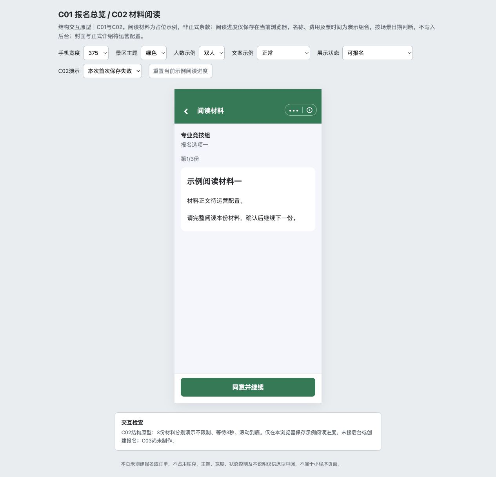

# C02｜报名前材料阅读

编辑源：[05-小程序逐页功能方案.md](../../05-小程序逐页功能方案.md)。本文件自动生成，请修改编辑源后重建。

**原型：**<a href="../../../../preview/miniapp/index.html" target="_blank" rel="noopener noreferrer">打开原型：报名项 → 阅读材料</a>。选择需要签署项目的可报名项，进入阅读页；已读进度可能影响首次位置。

查看截图：已有阅读结构截图，阅读持久化尚未接入

已有阅读结构截图，阅读持久化尚未接入。截图用于定位和布局参考；现行逻辑以本节正文及V1.1标记为准。

### 内容与动作

仅项目需签署时进入。一个页面按材料保存顺序逐份切换；顶部阅读材料，下方项目及收费报名项，显示第X/Y份、当前标题和完整富文本。无需签署直接C03，不因免费跳过所需阅读。

| 阅读方式 | 继续条件 |
| --- | --- |
| 不限制 | 不要求等待或滚到底，仍须点击确认继续 |
| 等待N秒 | 正整数配置，按钮显示剩余秒且禁用，到时可继续 |
| 滚动到底 | 到正文底部才可继续，短于一屏视为到底 |

底部固定“同意并继续”，正文预留底栏安全区。每份只采用一种方式，不叠加，不提供跳过/可选材料开关。

### 保存、恢复与失败

满足条件并确认，保存成功再切下一份，最后一份成功进入C03；保存中防重复点。已完成材料不重复限制，可回看；退出再进从第一份未完成接续，不要求保存未完成倒计时的秒级跨设备进度。

阅读进度保存失败不提示、不记已读，停留当前份重新阅读，其他已保存进度保留；不显示“阅读完成后，点击下方按钮继续”的冗余说明。材料加载失败/异常为空仍提示重新加载，不擅自当免签直接跳过。阅读不等于签名或报名，不下单、不占库存。

> **项目内迭代新增V1.1 · V11-12（规则细化）**：仅打开页面、阅读或完成全部材料阅读，不生成报名记录，不触发后台配置锁定；阅读进度独立保存。首次主动暂存成功（包括半填暂存）产生报名记录后，才按K05限制后台配置修改。

配置正文/材料变更按K05。

本节直接引用的公共规则：[K05](K05.md)。

需要跨页核对时见[公共规则](../../06-公共业务规则.md)；[待确认与实施边界](../../07-待确认与实施边界.md)另列，不把未决当既定要求。
