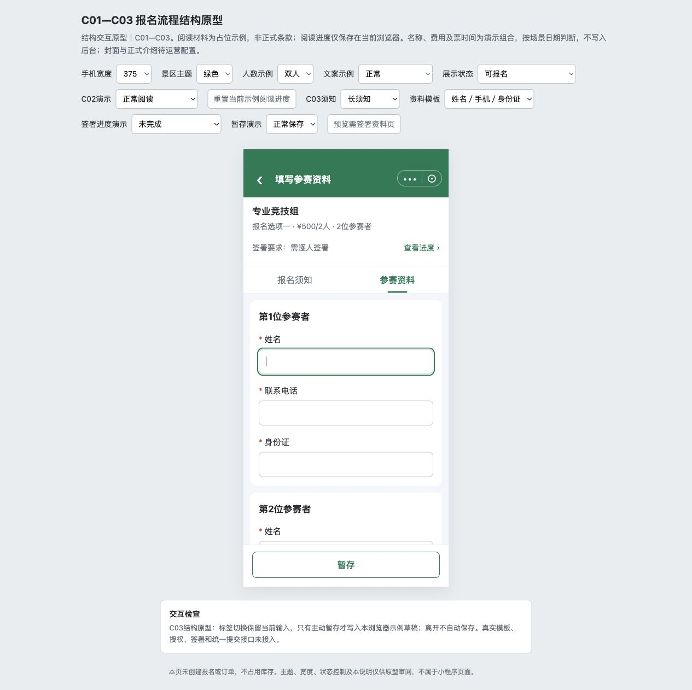
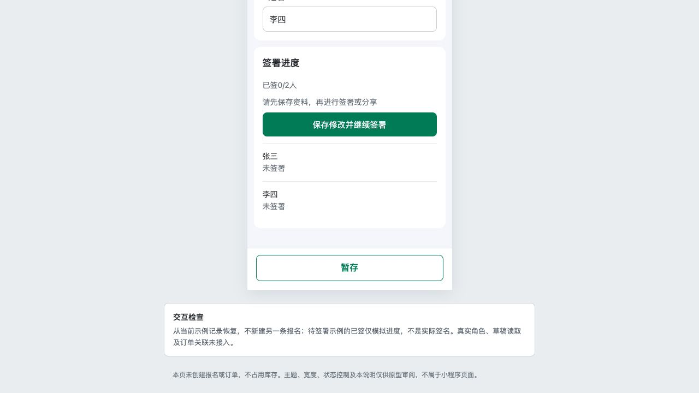
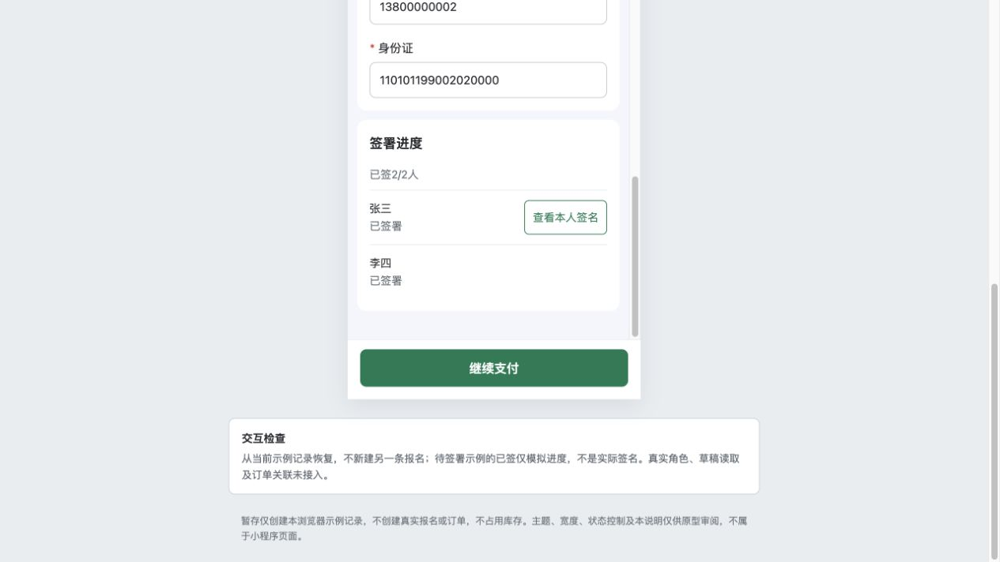

# C03｜参赛资料与暂存

编辑源：[05-小程序逐页功能方案.md](../../05-小程序逐页功能方案.md)。本文件自动生成，请修改编辑源后重建。

**项目内迭代新增V1.1 · V11-13（业务变化）**：已取消记录继续报名恢复本份资料和有效签署，主报人可修改；齐全后显示立即报名。暂存或签署仍保持已取消，直到重新提交成功。旧退款订单保持关联；完整重报判断见C06、C07。
**原型：**<a href="../../../../preview/miniapp/index.html" target="_blank" rel="noopener noreferrer">打开原型：预览需签署资料页</a>。外部审阅区点预览需签署资料页；或按报名流程读完材料进入。默认参赛资料标签。

> **项目内迭代新增V1.1 · V11-02**：全员资料齐且底部暂存成功才开放签署/分享；改资料后再用同一暂存按钮。首次暂存建记录的方向原已存在，本轮补齐本地同一记录保存及恢复。
> **项目内迭代新增V1.1 · V11-03**：暂存成功短暂浮层约2秒，不占底栏；不新增上方保存按钮。
> **项目内迭代新增V1.1 · V11-07**：主报人资料页底部继续支付进入同一有效原订单；组员/免费无按钮。原未付订单实际关闭才恢复立即报名，取消收银台不恢复；订单关闭回退原则原已存在，本轮补足该按钮衔接。

查看截图：已有A标签布局截图；较早截图不代表最新底部状态

已有A标签布局截图；较早截图不代表最新底部状态。截图用于定位和布局参考；现行逻辑以本节正文及V1.1标记为准。

查看截图：本轮迭代已有截图：先暂存再签署/分享

本轮迭代已有截图：先暂存再签署/分享。截图用于定位和布局参考；现行逻辑以本节正文及V1.1标记为准。

查看截图：本轮迭代已有截图：待付款发起人继续支付

本轮迭代已有截图：待付款发起人继续支付。截图用于定位和布局参考；现行逻辑以本节正文及V1.1标记为准。

### 结构与字段

采用A方案“报名须知／参赛资料”标签，默认参赛资料，B方案删除。标签切换不销毁输入、不自动暂存，各保留滚动位置。未配置须知直接显示表单，不留空标签；长须知完整富文本展示，不加倒计时、强制到底、同意勾选。

顶部简要回显项目、收费报名项和价格/固定人数；免费不造票/价格。需签时显示签署要求和查看进度定位入口，不显示“签署要求：无需签署”。下方按N纵向生成参赛者卡，同套字段/排序/规则/说明，无人数增减和填写方式选择。

姓名固定必填，其余按B05模板和K07票要求。手机号不自动给所有人灌发起人号码；身份证为唯一证件类型。字段校验沿B05，最终检查全部N人并定位人员与字段。主报人填写全部资料，分享不开放其他人自行填写。

> **项目内迭代新增V1.1 · V11-11（规则细化）**：区分后台项目配置限制与游客已填资料的修改权限；暂存产生记录不等于游客资料只读，不改变已确认业务。

### 游客修改资料与后台配置限制的区别

后台不能改删既有填写项，只限制运营修改资料模板，不会把已暂存的游客资料变成只读。主报人在资料待完善、待签署、待提交阶段，仍可修改全部N人的已填资料；普通修改后重新暂存，改姓名仅使对应人员签名失效。收费成功下单后（包括待付款）或免费提交成功后，资料才按提交快照只读。原未付订单实际取消或关闭后，保留资料及有效签署，恢复未提交阶段，可继续修改。组员从分享或查看资料进入时只读，属于身份权限限制，不是暂存导致锁定。

### 底部按钮和签署门槛

| 当前情况 | 显示/行为 |
| --- | --- |
| 需签但资料未齐 | 只提供暂存，签署区统一提示“请先完善全部参赛者资料，再进行签署”；具体错误放字段旁，不在进度区逐人罗列 |
| 资料齐但未成功暂存 / 暂存后又修改 | 提示“请先暂存资料，再进行签署或分享”，隐藏签署/分享入口；只用底部一个暂存，无上方保存按钮 |
| 暂存成功且全部资料有效 | 开放逐人签署/分享；未全签时底部仍仅暂存 |
| 全部资料有效且全部必要签署有效 | 出现立即报名；无签署项目保留暂存/立即报名，提交时再校验 |
| 姓名变更导致某人签名失效 | 隐藏立即报名，重新暂存后该人签署；其他人有效签名保留 |
| 待付款，发起人查看资料 | 全部资料及签署锁定，底部继续支付→关联原订单，无暂存/重复提交 |
| 原未付订单实际取消/关闭 | 保留资料/有效签署，恢复未提交，满足当前报名条件后立即报名；不以关闭收银台触发 |
| 已成功 / 只读组员 | 无暂存和立即报名，组员也无继续支付 |

未填完也可暂存。成功首次产生记录，后续保存同一条；成功提示已暂存用约2秒浮层，不占底部布局留白，失败保留错误与重试。普通填写、页面内切换、直接离开按K03，不增加保存并离开/直接离开/继续填写三按钮。

本节直接引用的公共规则：[K07](K07.md)、[K03](K03.md)。

需要跨页核对时见[公共规则](../../06-公共业务规则.md)；[待确认与实施边界](../../07-待确认与实施边界.md)另列，不把未决当既定要求。
