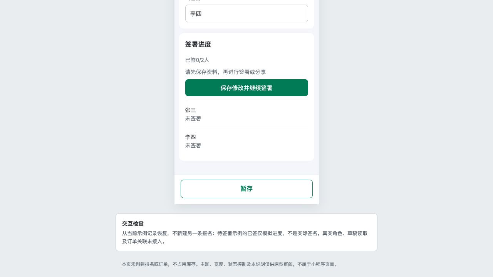

# C04｜签署进度组件

编辑源：[05-小程序逐页功能方案.md](../../05-小程序逐页功能方案.md)。本文件自动生成，请修改编辑源后重建。

**原型：**<a href="../../../../preview/miniapp/index.html" target="_blank" rel="noopener noreferrer">打开原型：C03参赛资料 → 签署进度</a>。本组件集成C03，填齐资料并暂存后看去签署/分享，不建立独立页。

> **项目内迭代新增V1.1 · V11-02**：全员资料齐且底部暂存成功才开放签署/分享；改资料后再用同一暂存按钮。首次暂存建记录的方向原已存在，本轮补齐本地同一记录保存及恢复。
> **项目内迭代新增V1.1 · V11-04**：有效关联组员从我的报名也可看全部N人只读资料；双方共用详情结构，仅本人行有查看本人签名，弹窗显示本人快照；组员不能修改、提交或付款。

查看截图：组件暂存门槛状态；完整进度按原型实际签署显示

组件暂存门槛状态；完整进度按原型实际签署显示。截图用于定位和布局参考；现行逻辑以本节正文及V1.1标记为准。

集成C03资料下方，显示已签X/N人、各人姓名和有效状态。全员资料通过并已保存后才开放操作。无签署项目不显示此区。

- 未签人员显示去签署、分享签署；已签人员隐藏分享，未下单有权本人入口改为重签署。
- 同机是每个人亲自签本人，不允许主报人代签全部；主报人无需先签，最后一人完成不自动提交或下单。
- 查看资料的只读上下文中，在当前访问者本人行显示查看本人签名，点击弹窗。其他人仅状态、无打开入口；用户不需区分不同资料布局。
- 只有修改已签人的姓名使该人失效；非姓名改动不重签，仍需暂存，仍校验实际资料。进度取已成功保存的签署，不把分享完成当签完。

本节直接引用的公共规则：无单独编号引用。

需要跨页核对时见[公共规则](../../06-公共业务规则.md)；[待确认与实施边界](../../07-待确认与实施边界.md)另列，不把未决当既定要求。
