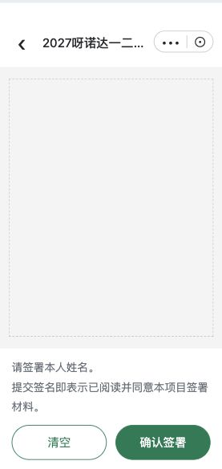
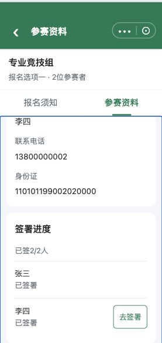

# C05｜纯签署、重签与分享接收

编辑源：[05-小程序逐页功能方案.md](../../05-小程序逐页功能方案.md)。本文件自动生成，请修改编辑源后重建。

**原型：**<a href="../../../../preview/miniapp/index.html?view=signature" target="_blank" rel="noopener noreferrer">打开原型：本人签署／重签署</a>。该链接使用现有签署专用审阅入口，自动装入虚构已暂存资料并打开签署画布；分享接收从C03点分享签署。

> **项目内迭代新增V1.1 · V11-02**：全员资料齐且底部暂存成功才开放签署/分享；改资料后再用同一暂存按钮。首次暂存建记录的方向原已存在，本轮补齐本地同一记录保存及恢复。

查看截图：已有纯签署页结构截图

已有纯签署页结构截图。截图用于定位和布局参考；现行逻辑以本节正文及V1.1标记为准。

查看截图：已有分享接收页截图，与纯签署页分开

已有分享接收页截图，与纯签署页分开。截图用于定位和布局参考；现行逻辑以本节正文及V1.1标记为准。

### 纯签署页

**项目内迭代新增V1.1 · V11-18（业务变化）**：不做手写签名与参赛者姓名的识别比对；确认时校验画布已有笔迹，空画布不可确认。保留签名保存、回显、清空重签及修改姓名后该人需重签的规则。

从去签署/重签署打开同一纯画布页。顶部赛事名称，不用本人签署当导航标题；不放人员资料卡、其他参赛者或材料列表，不让用户先滚过这些内容才能签名。

画布下方、按钮上方直接显示B06项目签署说明，留空隐藏、换行保留、长文可滚动且按钮可达。清空、确认签署两个动作；已签进入回显原有效签名。清空只改当前画布，未确认退出不覆盖旧签名；有效新签名确认保存成功才替换。

最后一次成功确认覆盖对应人员的签署快照，包含本次签名、姓名和确认时间，不保留多版本，不覆盖其他人。保存失败保留旧签，不假报已签。下单成功后签署锁定，不允许重签。

### 分享接收流程

主报人在已保存全员有效资料上分享指定人员。接收者按C02顺序阅读本项目全部材料，阅读进度按其本人记录，不直接借用主报人已读。之后进入须知/参赛资料A标签，默认资料，全部N人资料只读。

签署进度只开放指定接收者本人的去签署/重签署，其他人的签署/分享入口隐藏，全部分享按钮隐藏；不提供暂存、立即报名或支付。本人确认后回接收者资料页更新进度，不自动提交整份。

资料读取实际成功暂存的记录，不能分享内存未保存表单；身份和关系按K04校验，不以链接可见或姓名相同授权整组管理。真实跨设备持久化与微信分享未接入。

### 完成反馈与通知

签署保存成功后回对应资料页，提示签署成功并更新状态。发起人接收他人签完提醒采用短信；发送接口、模板、触发颗粒度及重签去重待U08d落实。保存失败不触发短信，不将本地提示称为已发送。

本节直接引用的公共规则：[K04](K04.md)。

需要跨页核对时见[公共规则](../../06-公共业务规则.md)；[待确认与实施边界](../../07-待确认与实施边界.md)另列，不把未决当既定要求。
