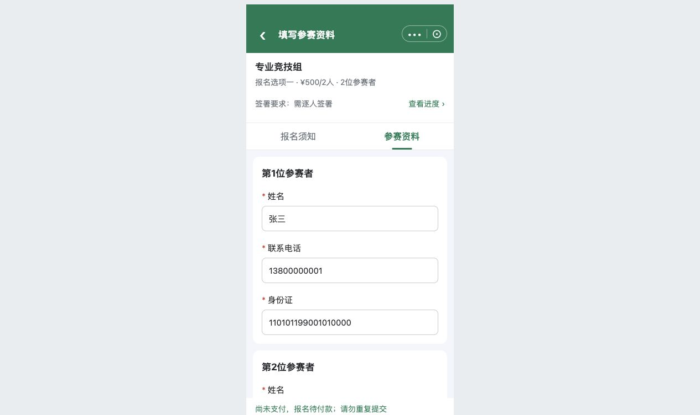

# C06｜立即报名与一次提交

编辑源：[05-小程序逐页功能方案.md](../../05-小程序逐页功能方案.md)。本文件自动生成，请修改编辑源后重建。

**项目内迭代新增V1.1 · V11-13（规则细化）**：待提交和已取消均须按提交当时重新校验全部资料、阅读/签署、报名时间与N名额。未关联票按项目条件；关联票同时检查当前报名项窗口，并由原下单层校验全员资格、限购、价格及票库存。失败保留原状态和旧退款单，未知先回查；新订单创建成功才替换关联、转待付款并临时占N名额，付款成功才计成功人数。
**原型：**<a href="../../../../preview/miniapp/index.html?view=records" target="_blank" rel="noopener noreferrer">打开原型：我的报名 → 待提交 → 继续报名 → 立即报名</a>。本项是C03提交动作，没有独立核对页；用虚构待提交示例操作。

查看截图：已有提交后锁定状态截图，仅模拟下单

已有提交后锁定状态截图，仅模拟下单。截图用于定位和布局参考；现行逻辑以本节正文及V1.1标记为准。

本节点在C03完成，不另建最终核对页、不再提交一次订单。主报人操作，其输入是当前报名对象、全部N人资料、有效阅读/签署和当前配置。

### 提交校验

> **项目内迭代新增V1.1**：本次细化以下第4—5项的最新名额／票库存复核、失败提示及并发占用要求；其余原有校验保留。

1. 主报人有权管理该记录，所选赛事/项目/项对应有效。
2. 固定N人资料满足模板、必填、类型和原票要求，不只校验首人。
3. 需要时全部材料已读、全员有效签署；未提交新增材料已补读，姓名失效签名不算有效。
4. 使用[公共规则K02](../../06-公共业务规则.md#K02-时间-可用性-名额与占用)重新读取当前有效窗口及项目可用人数R：有限名额R=总名额−成功人数−有效待付款占用人数，须R≥本次固定人数N；收费还须所选原票当前可用库存≥1张或库存不限，并通过票可用性、比赛日／有效期、价格检查；免费不查票库存。不能沿用C01进入时的数据。
5. 项目名额不足时本次提交失败并显示“已满员”；项目名额足够但本项票库存不足时显示“已售罄”，保留资料和有效签署，不继续创建有效订单。时间已过则按截止原因处理，不由库存提示覆盖。服务端必须在并发请求下保证占用不超过项目总名额，不能仅前端先查询后放行；同一报名重复请求不重复占用。收费下单、占用与失败释放的衔接见K02、K06及U07b。
6. 收费固定买1张、传全部N人资料和发起人授权手机号；原资格、限购、起售量等执行真实校验，人工限制说明不是通过凭证。

### 结果处理

| 情形 | 页面和业务结果 |
| --- | --- |
| 提交中 | 提交中…；禁重复提交、暂存、资料/签署修改 |
| 明确失败 | 当前页显示实际原因，恢复操作，保留当前输入和有效签署供修正；不因失败偷偷暂存 |
| 结果未知 | 正在核实，查询原请求/订单；没查明不开第二次下单 |
| 收费成功下单 | 报名待付款、锁定全部资料/签署、直接调微信支付；不提前计成功或出海报 |
| 免费提交成功 | 保存提交快照，报名成功，直接C08；不生成订单或走付款 |

前端禁用不是服务端幂等。实际两系统事务、部分成功和回查由研发接入验证，不能把“一次操作”当已经具备跨系统原子事务。

本节直接引用的公共规则：[K02](K02.md)、[K06](K06.md)。

需要跨页核对时见[公共规则](../../06-公共业务规则.md)；[待确认与实施边界](../../07-待确认与实施边界.md)另列，不把未决当既定要求。
