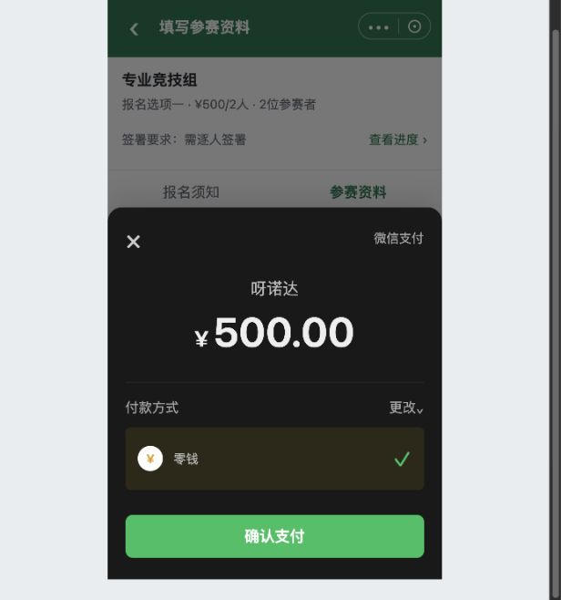
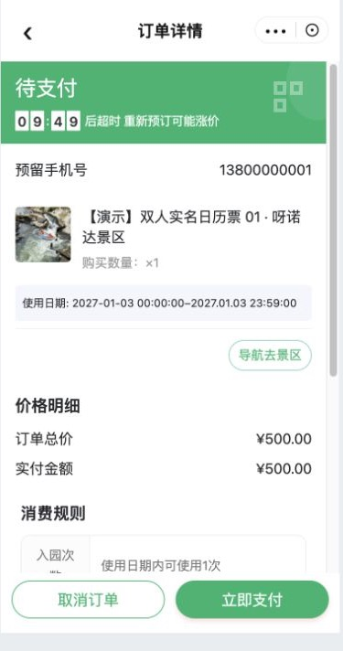
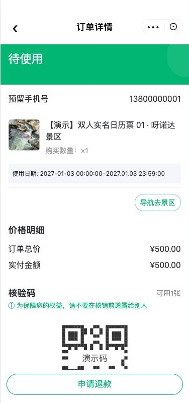
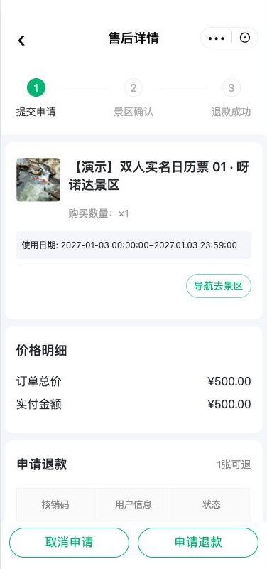

# C07｜微信支付与原订单

编辑源：[05-小程序逐页功能方案.md](../../05-小程序逐页功能方案.md)。本文件自动生成，请修改编辑源后重建。

**原型：**<a href="../../../../preview/miniapp/index.html?view=records" target="_blank" rel="noopener noreferrer">打开原型：我的报名 → 待付款 → 查看订单</a>。可从待付款查看资料的继续支付进入同一原订单；首次提交自动弹模拟微信收银台。

> **项目内迭代新增V1.1 · V11-07**：主报人资料页底部继续支付进入同一有效原订单；组员/免费无按钮。原未付订单实际关闭才恢复立即报名，取消收银台不恢复；订单关闭回退原则原已存在，本轮补足该按钮衔接。

查看截图：已有微信收银台模拟，非真实支付

已有微信收银台模拟，非真实支付。截图用于定位和布局参考；现行逻辑以本节正文及V1.1标记为准。

查看截图：依据用户截图还原的原订单页示意，原系统界面不改

依据用户截图还原的原订单页示意，原系统界面不改。截图用于定位和布局参考；现行逻辑以本节正文及V1.1标记为准。

### 进入和复用

> **项目内迭代新增V1.1 · V11-10（规则细化）**：明确完全复用原订单页的范围、主报人入口，以及订单关闭后的“报名状态回退”与“页面跳转”的区别；不新增赛事订单页或自动返回要求。

首次收费提交成功直接微信支付；C03待付款继续支付、C09查看订单进入本份当前有效原订单。订单号、金额、有效期、票券均取原订单实际数据，不在报名页编造。

原订单详情完全复用呀诺达原系统，包括取消订单、立即支付、二维码和既有返回。除本轮V11-13叠加赛事退款截止时间对“申请退款”入口及提交的判断外，报名不改其页面、字段和其他既有按钮，不增加赛事报名字段或查看报名入口，不要求从我的订单列表自行找单。报名资料在C03/C10查看，票券与核销码在原订单查看。报名侧仅向有权限的主报人提供对应订单入口；组员无查看订单或付款入口，不因参与报名新增原订单访问权限。原型还原截图仅帮助串流程，不是原系统改造稿。

### 事件处理

| 事件 | 报名侧结果 |
| --- | --- |
| 取消/未付微信收银台 | 展示原待付订单；仍待付款且锁资料，原有效订单不重复建 |
| 首次付款或后续原订单付款成功 | 实际核实后报名成功，直接C08海报 |
| 原未付订单人工取消/系统关闭 | 报名状态恢复未提交，资料/有效签署保留，按K06重新判断完整性及报名条件；这是状态变化，不要求订单页自动跳回报名详情 |
| 报名已截止但原订单仍有效 | 仍可在原订单有效期内付，实际成功即成功 |
| 订单关闭且报名已截止 | 保留记录，不允许新订单；不自动换票或转正价 |
| 支付/关闭未知或冲突 | 先查真实结果，未查明不重下、不重复释放；已付不回退未提交 |

**项目内迭代新增V1.1 · V11-10（规则细化）**：订单取消、关闭后的停留页面与返回行为沿用原订单系统，不增加自动跳回报名详情的要求。用户后续进入或返回“我的报名／报名资料”时，读取实际订单结果并显示恢复后的报名状态；条件满足时可继续报名。支付成功出海报是已明确的独立衔接要求，不由订单关闭规则推导。订单直达、支付结果衔接及关闭同步的技术接入见U07b，不能再把“是否完全复用订单页”列为待产品确认。

超时使用原订单配置及任务，不新增固定时长。演示09:49是静态示例。收费成功核销使用原订单二维码；海报码不能当核销码，免费不造二维码。

### 赛事订单申请退款

**原型：**<a href="../../../../preview/miniapp/index.html?view=refund" target="_blank" rel="noopener noreferrer">打开原型：已支付原订单 → 申请退款</a>。顶部审阅区可切原票规则、是否审核、时间、模拟退款结果与重新提交。

查看截图：V1.1 原订单退款入口与售后申请

> **项目内迭代新增V1.1 · V11-13（业务变化）**：复用截图中的原订单详情及售后流程，只新增赛事退款时间限制、全额退款后的名额和关联处理。

| 判断步骤 | 页面与处理 |
| --- | --- |
| 原订单不满足退票条件 | 不显示申请退款，赛事截止时间不能放开原本不可退的订单 |
| 原订单允许退款，未关联赛事 | 沿现有规则处理，不新增赛事限制 |
| 原订单允许退款且关联赛事，未到赛事退款截止时间 | 主报人可见申请退款，进入原售后流程，整单全额申请；审核配置沿原票 |
| 已设置时间且到达或超过赛事退款截止时间 | 隐藏申请退款；已提前打开售后页也须在提交时校验，不能仅隐藏按钮 |
| 原票允许退款、赛事未设置截止时间（含存量空值） | 仅按订单存储的原票退款规则展示申请按钮，不叠加赛事时间限制 |
| 读取截止时间或退款资格失败 | 不能当作允许退款；提示失败并可重试，实际接口及异常接入由研发核实 |

原票“不可退”“未消费且有效期内可退”“未消费均可退款（过期也可申请）”继续分别生效；未消费指尚未检票，不能统一把票过期写成不可退。本次业务计划使用未消费均可退款，再由赛事配置的截止时间限制游客主动申请。非主报人不新增订单/退款权限。

全额退款实际成功才释放N个项目名额；申请或退款中不释放。未重报时C09查看订单仍进入旧退款订单；新订单创建成功才替换报名关联，旧单保留在小程序我的订单。项目名额、票库存及当前订单关联按K06分别处理。退款成功后变已取消，提供继续报名并保留查看旧退款订单；不显示查看海报按钮，也不可直接进入海报页或调用保存/分享。本地原型已补原订单/售后页、审核与免审核场景、名额占用及新旧订单关联演示；未接真实退款、订单与库存接口。审核中的订单展示以真实原系统为准，当前仅结构示意。

### 退款成功、状态与重新报名联动

**项目内迭代新增V1.1 · V11-13（业务变化、规则细化）**：退款成功状态由原先未定明确为“已取消”，不使用“待提交”。

| 页面/触发 | 最新处理 |
|---|---|
| C07原订单申请按钮 | 先按订单存储的门票退款规则，再通过当前订单关联的报名项目实时读取其赛事退款截止时间；非必填、可随时改/清空，未配只用原票规则。读取失败与未配区分；到达截止隐藏按钮，申请提交再次检查最新值 |
| C07截止前已提交申请 | 截止后仍可审核，审核通过照常退款；审核中、退款中不改变报名成功或释放名额，沿原订单展示 |
| 游客／全域后台／票务系统退款结果 | 包括已检票后的强制退票，只有当前绑定票实际退款成功才改已取消、扣减N成功人数并释放N项目名额；历史旧单和重复通知不影响新报名，不重复释放 |
| C09我的报名 | 已取消卡片保留资料摘要、旧报名时间、已退款订单，主报人显示继续报名及查看订单，隐藏查看海报，不当作成功记录；C11仅成功的查询结果排除该记录 |
| C03/C10继续报名 | 从原已取消记录进入，保留资料/有效签署，可按未提交规则修改；数据仍齐且签署有效时显示立即报名，不要求重填全部内容。普通暂存/签署不把已取消改为待提交 |
| C06重新提交 | 待提交和已取消均走完整实时校验。未关联票检查项目条件、资料、阅读/签署及N名额；关联票同时检查报名项当前有效时间，并在原下单层校验全员资格/限购/价格/票库存。截止、满员、售罄等失败仍保留已取消与旧退款单 |
| 新下单成功 | 替换当前关联为新订单，旧退款单保留在我的订单，报名变待付款并临时占用N名额；支付成功才计成功人数。下单失败不解绑，结果未知回查 |
| 未付款订单取消/实际超时关闭 | 解除当前关联、回待提交，资料/有效签署保留；不变已取消。取消微信支付弹窗仍为待付款 |

本地原型可切换退款来源、审核、空截止时间及当前报名时间/库存场景演示；真实退款回调、查询最新配置、订单原校验、并发及权限须研发接入。退款实际成功后的已取消记录不提供海报查看、保存或分享。

**本轮交互检查（2026-11-11，V1.1）**：本地实际操作验证空截止可申请、申请后审核仍占2人、截止后已受理申请退款成功释放2人、已检票强退成功和重复结果不重复释放、已取消继续报名及截止拦截、重报新订单替换且旧订单保留、未付款主动取消回待提交。截图：[已取消及继续报名](../../../../preview/miniapp/设计依据/20261111-V11-13-退款已取消.png)、[继续报名资料页](../../../../preview/miniapp/设计依据/20261111-V11-13-退款继续报名.png)。320/360/375/390/414宽卡片未出现横向溢出，三主题可切换。以上是本地模拟，真实三端退款通知、系统超时、并发和票务校验仍须联调。

本节直接引用的公共规则：[K06](K06.md)。

需要跨页核对时见[公共规则](../../06-公共业务规则.md)；[待确认与实施边界](../../07-待确认与实施边界.md)另列，不把未决当既定要求。
