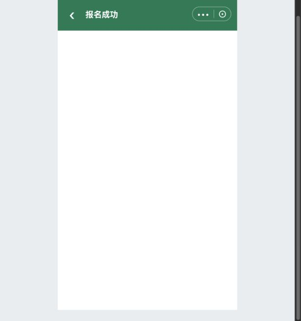

# C08｜报名成功：海报、兜底页与分享

编辑源：[05-小程序逐页功能方案.md](../../05-小程序逐页功能方案.md)。本文件自动生成，请修改编辑源后重建。

**原型：**<a href="../../../../preview/miniapp/index.html?view=records" target="_blank" rel="noopener noreferrer">打开原型：我的报名 → 成功记录 → 查看海报</a>。或沿免费提交/模拟付款成功直接展示。**项目内迭代新增V1.1 · V11-14（业务变化）**：海报模板与字段配置见B11；正式底图由业务上传。

查看截图：已有参考海报展示截图，不能作为正式海报设计

已有参考海报展示截图，不能作为正式海报设计。截图用于定位和布局参考；现行逻辑以本节正文及V1.1标记为准。

收费实际付款成功、免费最终提交成功后进入C08：有可用海报直接显示海报；没有可用海报进入本节兜底成功页，不先经过另一层成功卡片或资料页底部重复报名成功提示。后续补付款也衔接海报，成功状态不依本地弹窗猜测。

**项目内迭代新增V1.1 · V11-14（业务变化）**：一份成功报名一张，多人共用。使用所属赛事B11保存的背景图和文字配置，将本份全部参赛者姓名、当前项目名称和比赛日期、赛事举办地点、项目集合地点、赛事联系电话替换到指定位置；自定义标签使用业务配置的文字。日期起止同日只显示单日，不同日显示完整范围。每项字号、颜色与位置沿模板配置，保存图片与预览使用同一合成结果，不再下载固定参考图片。不自动做性别模板或新核销码。自定义变量{项目名称}按本次项目替换；缺值编辑占位不打印到成品。输出宽1500px，高度按背景比例；底色不透明度、边框、圆角等沿B11。游客端仅等比显示同一张合成图，不依手机屏宽重新排文字；统一字体与生成环境要求见B11第9节。已生成图片保留原快照；无图记录补生成及首次生成的字段来源等见U03。

海报支持保存及微信好友/群聊、朋友圈等分享路径。真实海报生成、相册及分享能力待接入，不声称已发送或发布朋友圈。生成失败不改变报名成功，不要求重报/重付，转入普通报名成功兜底页。我的报名成功记录可再次查看海报，并保留查看资料；收费还需查看订单。

### C08｜海报分享弹层

**项目内迭代新增V1.1 · V11-14（规则细化、页面调整）**：游客点击海报页“分享海报”，以当前已生成的完整海报图片打开微信图片分享面板。采用底部弹层结构，三个图标入口依次为“发送给朋友”“分享到朋友圈”“保存图片”，底部单独“取消”；关闭后仍停留在原海报页。正式端复用微信原生面板，原型仅模拟结构，图标、项目顺序和具体外观以微信客户端为准，不另做一套强制覆盖原生样式。

| 操作 | 处理与边界 |
|---|---|
| 发送给朋友 | 分享当前海报图片，进入微信选择朋友或群聊；不把完整海报替换成小程序页面卡片 |
| 分享到朋友圈 | 微信基础库3.8.2及以上支持图片面板直接分享至朋友圈；进入微信朋友圈编辑，由用户确认发布，不自动发布。分享图片不携带订单核销二维码 |
| 保存图片 | 保存同一张海报图片到相册；正式端处理保存权限及失败反馈，浏览器原型为文件下载 |
| 低版本或能力不可用 | 提供保存图片到相册，再由用户自行发朋友圈的兼容路径；不展示不可执行的直接分享能力 |
| 取消／关闭 | 返回当前海报，不改变报名、订单或海报快照，不将关闭面板认定为分享成功 |

依据：[微信官方API类型说明：showShareImageMenu](https://github.com/wechat-miniprogram/api-typings/blob/master/types/wx/lib.wx.api.d.ts)；官方明确自基础库3.8.2支持分享朋友圈。该能力是图片分享，与右上角菜单的页面分享不同。真实好友选择、朋友圈编辑、相册保存及不同微信版本真机验证待研发接入。

**原型检查**：分享弹层在320、360、375、390、414px均无横向溢出；朋友圈入口反馈和取消返回已检查，真实分享仍需真机接入。[查看分享弹层截图](../../../../preview/miniapp/设计依据/20261110-V11-14-海报分享弹层.png)。

### C08｜普通报名成功兜底页与调用逻辑

> **项目内迭代新增V1.1 · V11-14（业务变化、规则细化）**：本轮增加无海报时的普通成功页。不新增赛事上架操作，不将海报配置作为游客报名门槛。

| 判断顺序/场景 | 展示与行为 |
| --- | --- |
| 尚未确认报名成功/收费仍待付款 | 不进入成功页，仍走C06/C07原状态核实与支付路径，不能因海报存在推定成功 |
| 免费最终提交成功、收费实际支付成功（含原订单补付成功） | 读取本份报名成功结果，进入以下海报/兜底判断 |
| 已有该份报名海报图片快照且可读取 | 直接展示该图片，不因后台模板变化重排字或自动重生成 |
| 没有图片快照，但所属赛事已保存有效模板 | 统一生成图片快照，成功后直接展示海报；生成期间短暂显示正在生成海报，不要求再点击报名 |
| 未配模板、模板没有可用背景或内容项 | 直接展示普通报名成功页，不使用参考图、其他赛事模板或空白海报 |
| 图片生成/读取失败 | 展示普通报名成功页；不得转成报名失败，不重复创建报名或订单，不要求再次支付 |

**兜底页字段和操作**：页标题“报名成功”，成功图形及主文案“报名成功”；说明“可在我的报名中查看报名资料”。显示本份报名的项目名称、选项展示名称（有则展示）、全部N位参赛者姓名，读取已提交报名快照，不展示后台变量占位。只提供“我的报名”按钮，进入C09；再从记录查看资料，收费记录按既定权限查看原订单。该页不显示保存/分享海报按钮，不展示不存在的海报，也不新增核销二维码。

海报模式仍保留保存海报、分享海报，及原有我的报名查看入口；普通成功页与海报页是同一成功节点的互斥结果，不叠加显示两次成功页。兜底页不提示游客“后台没有配置”或暴露技术失败原因；技术原因仅放审阅说明/日志，不作为游客主文案。

**图片快照**：成功合成一次保存图片结果，查看、下载与分享使用同一张图。后台改模板只影响后续新生成图片，不自动改变已生成海报。游客端只等比显示，不按手机屏宽重新排字。已成功但当时走兜底的记录，后续补配模板是否补生成，仍留待确认，不把它默认为已有海报必须重做。退款后的海报处理仍按U03未决边界，不由兜底规则推导。

**本地原型演示**：左侧“提交与支付”→“成功展示”可选按当前配置、未配置海报兜底、海报生成失败兜底；从成功记录查看海报或模拟提交/支付成功进入同一分支。该控件在手机外，仅用于评审。本地已接分支，不代表已接服务端图片快照持久化。

本节直接引用的公共规则：无单独编号引用。

需要跨页核对时见[公共规则](../../06-公共业务规则.md)；[待确认与实施边界](../../07-待确认与实施边界.md)另列，不把未决当既定要求。
