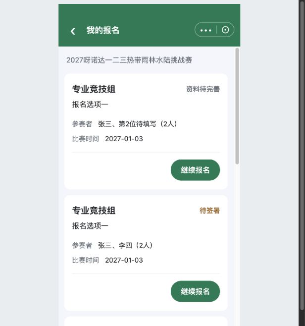

# C09｜我的报名

编辑源：[05-小程序逐页功能方案.md](../../05-小程序逐页功能方案.md)。本文件自动生成，请修改编辑源后重建。

**原型：**<a href="../../../../preview/miniapp/index.html?view=records" target="_blank" rel="noopener noreferrer">打开原型：我的报名</a>。现有直达审阅入口；查看身份可切发起人/已关联组员；场景可切免费。

> **项目内迭代新增V1.1 · V11-04**：有效关联组员从我的报名也可看全部N人只读资料；双方共用详情结构，仅本人行有查看本人签名，弹窗显示本人快照；组员不能修改、提交或付款。

查看截图：已有五状态列表截图，非真实账号数据

已有五状态列表截图，非真实账号数据。截图用于定位和布局参考；现行逻辑以本节正文及V1.1标记为准。

### 范围与卡片

C01我的报名进入，限定当前赛事和当前账号发起或有效关联的记录，包含六种主状态（增加已取消）。不是全赛事名单，不因同名、同机、仅打开分享自动收录。每份报名一张卡，N人不拆N条，无一人只能报名一次的新增限制。

| 字段 | 来源 |
| --- | --- |
| 项目、收费报名项 | 记录归属和所选项，已提交按快照；免费不造票名 |
| 人员摘要与N | 已成功保存姓名及固定人数，不用未保存输入冒充已存 |
| 比赛时间 | 本项目对应日期，单日合并 |
| 报名时间 | 最终报名提交时间，未提交不显示；不是付款或暂存时间 |
| 状态 | K06六种主状态，项目已截止不替换它 |

卡片沿小程序现有主题，状态在标题右侧，长名称允许换行。当前按钮基线36px高、14px字、左右12px、间距8px，透明扩展约44px触控范围；不是最终Figma尺寸批准。无列表身份证、手机、签名；排序/分页尚未确定正式契约。

### 入口矩阵

| 状态 | 主报人 | 已关联组员 |
| --- | --- | --- |
| 资料待完善/待签署/待提交 | 继续报名，恢复原记录，不新建 | 有效关联范围内查看资料，只读，不提交 |
| 收费待付款 | 查看资料、查看订单；资料页底部继续支付 | 查看资料，无付款入口 |
| 收费报名成功 | 查看资料、查看订单、查看海报 | 查看资料，本人签名弹窗 |
| 免费报名成功 | 查看资料、查看海报，无订单/付款逻辑 | 查看资料，只读 |
| 已取消（当前绑定票实际退款成功） **项目内迭代新增V1.1 · V11-13** | 继续报名，恢复原资料及有效签署；查看订单仍打开旧退款单；不显示查看海报 | 查看资料，只读，不提供重报、订单或支付权限 |

组员在分享签署入口处理本人签署；不能从记录权限推出统一提交或代付款。无记录和加载失败分开，失败可重试。历史所选项在C01被隐藏不删除旧记录，截止仍保留资料，继续行为按K06。

本节直接引用的公共规则：[K06](K06.md)。

需要跨页核对时见[公共规则](../../06-公共业务规则.md)；[待确认与实施边界](../../07-待确认与实施边界.md)另列，不把未决当既定要求。
