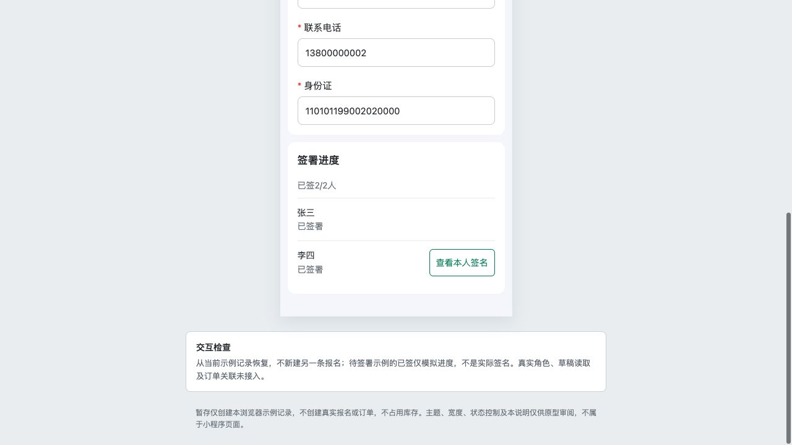
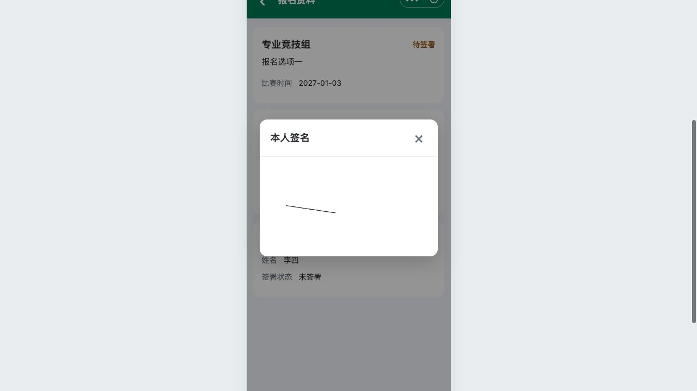

# C10｜共用查看资料与本人签名

编辑源：[05-小程序逐页功能方案.md](../../05-小程序逐页功能方案.md)。本文件自动生成，请修改编辑源后重建。

**项目内迭代新增V1.1 · V11-13（业务变化）**：退款成功后的已取消记录，主报人从继续报名进入同一资料结构，可修改并重新提交；组员仍只读。旧退款订单继续可查；只有新订单创建成功才替换关联。未付款订单实际关闭则解绑回待提交，与已取消区分。
**原型：**<a href="../../../../preview/miniapp/index.html?view=records" target="_blank" rel="noopener noreferrer">打开原型：我的报名 → 查看资料</a>。主报人/组员用同一详情；切身份后分别点成功记录查看资料。

> **项目内迭代新增V1.1 · V11-04**：有效关联组员从我的报名也可看全部N人只读资料；双方共用详情结构，仅本人行有查看本人签名，弹窗显示本人快照；组员不能修改、提交或付款。
> **项目内迭代新增V1.1 · V11-07**：主报人资料页底部继续支付进入同一有效原订单；组员/免费无按钮。原未付订单实际关闭才恢复立即报名，取消收银台不恢复；订单关闭回退原则原已存在，本轮补足该按钮衔接。

查看截图：已有组员共用详情及本人行按钮截图

已有组员共用详情及本人行按钮截图。截图用于定位和布局参考；现行逻辑以本节正文及V1.1标记为准。

查看截图：已有本人签名弹窗截图

已有本人签名弹窗截图。截图用于定位和布局参考；现行逻辑以本节正文及V1.1标记为准。

主报人和有效关联组员从C09查看资料进入同一C03资料详情结构：A标签、全部N人资料、全员签署进度。不同的是读写权限、底部动作及本人签名按钮所在行，不另做组员卡片布局。

- 未提交取成功暂存及适用模板；已提交含待付款读取字段和值的提交快照，不追补新增项。
- 免费无订单；收费待付款主报人底部继续支付进入原订单。成功只读，不显示立即报名/暂存，订单和海报仍从C09入口可达。
- 当前有效本人签名用弹窗只读显示最后确认快照，关闭留原详情；他人只显示签署状态。本人依据真实关系定位，不默认第一人就是当前账号，原型第1/2位身份开关仅示例。
- 只读组员看整组资料，但不能修改、替主报人提交或付款。C11查询命中不能跳到此完整详情。
- 有效订单锁全部资料/签署，实际未付订单关闭才按K06回退；不可通过改页面地址或隐藏按钮绕过服务端校验。

本节直接引用的公共规则：[K06](K06.md)。

需要跨页核对时见[公共规则](../../06-公共业务规则.md)；[待确认与实施边界](../../07-待确认与实施边界.md)另列，不把未决当既定要求。
