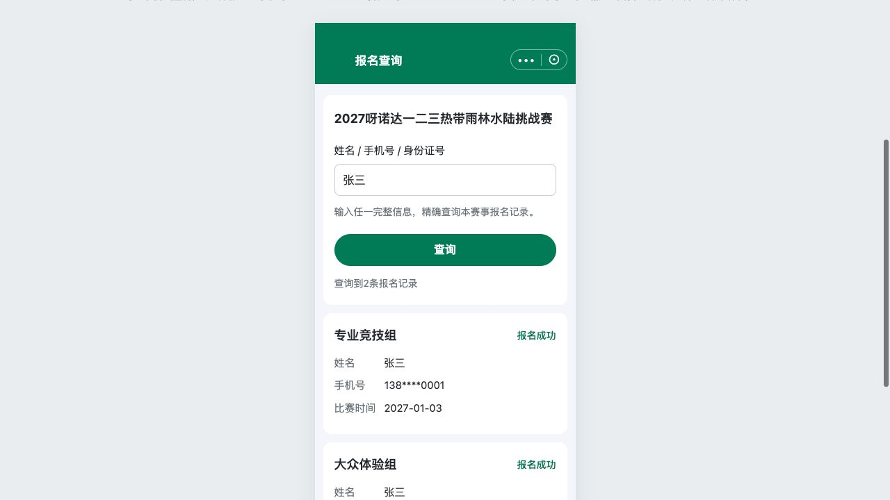

# C11｜独立报名查询

编辑源：[05-小程序逐页功能方案.md](../../05-小程序逐页功能方案.md)。本文件自动生成，请修改编辑源后重建。

**原型：**<a href="../../../../preview/miniapp/index.html?view=query" target="_blank" rel="noopener noreferrer">打开原型：独立报名查询</a>。现有直达查询入口；张三或13800000001可命中虚构成功示例。

> **项目内迭代新增V1.1 · V11-05**：新增C11结构原型：一个框按姓名/手机号/身份证精确OR匹配，只返回成功记录，结果手机号前三后四、中间****。仅C11适用。

查看截图：已有最新查询口径截图：只成功、结果手机号脱敏

已有最新查询口径截图：只成功、结果手机号脱敏。截图用于定位和布局参考；现行逻辑以本节正文及V1.1标记为准。

### 入口、条件、结果

P00本赛事报名查询或B01查询页推广直达，独立于C01和C09，绑定一场赛事。初始不展示全部人员名单。

| 内容 | 规则 |
| --- | --- |
| 输入 | 一个框，完整姓名/完整手机号/完整身份证号任一，精确OR匹配，不选查询类型，不要求组合 |
| 匹配来源 | 实际收集并成功保存资料；不反向强制收集手机号/证件，不用发起人授权号冒充参赛者手机号 |
| 状态范围 | 只查报名成功，其他四状态匹配也不返回 |
| 多条命中 | 同名或多份成功报名分别展示，不猜哪条本人 |
| 摘要 | 命中人员完整姓名、已收集手机号脱敏、项目、比赛时间、报名成功状态 |
| 手机号 | 输入完整号查，结果前三后四、中间****；例如138****0001；未收集不造号码 |
| 身份证 | 仅输入条件，结果不展示完整或脱敏身份证 |
| 权限 | 无整组详情、签名、修改、报名提交、付款、票码或自动认领/关联 |

只返回命中人员的摘要，不附带不相关同行资料。无输入不返回全量；无结果与请求失败分开，失败可重试，修改输入清旧结果。不增加未确认的验证码、实名或新认证流程。

### 可查的虚构用例

姓名张三、手机号13800000001、身份证110101199001010000，任一在现有原型命中两份成功示例；结果号码138****0001。输入“不存在的测试姓名”无结果。以上只用于本地交互演示，不是正式人员数据或生产查询验收。

**本轮原型检查（V1.1）**：未配置海报进入普通成功页；“我的报名”返回原列表并保留成功记录。兜底页面截图：[查看截图](../../../../preview/miniapp/设计依据/20261110-V11-14-普通成功兜底.png)。真实图片生成、存储及微信支付回调仍需研发接入。

---

# 赛事活动报名｜公共业务规则

本文件维护跨页面共同使用的规则。页面只说明本页字段和动作，不反复复制公共正文。

本节直接引用的公共规则：无单独编号引用。

需要跨页核对时见[公共规则](../../06-公共业务规则.md)；[待确认与实施边界](../../07-待确认与实施边界.md)另列，不把未决当既定要求。
