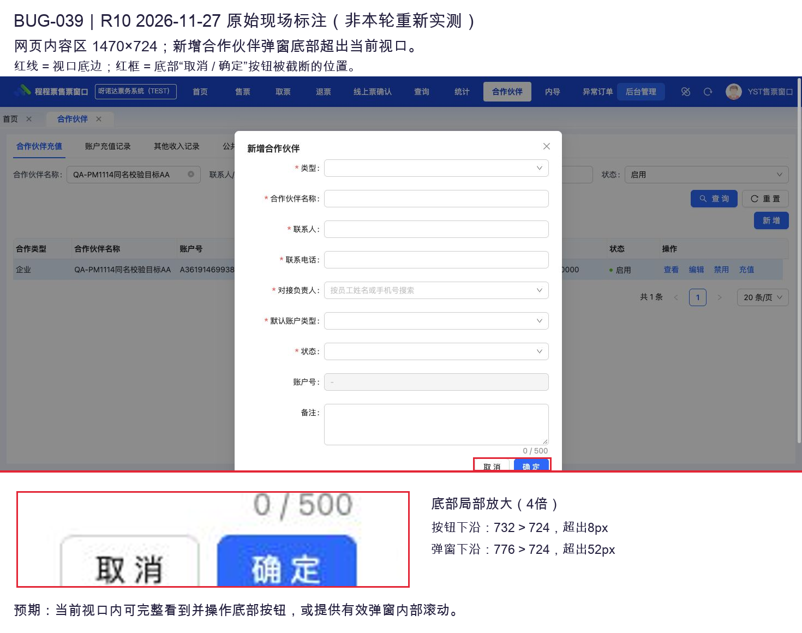

# BUG-039：新增合作伙伴弹窗底部被视口截断

证据来源：2026-11-27 R10实际测试，本次仅补充标注和清晰说明，未重新登录业务系统复测。部署版本当时未显示。

## 看哪里

这是售票窗口“合作伙伴 → 合作伙伴充值 → 新增”的弹窗。**实际网页内容区（innerWidth/innerHeight）为1470×724 CSS像素**，不是整台显示器分辨率，也不是浏览器外框尺寸。浏览器工具栏等占用不计入724。

原图底部“取消 / 确定”按钮只露出上部，下沿被截图底边截断。问题不是按钮完全消失，也未证明无法通过页面滚动操作；问题是弹窗和操作区未在该视口完整容纳，R10未提供有效的弹窗内部滚动。

## 开发复现步骤

1. 打开HTTP QA售票窗口，以YST售票窗口账号、YST团队售票窗口设备进入。
2. 将网页内容区设为宽1470、高724；浏览器缩放100%。用开发者工具确认`window.innerWidth`和`window.innerHeight`实际读数，不只设置显示器分辨率。
3. 打开“合作伙伴 → 合作伙伴充值”，点击“新增”。不需要填写或保存任何字段。
4. 在初次打开、页面未滚动的状态看底部“取消 / 确定”按钮和弹窗底边。
5. 对照原图：R10弹窗top=100、bottom=776；按钮bottom=732，而视口底边为724。按钮下沿超出8px，弹窗整体超出52px。

R10可见原图尺寸1470×724。R10记录未保存浏览器缩放读数，因此不声称当时已核实100%；上述100%是开发复现时用于排除缩放差异的操作条件。1280×800能完整显示，不能证明1470×724也正常；本问题主要受可用高度影响。

## 预期和影响

预期：弹窗按可用高度自适应，或内容区提供有效内部滚动并保证底部按钮完整可见、可操作。不强制唯一CSS实现。

实际影响为P3布局问题，不涉及保存数据、金额或账务错误。原型600×582是参考布局，不把必须实现该固定尺寸当修复条件。

## 证据

[未裁剪原图1470×724](evidence/BUG-039-R10-新增弹窗1470x724仍超出.jpg)

标注图只增加说明、红框和原图局部放大，没有补画被视口裁掉的画面。数值来自R10已保存的页面测量记录，不是从放大图反推。
