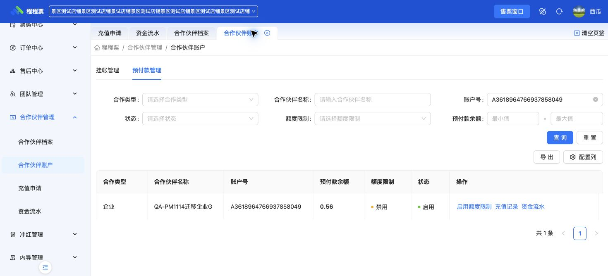

# R05 用户辅助50条导入到账补验

用户辅助上传并提交valid-fifty.xlsx。AI读取第6～55行线下流水QA-PM1114-R03-IMPORT-B50-01～50全部成功：50成功0失败。企业G充值记录10→60条，其中本次50个不同RG单号均为同账户预付款现金0.01，完成时间14:23:44～14:23:45；资金流水14→64条，本次50笔+0.01的单号集合与充值记录完全一致，无缺失、无额外或重复。账户余额0.06→0.56。详情抽查B50-37/38/39/50与备注对应，付款人、负责人、方式正确。完整导入结果、50笔充值/流水对应数据见import-samples/fifty-verification.json。

## 结果及边界

- 本次导入50条、50成功、0失败；与此前51条整份拒绝构成数量边界核验。
- 五项导入分支全部完成。累计268通过、43有问题、23阻塞，9个原缺陷未关闭。
- 本轮只读回查；上传及同步导入由用户辅助。自动上传权限未确认恢复；4项导出仍缺实际文件。
- 无共享业务配置变更；充值与流水列表为核验临时显示100条/页。
- 本次50笔0.50元测试充值保留追溯，不删除或调账抹平。

