# 支付配置化｜全程流程图

版本：V1.7｜2026-10-23。节点对应[页面清单](01-页面清单.md)。仅展开本次新增/修改；原交易处理用一个节点表示，不重新定义。

## 一、全程总览

打开原型：[后台配置 ↗](prototype/admin/index.html?page=payment) · [散客售票 ↗](prototype/window/index.html) · [内导 ↗](prototype/window/index.html?view=innerGuide)

[独立打开全程总览图](assets/flow-01.svg)

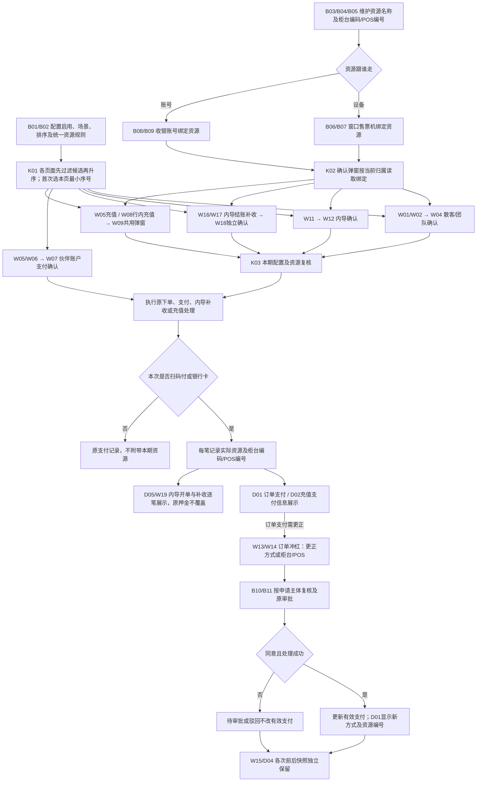

冲红增量：申请选择与订单当前有效支付分开保存；扫码付/银行卡可保持方式只更正资源或编号。同意成功后才生效，原交易金额及既有换方式处理不变；详细分支见第九—十一图。

排序处理：各页面先按启用、场景及业务资格取候选，再按序号升序；9项排9项、3项排3项，跳号不补齐。首次进入选本页候选中最小序号，不取其他场景的最小项。同一景区全部支付方式（含停用）序号不可重复。确认弹窗沿用已选方式，当前有效选择不因重排被覆盖；伙伴账户锁定、冲红初始不选。默认方式缺资源时弹窗提示，不自动跳到现金。

## 二、内导售票与支付确认

打开原型：[内导开单及支付确认 ↗](prototype/window/index.html?view=innerGuide)

首次开单后进入订单记录；后续结账补收、退款与逐笔记录见第十二图。

## 三、管理员配置、绑定与后续变更

打开原型：[支付配置 ↗](prototype/admin/index.html?page=payment) · [资源管理 ↗](prototype/admin/index.html?page=paymentResources) · [设备绑定 ↗](prototype/admin/index.html?page=device) · [账号绑定 ↗](prototype/admin/index.html?page=systemRole)

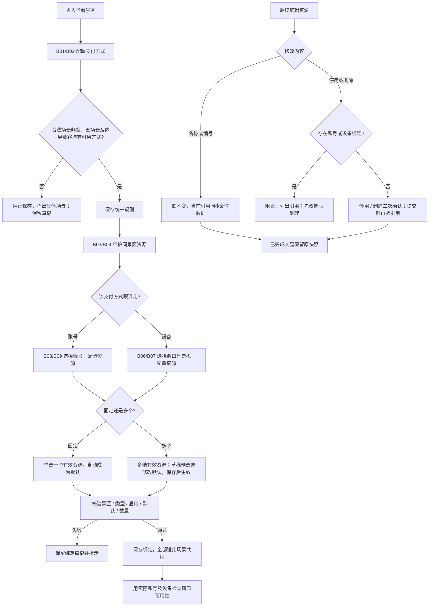

归属由账号切为设备不自动复制绑定。多个改固定后旧绑定不合格，须管理员明确重选；窗口不自动取第一项。

## 四、扫码付/银行卡公共资源解析

打开原型：[散客支付确认入口 ↗](prototype/window/index.html) · [合作伙伴充值入口 ↗](prototype/window/index.html?view=partnerList)

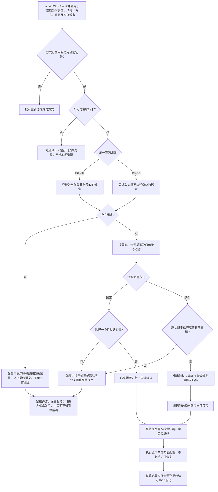

## 五、散客/团队售票与订单支付记录

打开原型：[散客 ↗](prototype/window/index.html) · [团队 ↗](prototype/window/index.html?view=team) · [订单详情 ↗](prototype/admin/index.html?page=order)

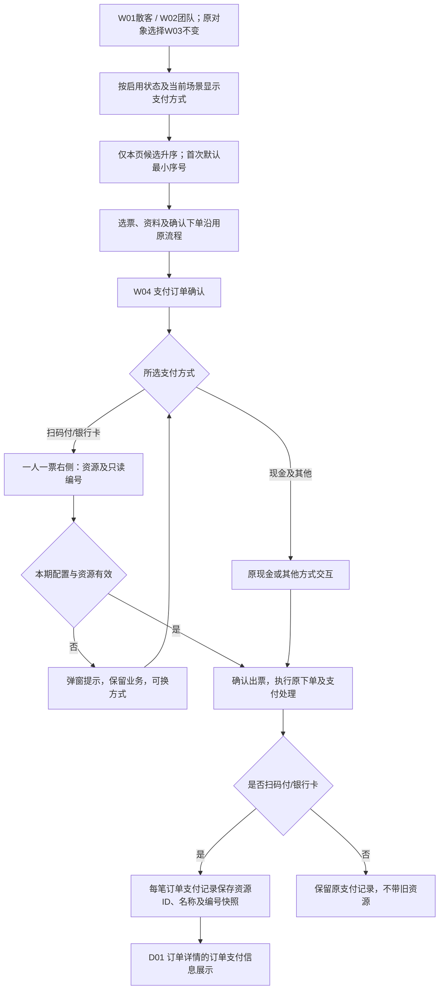

## 六、长期合作伙伴与临时客户售票

打开原型：[合作伙伴售票 ↗](prototype/window/index.html?view=partnerSale)

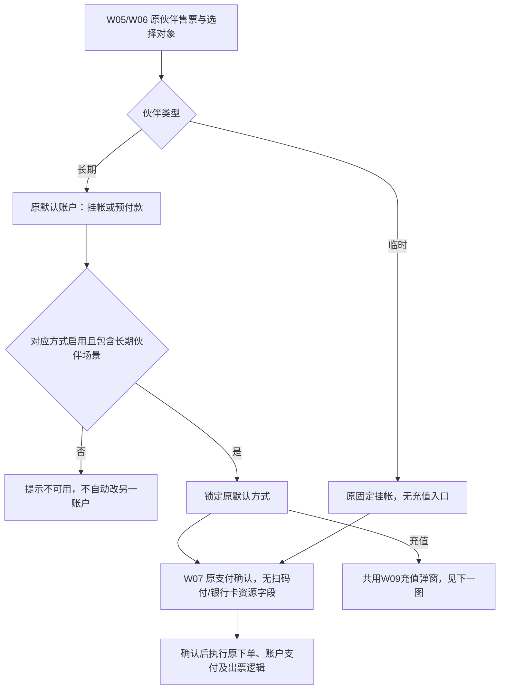

## 七、两个充值入口共用资源与编号

打开原型：[售票页充值入口 ↗](prototype/window/index.html?view=partnerSale) · [充值列表入口 ↗](prototype/window/index.html?view=partnerList)

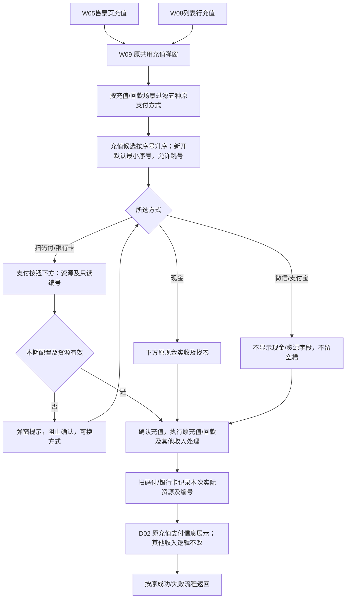

## 八、配置变化、挂单恢复与历史展示

打开原型：[售票及挂单入口 ↗](prototype/window/index.html) · [订单详情 ↗](prototype/admin/index.html?page=order)

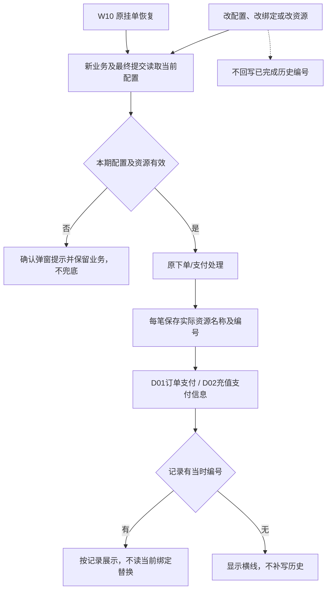

## 九、冲红申请：原信息回显与资源选择

打开原型：[W13销售记录 → W14冲红申请 ↗](prototype/window/index.html?view=reversal)

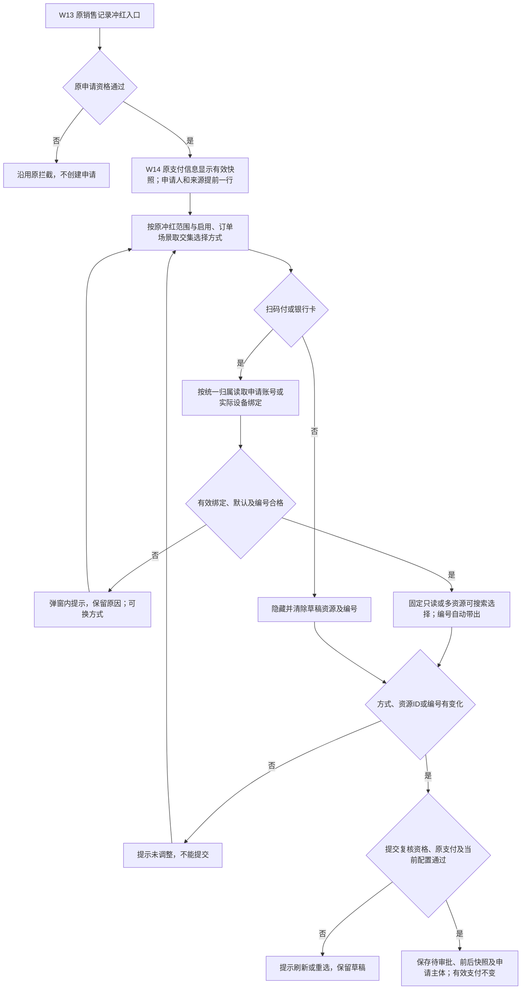

图下处理规则：

- 原资源及编号读取订单有效支付快照；历史缺值显示“—”，与下方申请选择互不覆盖。
- 原方式为扫码付/银行卡时可选相同方式更正资源或编号；其余范围沿用原冲红资格，不新增独立场景。
- 资源只从申请账号或实际设备的有效绑定中取值；无默认不取首项，固定一个不允许切换，多资源支持名称搜索。
- 切换方式清除旧资源；配置、绑定或编号变化须重新确认。保存前再校验，取消不创建申请，重复提交不生成多条待审批。

## 十、后台审核：复核、生效与驳回

打开原型：[B10冲红审核 → B11同意 / 驳回 ↗](prototype/admin/index.html?page=reversal)

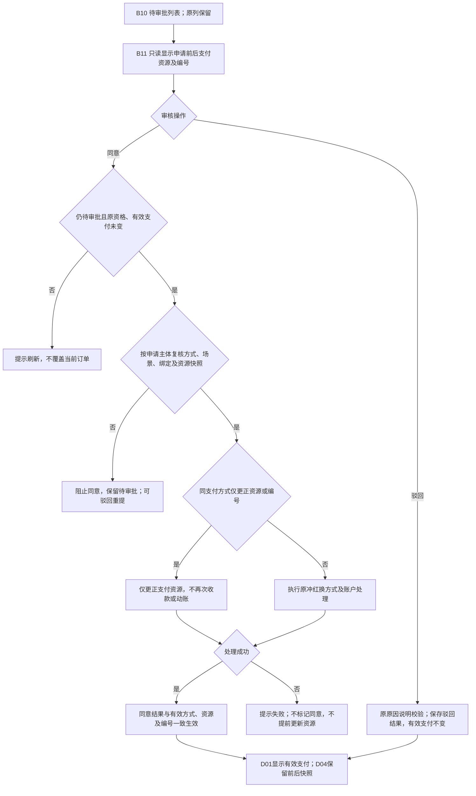

图下处理规则：

- 同方式更正的列表前后类型可以相同；进入原审核弹窗查看具体资源差异，不增加列表资源列。
- 审核人只能同意/驳回，不能改申请值；资源复核始终使用申请记录的主体，不使用审核人的绑定。
- 名称、编号、归属或绑定等配置变化时，不静默替换资源；驳回不受失效资源阻拦。
- 新方式无需资源时，生效支付清除柜台/POS关联；原值保留在历史。失败、重复审核不能造成半完成或重复账务处理。

## 十一、冲红记录与订单支付：多次调整及历史

打开原型：[W15冲红记录 / 窗口订单详情 ↗](prototype/window/index.html?view=reversal) · [D04后台已审批详情 ↗](prototype/admin/index.html?page=reversal)

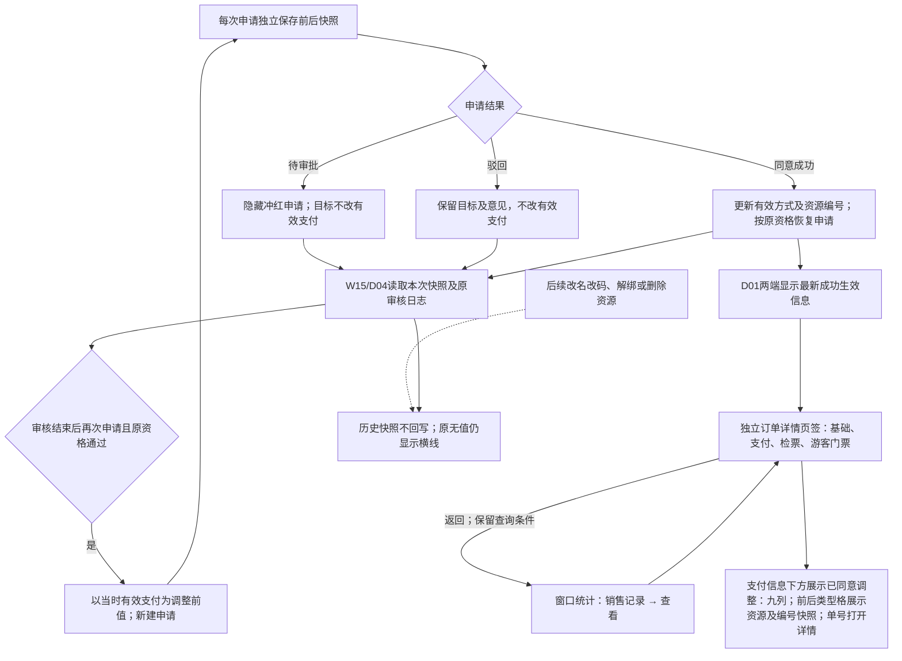

图下处理规则：订单支付显示最新有效结果，冲红详情显示每次申请自己的前后值；二者不混用。再次冲红不覆盖上一笔记录；历史未记录资源或编号时显示“—”，更正只改变本次生效值。

## 十二、内导开单后结账、补收及逐笔记录

页面及字段规则：[内导结账补充方案](07-内导结账补充方案.md)。打开原型：[结账补收确认 ↗](prototype/window/index.html?view=innerSupplement)。

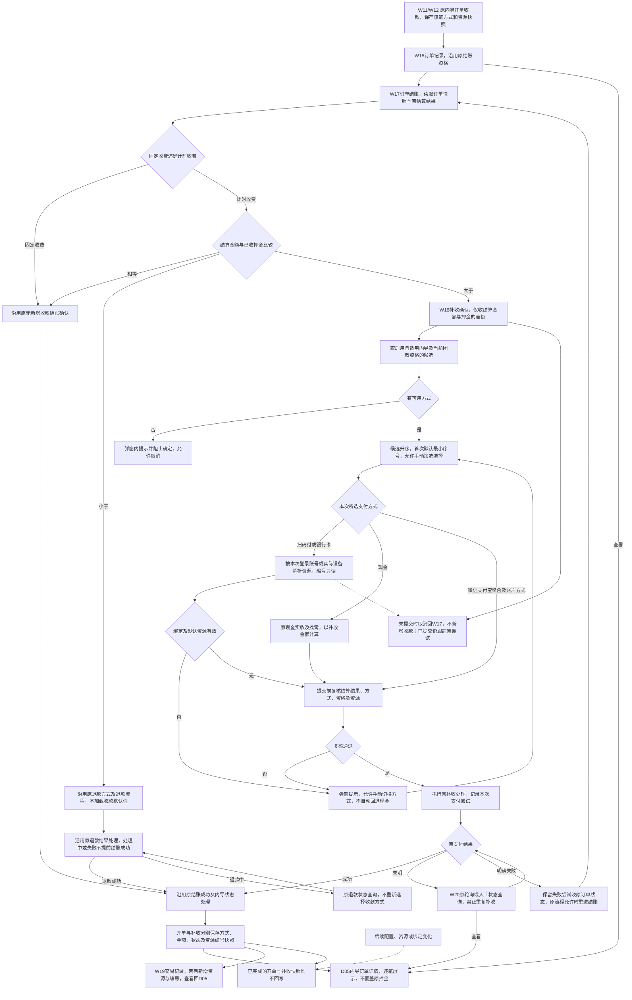

图下处理规则：首次押金与结账补收是不同交易。补收独立加载当前可用方式和资源；已提交交易查询沿用原尝试。无差额、固定收费结账和退款不增加收款选择。计费、扣款、结账和退款仍调用原处理；本期只增加配置取用及每笔资源记录展示。
