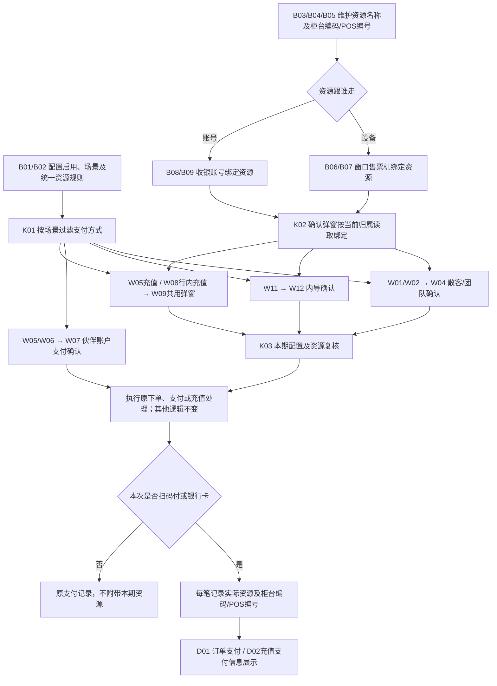
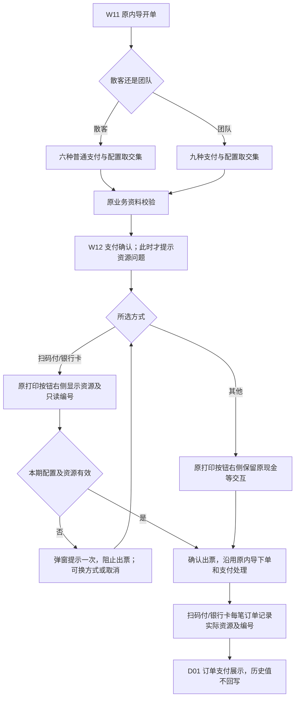
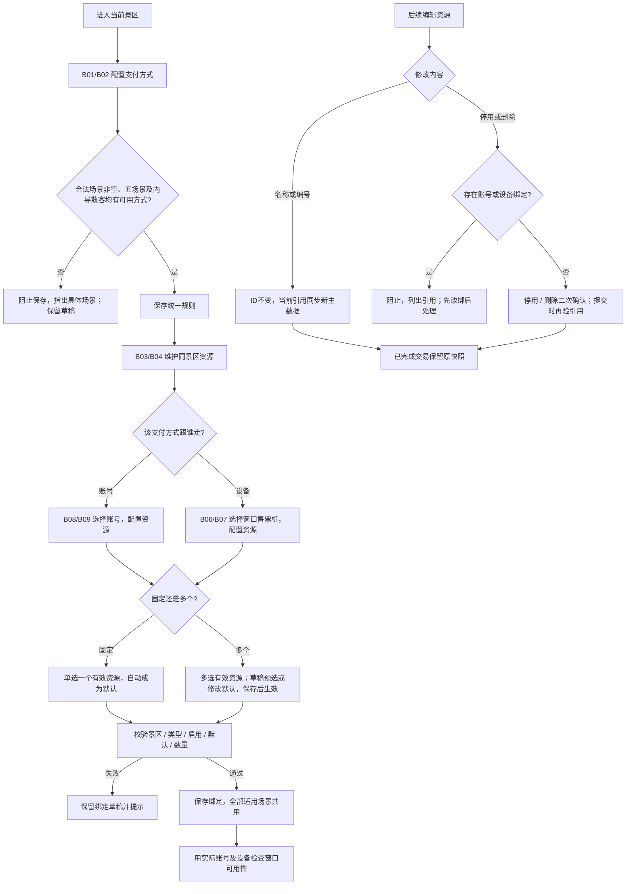
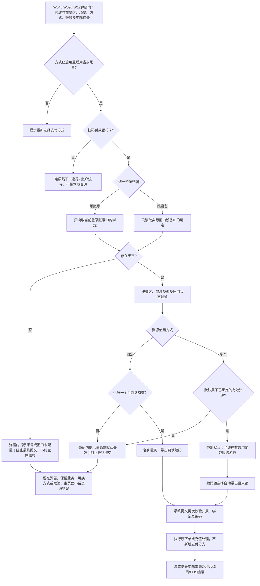
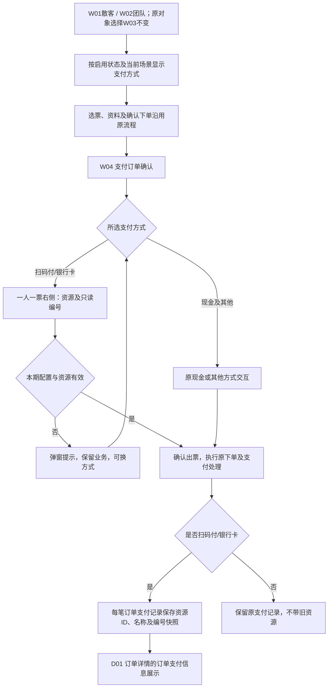
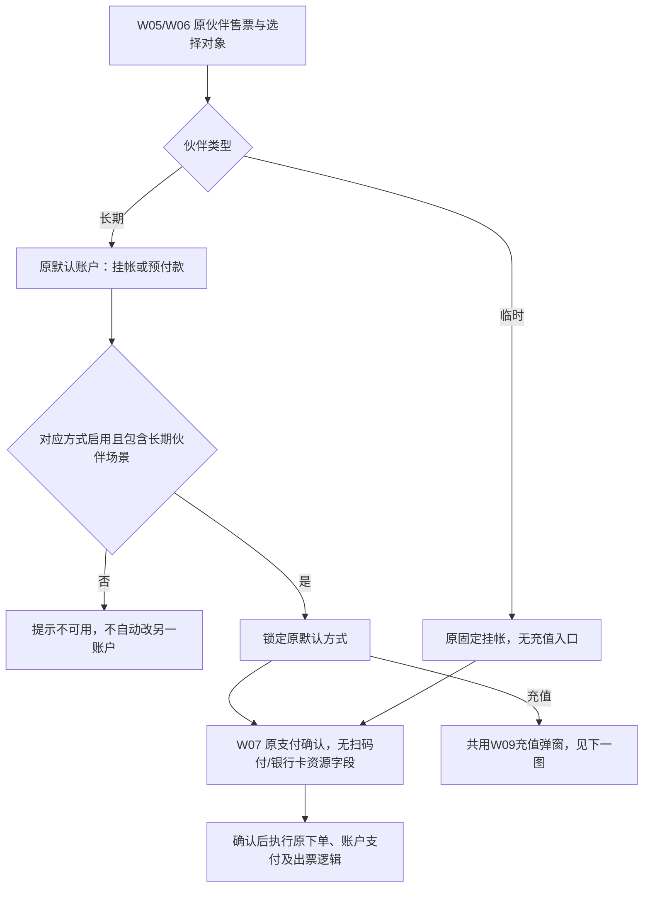
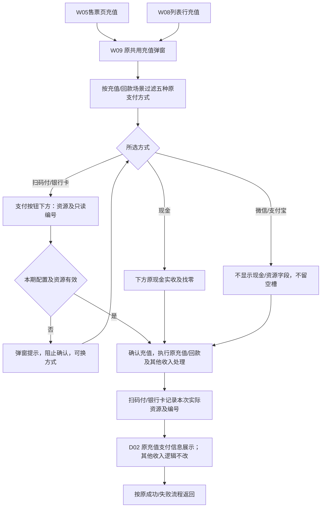
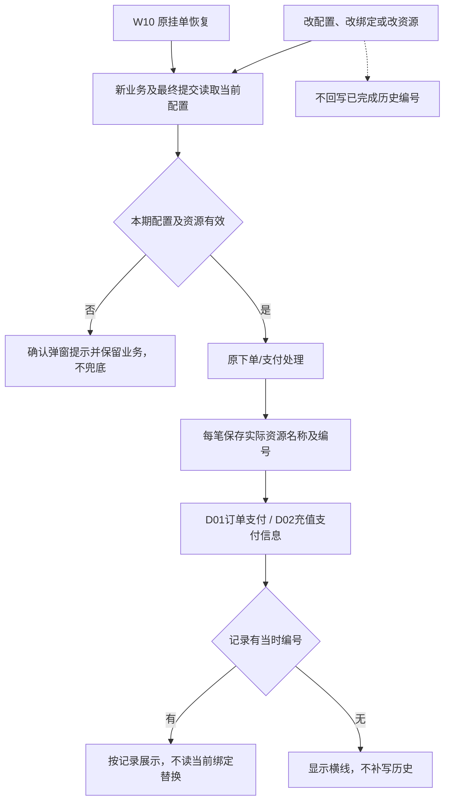

# 支付配置化｜全程流程图

版本：V1.4｜2026-10-19。节点对应[页面清单](01-页面清单.md)。仅展开本次新增/修改；原下单、支付和充值处理用一个节点表示，不重新定义。

## 一、全程总览

## 二、内导售票与支付确认

## 三、管理员配置、绑定与后续变更

归属由账号切为设备不自动复制绑定。多个改固定后旧绑定不合格，须管理员明确重选；窗口不自动取第一项。

## 四、扫码付/银行卡公共资源解析

## 五、散客/团队售票与订单支付记录

## 六、长期合作伙伴与临时客户售票

## 七、两个充值入口共用资源与编号

## 八、配置变化、挂单恢复与历史展示

