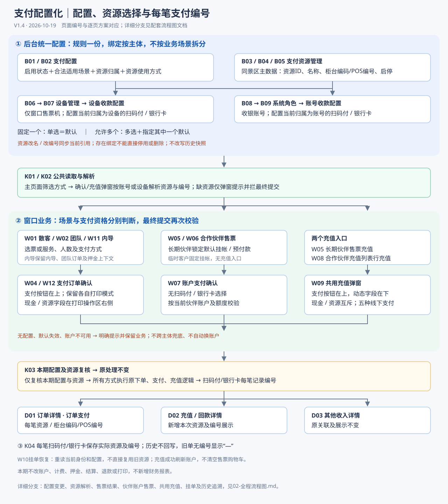
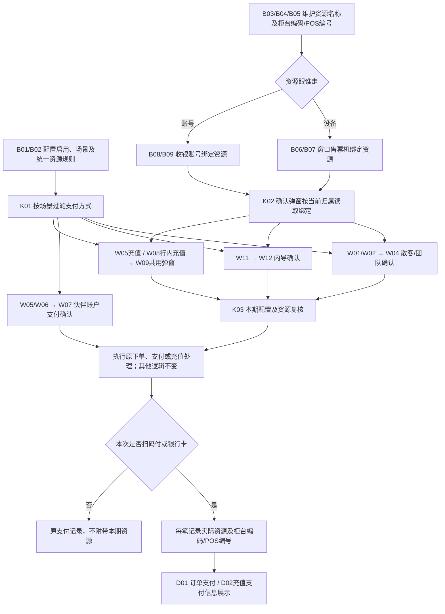
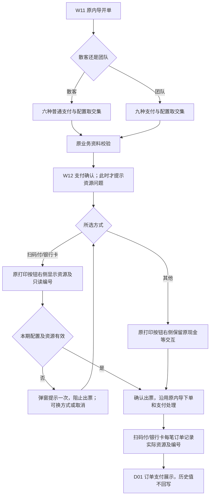
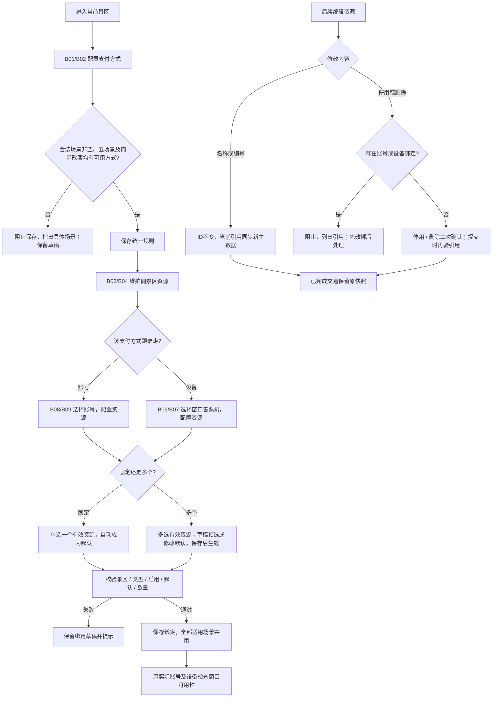
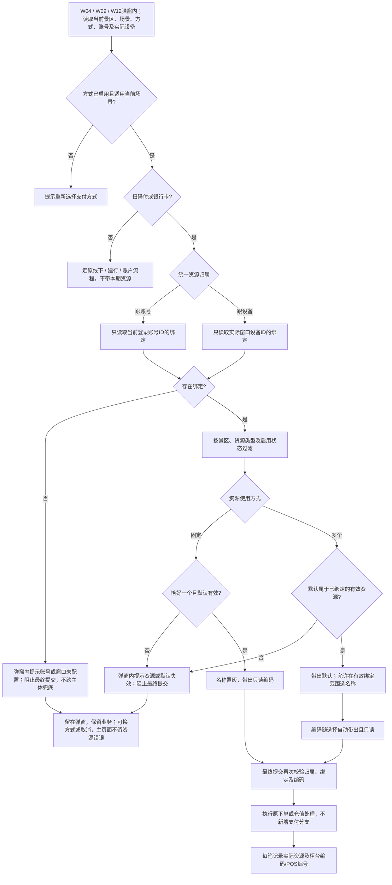
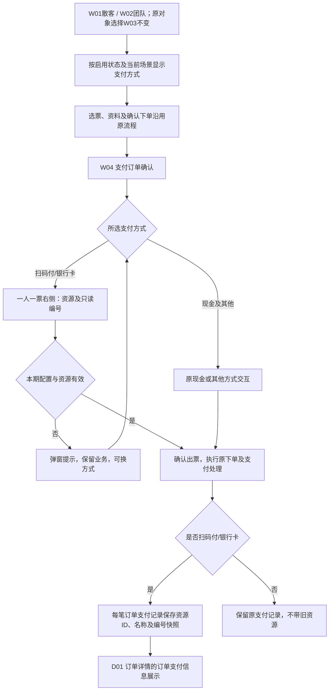
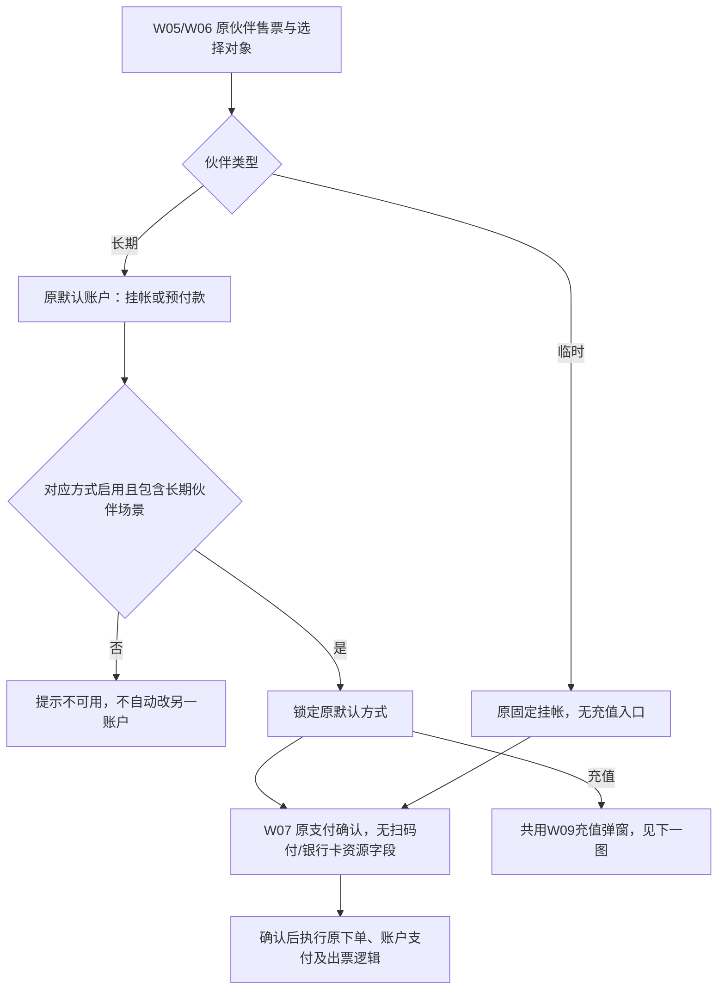
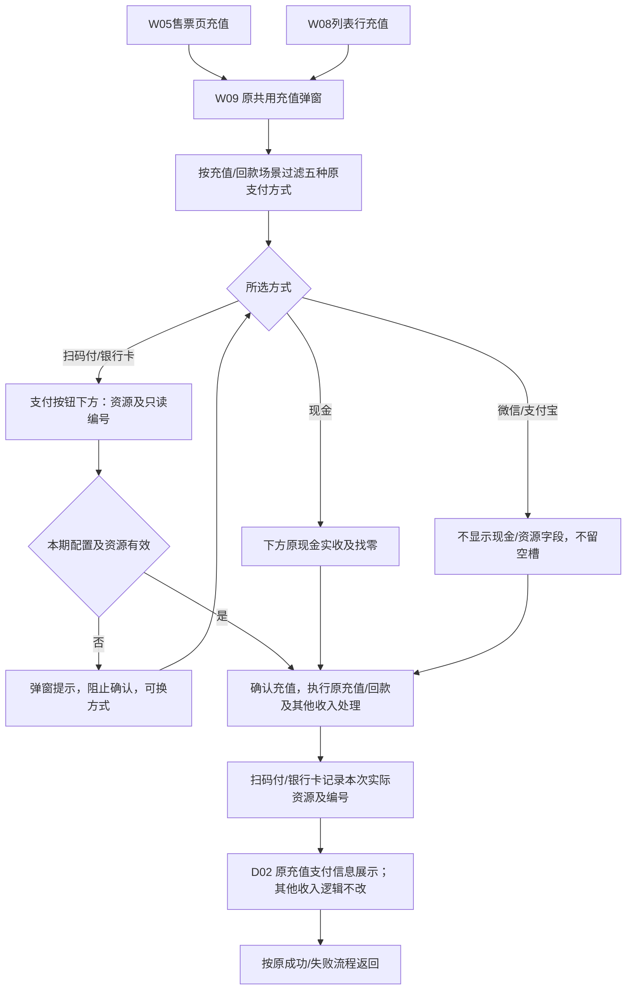
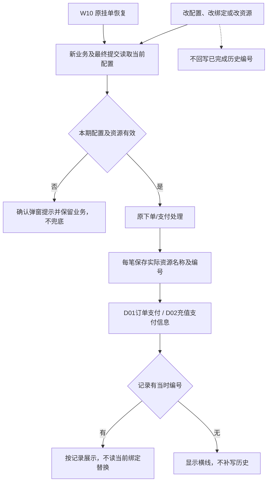

# 支付配置化功能方案

功能版本：V3.6｜方案修订：V1.4｜2026-10-19。

配套：[页面清单](01-页面清单.md) · [全程流程图](02-全程流程图.md) · [开发与验收](04-开发核对与验收清单.md)。

## 1. 本次修改范围

本次只修改三部分：

1. 后台统一配置支付方式的启用状态、适用场景，以及扫码付/银行卡的资源规则和账号/设备绑定。
2. 窗口按配置显示支付方式；扫码付/银行卡在确认弹窗中带出收款资源和柜台编码/POS编号。
3. **每笔扫码付、银行卡订单新增记录实际使用的资源及柜台编码/POS编号，并在订单的“订单支付”信息中展示。** 合作伙伴充值/回款同样保存并展示本次使用的资源及编号。

**所有支付方式确认后的下单、收款、账户处理、出票等均沿用原逻辑。本次不改支付接口、订单状态、扣款、计费、押金、结算、退款或打印逻辑。**

## 2. 公共规则

### 2.1 统一配置与场景

一种支付方式只维护一份资源归属和使用方式，所有适用场景共用。扫码付、银行卡可分别选择不同归属。

场景为：散客售票、团队售票、长期合作伙伴、合作伙伴充值/回款、内导售票。内导散客/团队属于同一场景的业务子类型，不拆绑定。

资源及绑定按当前景区管理；账号取当前登录账号，设备取实际窗口设备，不用账号档案的绑定窗口代替实际设备。

### 2.2 支付方式白名单

“可选”表示后台可勾选，窗口还需满足“已启用＋包含当前场景”。

| 支付方式 | 散客售票 | 团队售票 | 长期合作伙伴 | 充值/回款 | 内导售票 | 原收款处理 | 本期资源 |
| --- | --- | --- | --- | --- | --- | --- | --- |
| 现金 | 可选 | 可选 | 不允许 | 可选 | 可选 | 线下支付 | 无 |
| 扫码付 | 可选 | 可选 | 不允许 | 可选 | 可选 | 线下支付 | 扫码付柜台 |
| 银行卡 | 可选 | 可选 | 不允许 | 可选 | 可选 | 线下支付 | 银行卡POS |
| 微信 | 可选 | 可选 | 不允许 | 可选 | 可选 | 线下支付 | 无 |
| 支付宝 | 可选 | 可选 | 不允许 | 可选 | 可选 | 线下支付 | 无 |
| 聚合支付 | 可选 | 可选 | 不允许 | 不允许 | 可选 | 线上支付，建行聚合支付 | 沿用原设备关系 |
| 挂帐 | 不允许 | 可选 | 可选 | 不允许 | 仅内导团队 | 账户支付 | 无 |
| 预付款 | 不允许 | 可选 | 可选 | 不允许 | 仅内导团队 | 账户支付 | 无 |
| 授信签单 | 不允许 | 可选 | 不允许 | 不允许 | 仅内导团队 | 账户支付 | 无 |

团队允许全部九种；内导散客六种，内导团队九种。长期伙伴仍按原默认账户锁定挂帐或预付款；临时伙伴固定挂帐，不作为可配置场景。

### 2.3 启用及提交条件

- 适用场景至少选一个；每个正式场景至少保留一种已启用方式。内导散客须至少保留一种普通支付，不能仅剩账户支付。
- 停用或取消场景导致无可用方式时阻止保存，指出具体场景。
- 支付方式可显示，不代表资源已就绪。缺资源不拦主页面“确认下单”；在支付确认弹窗内提示，阻止该方式最终提交，可换其他可用方式。
- 所有原业务校验不变。

### 2.4 资源与统一编号

| 字段 | 本期规则 |
| --- | --- |
| 资源ID | 稳定关联账号/设备绑定及订单，不按名称关联 |
| 资源类型 | 扫码付柜台 / 银行卡POS；编辑不可改 |
| 资源名称 | 必填，同景区不可重名；绑定下拉显示此名称 |
| 柜台编码/POS编号 | 同一个字段；必填文本，保留前导零 |
| 启用状态 | 控制资源可用性，与支付方式启用状态分别管理 |

### 2.5 资源归属与使用方式

| 配置 | 规则 |
| --- | --- |
| 跟收银账号 | 只取当前登录账号绑定；换设备不改变账号资源 |
| 跟窗口设备 | 只取实际窗口设备绑定；换账号不改变设备资源 |
| 固定使用一个 | 绑定一个，该资源即默认；窗口灰显不可切换 |
| 允许多个并默认一个 | 至少绑定一个，指定其中一个默认；窗口允许在有效绑定中切换 |

不跨账号/设备兜底，不自动取第一项。切换归属保留另一方绑定，不自动复制；多资源改固定后，不符合新规则的绑定须重新配置。

### 2.6 编辑、停用、删除与历史

- 改资源名称/编号后，当前绑定及新订单同步读取新值。
- 已有账号或设备绑定的资源不能停用或删除，提示引用主体；须先改绑。
- 无绑定资源可停用或删除，删除二次确认，提交时复核引用。
- 每笔订单保存当时实际使用的资源及编号；后续改名、改码、解绑或删除不回写历史。旧记录无编号显示“—”。
- 最终提交时复核当前配置和有效绑定，失败保留业务内容。

## 3. B01｜支付配置列表

[打开原型：支付配置](prototype/admin/index.html?page=payment)

### 3.1 入口与结构

配置中心 → 支付配置。统一展示全部九种支付方式，不按散客、团队拆标签，不设支付查询、配置状态或当前景区副标题。

| 列 | 显示与来源 |
| --- | --- |
| 支付方式 | 现有字典名称，不提供新增、删除、改名或改编码 |
| 启用状态 | 当前支付方式开关，启用蓝色、停用灰色 |
| 适用场景 | 当前已选场景标签，允许换行 |
| 收款处理 | 线下支付 / 线上支付 / 账户支付 |
| 对接方式 | 按3.3逐项固定对应，不提供任意选择 |
| 资源归属 | 扫码付/银行卡显示配置；聚合支付显示现有设备关系；其他“—” |
| 资源使用方式 | 仅扫码付/银行卡显示固定或多资源规则 |
| 操作 | 所有方式均保留“配置” |

### 3.2 操作与状态

- 点开关直接提交启停；请求中禁重复点，成功更新，失败保持原值并提示。
- 停用前按变更后的全量配置检查五个正式场景；内导还须保证散客子类型至少一种普通方式，不能仅剩账户支付。任一场景变成0种，阻止并指出场景，如“无法停用：内导售票（散客）将无可用支付方式”。服务端同样执行，不依赖前端开关回滚。
- 点配置进入B02，不改变当前配置；保存成功刷新该行；取消不改动。
- 加载失败显示失败和重试，不能用“默认全部启用”冒充已保存数据。空配置提示初始化异常，管理员修复，不让窗口静默放行。

### 3.3 九种支付方式逐项设定

列表“适用场景”展示已保存标签；点击“配置”后才以下拉多选修改，并非在列表直接展开。**允许出现哪些选项是系统设定；实际勾选哪些由管理员配置。** 未允许的场景不出现在下拉中，不是置灰后仍可选。

| 支付方式 | 场景下拉选项（数量及完整范围） | 收款处理（固定只读） | 列表对接方式（固定说明） |
| --- | --- | --- | --- |
| 现金 | 4项：散客售票、团队售票、合作伙伴充值/回款、内导售票 | 线下支付 | — |
| 扫码付 | 4项：散客售票、团队售票、合作伙伴充值/回款、内导售票 | 线下支付 | — |
| 银行卡 | 4项：散客售票、团队售票、合作伙伴充值/回款、内导售票 | 线下支付 | — |
| 微信 | 4项：散客售票、团队售票、合作伙伴充值/回款、内导售票 | 线下支付 | — |
| 支付宝 | 4项：散客售票、团队售票、合作伙伴充值/回款、内导售票 | 线下支付 | — |
| 聚合支付 | 3项：散客售票、团队售票、内导售票 | 线上支付 | 建行聚合支付 |
| 挂帐 | 3项：团队售票、长期合作伙伴、内导售票 | 账户支付 | 对应业务账户 |
| 预付款 | 3项：团队售票、长期合作伙伴、内导售票 | 账户支付 | 对应业务账户 |
| 授信签单 | 2项：团队售票、内导售票 | 账户支付 | 团队账户 |

“内导售票”下拉只列一项；挂帐、预付款、签单即使勾选内导，也只在内导团队可用。对应业务账户按原业务对象取团队或伙伴账户，不是管理员在此选择账户。

| 支付方式 | 资源归属列 | 资源使用方式列 | 管理员可修改范围 |
| --- | --- | --- | --- |
| 扫码付 | 跟窗口设备 / 跟收银账号，显示已保存值 | 固定使用一个 / 允许多个并默认一个，显示已保存值 | 启停、合法场景、资源归属、资源使用方式 |
| 银行卡 | 同上，独立于扫码付保存 | 同上，独立于扫码付保存 | 启停、合法场景、资源归属、资源使用方式 |
| 聚合支付 | 固定“现有聚合支付设备关系” | — | 仅启停、合法场景；不改原设备关系 |
| 现金、微信、支付宝、挂帐、预付款、授信签单 | — | — | 仅启停、合法场景 |

收款处理、对接方式均是支付方式对应的固定值，不属于“默认选中但允许更换”的配置。所有方式保留配置入口。

## 4. B02｜配置支付方式弹窗

[打开原型：支付配置 → 配置](prototype/admin/index.html?page=payment)

### 4.1 公共字段

| 字段 | 控件 | 默认 / 校验 |
| --- | --- | --- |
| 支付方式 | 灰色只读 | 当前方式名称；不允许改字典 |
| 启用状态 | 启用/停用单选 | 回显当前值 |
| 适用场景 | 下拉多选，标签回显 | 回显当前选择，至少一个；只列2.2允许的场景 |
| 收款处理 | 灰色只读控件 | 当前固定类型，所有方式均不可修改 |
| 对接方式 | 仅聚合支付显示，灰色只读 | 固定建行聚合支付；其他方式隐藏此字段，不出现空行 |
| 资源归属 | 两项单选 | 仅扫码付/银行卡出现，必选 |
| 资源使用方式 | 两项单选 | 仅扫码付/银行卡出现，必选 |

仅资源归属选项切换简短说明，固定值不出现可修改入口。保存/取消统一见4.4。

### 4.2 每种支付方式的弹窗差异

所有弹窗都有：支付方式（只读）、启用状态（可选）、适用场景（按3.3范围多选）、收款处理（固定只读，不可修改）。以下只列差异，隐藏字段不占空行，也不参与必填校验。

| 打开哪种方式 | 收款处理回显 | 对接方式字段 | 资源归属字段 | 资源使用方式字段 |
| --- | --- | --- | --- | --- |
| 现金 | 线下支付，只读 | 隐藏 | 隐藏 | 隐藏 |
| 扫码付 | 线下支付，只读 | 隐藏 | 显示：跟窗口设备 / 跟收银账号，二选一 | 显示：固定使用一个 / 允许多个并默认一个，二选一 |
| 银行卡 | 线下支付，只读 | 隐藏 | 与扫码付相同，但读取、保存银行卡自己的值 | 与扫码付相同，但读取、保存银行卡自己的值 |
| 微信 | 线下支付，只读 | 隐藏 | 隐藏 | 隐藏 |
| 支付宝 | 线下支付，只读 | 隐藏 | 隐藏 | 隐藏 |
| 聚合支付 | 线上支付，只读 | 显示：建行聚合支付，只读 | 隐藏；不在此修改原聚合设备关系 | 隐藏 |
| 挂帐 | 账户支付，只读 | 隐藏；列表固定显示“对应业务账户” | 隐藏 | 隐藏 |
| 预付款 | 账户支付，只读 | 隐藏；列表固定显示“对应业务账户” | 隐藏 | 隐藏 |
| 授信签单 | 账户支付，只读 | 隐藏；列表固定显示“团队账户” | 隐藏 | 隐藏 |

这里的“资源使用方式”只配置规则；具体选哪几个资源、哪一个默认，仍到B07/B09账号或设备收款配置中维护，本弹窗不增加资源选择下拉。

### 4.3 固定值、当前值与首次样例分开

- 已有配置：每次打开均回显该支付方式已保存的启用状态、场景、资源归属和使用方式；不重置为样例值。截图中银行卡“跟收银账号＋允许多个”就是当前配置，不是银行卡固定规则。
- 场景下拉：勾选已保存场景，未勾选的合法场景仍可选；固定白名单不随勾选变化。取消/关闭后重开，恢复保存前的值。
- 收款处理和对接方式：始终按3.3映射，不跟着场景、启停或资源归属改变；不得切换线下/系统/账户支付。
- 未保存过配置的原型样例：九种方式均启用，各自合法场景全部勾选；扫码付为“跟窗口设备＋允许多个并默认一个”，银行卡为“跟窗口设备＋固定使用一个”。这两种方式都允许管理员改选，不是固定限制。
- 上述首次值仅描述现有原型样例，不作为生产初始化决定。已有景区保留原配置；新景区初始启停、勾选及资源规则需确认后初始化，不能从截图或测试数据推定为生产默认。

### 4.4 配置、保存及取消

1. 打开当前方式，创建草稿，按4.2显示字段并回显已保存值；修改草稿不立即改变列表或窗口。
2. 场景多选至少保留一项，停用时也不能清空；只能提交3.3的合法选项。
3. 仅扫码付/银行卡校验资源归属、使用方式已选择；其他方式不校验隐藏项，不允许提交篡改的固定收款处理或对接方式。
4. 用修改后的全量配置检查各场景至少一种；内导散客须仍有普通支付。失败留在弹窗并指出具体场景，原配置不变。
5. 成功只更新当前支付方式的可编辑配置，列表同步显示；不改其他方式、不复制或清空账号/设备资源绑定。切换资源规则后的绑定处理按2.5执行。
6. 取消、关闭不保存；保存失败保留草稿供修正或重试。支付确认以后的处理仍完全沿用原逻辑。

## 5. B03｜支付资源管理列表

[打开原型：支付资源管理](prototype/admin/index.html?page=paymentResources)

入口：配置中心 → 支付资源管理。管理资源主数据，不在此绑定账号或设备。

筛选沿用原型已有资源名称、资源类型条件，查询及重置只改变列表条件，不改变资源；启用状态在表格开关中维护，不另加筛选。当前景区通过上下文隔离，不再加选择景区字段。

| 列 / 按钮 | 规则 |
| --- | --- |
| 资源名称 | 当前名称 |
| 资源类型 | 扫码付柜台 / 银行卡POS |
| 柜台编码/POS编号 | 一个列，显示该资源编码 |
| 启用状态 | 与B01同款开关，控制该资源 |
| 操作 | 编辑、删除，沿用现有文字操作样式 |
| 新增支付资源 | 位于表格上方右侧，打开B04新增态 |

停用时检查全部账号与设备绑定，包括当前资源归属暂未启用的一方保留的绑定。有引用则阻止，显示引用账号/设备；启用不恢复任何已经取消的绑定。不能因为资源所在支付方式被停用，就允许绕过引用检查。

删除进入B05。空列表显示暂无支付资源；后续绑定下拉同样为空，不再生成虚构的柜台/POS。加载失败不当作空列表允许覆盖保存。

## 6. B04｜新增/编辑支付资源

[打开原型：资源列表 → 新增 / 编辑](prototype/admin/index.html?page=paymentResources)

| 字段 | 新增态 | 编辑态 | 校验 |
| --- | --- | --- | --- |
| 资源类型 | 下拉必选，默认扫码付柜台；可选扫码付柜台、银行卡POS | 灰色不可改 | 只能为两种类型 |
| 资源名称 | 初始空白，必填文本 | 回显保存名称，可改 | 去前后空格；同景区重名拦截，排除自身 |
| 柜台编码/POS编号 | 初始空白，必填文本 | 回显保存编号，可改 | 不得为空；扫码付提示“请输入扫码付柜台编码”，银行卡提示“请输入银行卡POS编号”；不作数值转换 |
| 启用状态 | 默认启用 | 回显 | 启用/停用；已绑定不能改停用 |

保存后保持资源ID不变，所有当前绑定按ID读取新名称与编号。新建未绑定的资源只进入资源库，不自动分配给账号/设备。取消不生成或修改记录。

编号按文本保存，去前后空格、保留前导零；长度、字符范围及唯一性由开发对接现有字段约束，不因合并名称改变原编码含义。

## 7. B05｜删除资源确认

[打开原型：资源列表 → 删除](prototype/admin/index.html?page=paymentResources)

1. 点删除先查引用；存在引用直接拦截并指出主体，不打开可确认删除状态。
2. 无引用打开“确认删除‘{资源名称}’？”；取消不处理。
3. 点确定服务端再次查引用，防止弹窗打开后被他人绑定；若新增引用则失败，保留资源。
4. 成功后从可配置资源库移除，绑定下拉同步刷新。已完成订单、充值及其他收入历史不删除、不改名。

有历史交易、无当前绑定不等于可以物理清空交易外键；使用逻辑删除或等效保留机制，历史展示以快照为准。

## 8. B06｜设备管理列表

[打开原型：设备管理](prototype/admin/index.html?page=device)

入口：基础信息 → 设备管理。完整复用现有筛选、列、分页、列配置、查看/编辑/删除、批量启停和导出，不重做简化列表。

筛选保留所属景点/站点/通道、设备名称、设备类型、设备ID、设备状态、启用状态；新增“支付资源”单选下拉，默认全部，选项为当前景区所有已启用的扫码付柜台及银行卡POS资源。按资源ID查询已绑定该资源的设备（含非默认绑定），与其他条件取交集；重置恢复全部。资源新增、改名、启停后同步更新选项。控件样式和位置沿用现网，支付资源放在第二行第四格。新增、启用、禁用、导出及配置列在现有右侧操作区。

表格保留勾选、设备名称、所属景点、所属站点、所属通道、设备IP、设备类型、设备状态及现有其他可配置列。宽表在表格内部横向滚动；操作列固定右侧、独立白底与边界阴影，不覆盖状态文字。侧栏折叠、页签图标和关闭效果沿用线上基座。

| 设备类型 | 收款配置 | 默认通道 |
| --- | --- | --- |
| 窗口售票机 | 显示，查看 → 编辑 → 收款配置 → 删除 | 不显示 |
| 手机 | 不显示 | 未设默认时蓝色“设定默认通道”；已设默认显示灰色“默认通道”标签，非按钮 |
| 其他 | 不显示 | 不显示 |

删除文字不单独改红。设备状态/启用状态继续沿用现有含义，不把资源配置当成设备启用条件。设备删除或变更类型的关联处理应复用现有设备约束，并清理/失效其当前绑定引用，不能留下可被运行时命中的孤立设备绑定；历史交易不变。

## 9. B07｜设备收款配置

[打开原型：设备管理 → 收款配置](prototype/admin/index.html?page=device)

入口：窗口售票机行 → 收款配置。标题“设备收款配置”。

| 区域 | 字段 | 规则 |
| --- | --- | --- |
| 身份 | 设备名称、IP/设备ID | 灰色只读，当前设备 |
| 扫码付 | 资源使用方式 | 只读继承B02；仅当前扫码付归属为设备时显示此区 |
| 扫码付 | 绑定资源 / 可用资源 | 固定时单选，多资源时下拉多选；只取当前景区启用扫码付资源 |
| 扫码付 | 默认资源 | 仅多资源出现，单选且必须在已选中 |
| 银行卡 | 资源使用方式 | 只读继承B02；仅当前银行卡归属为设备时显示此区 |
| 银行卡 | 绑定POS / 可用POS | 固定时单选，多资源时下拉多选；只取当前景区启用POS资源 |
| 银行卡 | 默认资源 | 仅多资源出现，单选且必须在已选中 |

不按散客、团队、充值或内导拆标签。没有任何设备归属方式时展示“当前无跟窗口设备的收款配置项”，不要求填隐藏字段。支付方式暂时停用不清空已保存绑定。

| 打开或修改时 | 取值与默认规则 |
| --- | --- |
| 已有绑定 | 按当前设备回显所选资源及默认，不读其他设备/账号的绑定 |
| 未配置绑定 | 所选为空；多资源的默认也为空，不自动绑定资源库首项 |
| 固定一个 | 单选当前已绑定资源；没有独立默认下拉，保存时唯一选择即默认 |
| 允许多个 | 可用资源多选；默认下拉仅列当前已选资源名称 |
| 多资源默认仍在已选中 | 保留原默认 |
| 多资源首次选择或移除原默认 | 按原型，草稿预选当前已选首项作为默认；管理员可修改，保存后才生效；已选清空则默认清空 |
| 取消/关闭 | 丢弃草稿，原绑定及默认不变 |

编辑草稿预选不等于售票时兜底；窗口遇失效默认仍报错，不自行取第一项。

保存逐区校验：至少选一个 → 固定恰好一个/多资源默认在范围内 → 类型与景区匹配 → 全部仍启用有效 → 原子保存该设备绑定。固定时直接把唯一选择写成默认，不再重复选默认。

资源列表为空时显示“暂无可用资源，请先维护支付资源”，提供路径提示，不允许自由手填编码。其他隐藏归属的已有绑定保持不变，不因本次保存误清空。

## 10. B08｜系统角色列表

[打开原型：系统角色](prototype/admin/index.html?page=systemRole)

入口：员工管理 → 系统角色。这里维护现有收银账号，不新建RBAC角色页。

- 保留账号查询，新增支付资源单选下拉：默认全部，读取当前景区全部已启用的扫码付柜台及银行卡POS资源；按账号已绑定资源ID匹配（含非默认资源），与账号条件取交集。新增、改名及启停后更新选项；重置清空条件、恢复全部。
- 新增、绑定日志均为蓝色主按钮，与配置列依次放在表格上方右侧；不增加重复页面标题。查询、重置及分页保留。
- 列保留账号、手机号、注册日期、用户名、绑定窗口、状态、操作。
- 原有编辑、删除、绑定窗口、解绑等动作按现有权限及顺序保留，增加收款配置。操作列按内容合理宽度靠右固定，不留大段空白，也不能把状态列盖住。
- 账号绑定窗口与账号收款配置是两种关系：换绑窗口不迁移账号资源；解绑也不把账号资源自动交给设备。
- 账号停用/删除由现有登录和权限控制拦截；删除后的绑定不再供新交易使用，历史收银人快照保留。不能以改用户名破坏资源引用。

## 11. B09｜账号收款配置

[打开原型：系统角色 → 收款配置](prototype/admin/index.html?page=systemRole)

入口：账号行 → 收款配置。标题“账号收款配置”。灰色展示“账号/用户名”“绑定窗口”，未绑定展示“未绑定”。

资源字段、控件、默认、保存及取消规则与B07相同，区别仅为归属主体：仅显示B02当前配置为“跟收银账号”的扫码付/银行卡区，按账号稳定ID保存。无对应项显示空态，不把设备绑定复制过来。

只读信息取所点账号行：账号/用户名、原绑定窗口；无窗口显示“未绑定”。所选资源和默认读取该账号自己的绑定，不从绑定窗口推导。

一个账号只有一套扫码付和银行卡绑定，跨其可用业务场景共用。账号是否可售团队/散客由既有权限控制，不因资源配置创建第二个业务账号或拆场景绑定。

## 12. W01｜散客售票工作台

[打开原型：散客票](prototype/window/index.html)

原页面及下单操作不变；支付方式按散客场景配置过滤。

主页面不显示资源、编号或资源错误；业务资料通过原校验后打开W04。

- 进入或刷新时，读取散客场景的启用方式；主页面下拉与确认弹窗共用当前选择。
- 仅切换支付方式不改变已选票、数量、游客和金额。
- 当前方式被停用或取消场景时，提示重新选择；无可用方式时明确提示，不自动放行。
- 缺账号/设备资源不在此处报错，进入W04后处理；原实名等业务校验不改。

## 13. W02、W03｜团队售票及选择对象

[打开原型：团队票](prototype/window/index.html?view=team) · [打开原型：团队票 → 旅行社 / 导游选择](prototype/window/index.html?view=team)

旅行社、导游、选票及账户逻辑沿用原功能。团队九种支付方式按启用状态及团队场景过滤，挂帐允许配置使用。

主页面不显示资源/编号，确认下单进入W04；原选择弹窗不新增业务逻辑。

- 支付顺序沿用现有团队窗口：现金、扫码付、银行卡、挂帐、微信、支付宝、预付款、授信签单、聚合支付，再按配置过滤。
- 团队账户方式仍取所选旅行社原账户，不因本期配置改变账户来源。
- 切换场景后不将团队账户支付残留到散客；团队原对象选择和资料保留规则不变。
- 扫码付/银行卡的账号或设备绑定与其他场景共用，不另配团队资源。

## 14. W04｜散客/团队支付订单确认

[打开原型：散客 → 确认下单](prototype/window/index.html) · [团队 → 确认下单](prototype/window/index.html?view=team)

### 14.1 本期界面变化

门票表格、金额、出票模式及确认/取消按钮沿用原页面。

1. 第一行：当前场景可用支付方式按钮。
2. 第二行：一票多人 → 一人一票 → 动态字段 → 取消出票 → 确认出票。

| 支付方式 | 动态字段 |
| --- | --- |
| 现金 | 原现金实收、找零，不改计算 |
| 扫码付 | 新增收款资源、柜台编码/POS编号 |
| 银行卡 | 同上，读取POS资源 |
| 其他方式 | 原交互，不显示本期资源字段 |

动态字段紧接“一人一票”右侧；现金与资源字段互斥，不放上方、不留空白槽。切换方式不重置出票模式。

### 14.2 资源加载与提示

加载顺序：当前支付方式 → 统一资源归属 → 当前账号或实际设备 → 同景区同类型有效绑定 → 唯一/默认资源 → 名称与编号。

| 状态或操作 | 页面处理 |
| --- | --- |
| 固定一个 | 名称、编号均灰显，只读；置灰不代表不可支付 |
| 多资源 | 默认带出指定资源，名称下拉仅列有效已绑定资源，编号只读 |
| 切换资源名称 | 立即带出同一资源的编号，不允许名称与编号错配 |
| 切换扫码付/银行卡 | 重新读取该方式绑定，不保留另一方式的资源或编号 |
| 切换其他方式 | 隐藏资源区，不在本笔支付中携带旧资源 |
| 资源库/绑定为空 | 弹窗提示当前账号或当前窗口未配置，不显示虚构资源，不手填编号 |
| 配置加载失败 | 提示加载失败并可重试，不当作有效默认配置放行 |

资源下拉的候选值为资源ID、显示资源名称；编号取当前所选资源的柜台编码（扫码付）或POS编号（银行卡）。首次选择该支付方式带出已绑定默认资源，再次切回该方式也从其默认资源开始；没有有效默认不自动取第一项。只读编号无值显示“—”。

缺绑定、默认失效、资源失效或编号缺失时，在弹窗资源区域提示一次，禁止该方式最终出票；可改用其他方式。取消后主页面不留资源错误，不清空已选票及游客。

### 14.3 确认后的处理

复核本期支付配置及资源后，**所有方式均执行原下单和支付处理**，不新增交易分支。

扫码付、银行卡在原订单支付记录中一并保存实际资源ID、资源名称及柜台编码/POS编号；每笔订单分别记录，不仅保留当前账号/设备配置。其他支付方式不附带上次选择的资源信息。展示见D01。

- 最终提交复核方式启用、适用场景、归属主体、有效绑定及所选编号；校验失败留在弹窗，保留票、游客和出票模式。
- 弹窗期间资源改名/改码或绑定变更后，刷新当前选择再确认，不用旧编号提交；不自动改另一个资源。
- 新增资源信息随原订单支付记录一并保存，不另建一次支付，不改变原成功/失败处理。

## 15. W05、W06｜合作伙伴售票与选择对象

[打开原型：临时/长期合作伙伴售票](prototype/window/index.html?view=partnerSale) · [打开原型：合作伙伴售票 → 选择对象](prototype/window/index.html?view=partnerSale)

原对象选择、选票及账户业务不变。长期伙伴仅按默认账户显示挂帐或预付款，并检查对应方式已启用且包含长期伙伴场景；不可用时提示，不自动改另一账户。

临时伙伴固定挂帐、无充值入口。售票及确认弹窗不出现扫码付、银行卡或资源字段。

长期伙伴原蓝色钱包“充值”按钮统一打开W09。

## 16. W07｜合作伙伴支付订单确认

[打开原型：合作伙伴售票 → 确认下单](prototype/window/index.html?view=partnerSale)

仅显示对应挂帐或预付款，沿用原确认及支付处理。不新增资源/编号字段，不修改账户处理。

## 17. W08｜合作伙伴充值列表

[打开原型：合作伙伴充值列表](prototype/window/index.html?view=partnerList)

保留现有页面，行内“充值”与W05充值按钮统一调用W09，传入当前伙伴及账户。其他操作不变。

## 18. W09｜共用合作伙伴充值弹窗

[打开原型：售票页 → 充值](prototype/window/index.html?view=partnerSale) · [充值列表 → 行内充值](prototype/window/index.html?view=partnerList)

### 18.1 两入口共用

W05售票页充值、W08列表行充值使用同一弹窗、配置及资源逻辑。

### 18.2 本期界面变化

原伙伴资料、充值金额、其他收入、现金实收/找零、备注及按钮保持原逻辑。

- 支付方式按充值/回款场景过滤，仅现金、扫码付、银行卡、微信、支付宝。
- 支付按钮在上，动态字段在下：现金显示原实收/找零；扫码付/银行卡显示资源及只读编号；微信/支付宝不留空白槽。
- 资源解析、切换及失效提示与W04相同，不出现横向滚动或大段留白。

| 本期字段 | 来源与操作 | 保存要求 |
| --- | --- | --- |
| 支付方式 | 当前启用且包含充值/回款场景的五种方式 | 原字段继续使用 |
| 收款资源 | 当前账号/设备有效绑定；固定灰显，多资源默认带出并允许切换 | 保存本次实际资源ID及名称 |
| 柜台编码/POS编号 | 随资源自动带出，文本、只读 | 保存本次实际编号，不取当前配置重算历史 |

缺资源、默认失效或编号缺失在本弹窗提示，并阻止该方式确认充值；可切换其他可用方式。取消不保存本次选择；两个入口均按同一规则执行。

### 18.3 确认后的处理

确认充值沿用原充值/回款及其他收入处理，仅将扫码付/银行卡实际使用的资源及编号一并记录，展示见D02。

不新定义入账、金额分拆或事务规则；成功/失败、账户刷新、购物车保留均沿用原逻辑。

## 19. W10｜挂单恢复及配置刷新

[打开原型：售票 → 挂单列表](prototype/window/index.html)

原挂单恢复逻辑不变。恢复后及最终提交前，按当前账号、实际设备和当前配置重新校验资源；不能直接用草稿中的旧编号。

原型测试账号/设备切换仅供测试，不加入生产页面。

## 20. D01｜订单详情中的“订单支付”

[打开原型：订单详情](prototype/admin/index.html?page=order)

在现有订单详情的“订单支付”信息中，扫码付、银行卡订单新增：

| 字段 | 保存与展示 |
| --- | --- |
| 收款资源 | 本订单实际使用的资源ID关联及名称快照 |
| 柜台编码/POS编号 | 本订单实际使用的编号快照；扫码付为柜台编码，银行卡为POS编号 |

适用于相关散客、团队及内导订单；窗口与后台读取同一笔订单支付数据，不新增菜单或独立支付订单。

其他方式无本期资源值；旧订单没有编号显示“—”，不按当前绑定补写。支付方式、金额、状态等原字段及处理不变。

- 柜台编码和POS编号是同一展示字段，按支付方式显示本笔实际值，不并排新增两个空列。
- 改资源名称、编号或删除当前资源后，已完成订单仍显示当时值。
- 同一账号/设备连续使用不同资源下单，各订单分别保存自己的值；不能共用一份可变配置代替订单记录。
- 订单已有多条支付记录时，按原记录结构在对应扫码付/银行卡记录上展示，不因本期新增支付拆分方式。

## 21. D02｜充值/回款详情

[打开关联入口：合作伙伴 → 账户充值记录](prototype/window/index.html?view=partnerList)（历史充值详情尚未制作独立原型）

在原支付信息中补充本次扫码付/银行卡的收款资源、柜台编码/POS编号，读取充值时保存的值，不按当前配置重算。

其余字段、金额和状态均沿用原功能。

## 22. D03｜其他收入详情

[打开关联充值入口](prototype/window/index.html?view=partnerList)（其他收入详情沿用原页，未制作独立原型）

不单独改造。沿用原充值业务关联及展示，不新增收入字段、不改记账逻辑。

## 23. 记录范围

本期仅补充扫码付/银行卡实际使用的资源及编号，历史值不回写。不新增财务统计口径、日交款、对账或报表功能。

## 24. 实施边界

配置、绑定及编号记录复用现有权限和业务接口；现有景区上线前补齐所需资源和绑定，历史订单不补造编号。

本文为开发要求，原型使用模拟数据，不代表真实交易已联调。原下单和支付逻辑不在本次重做。

## 25. W11、W12｜内导售票与支付确认

[打开原型：内导 → 导游开单](prototype/window/index.html?view=innerGuide) · [打开原型：内导 → 确认下单](prototype/window/index.html?view=innerGuide)

### 25.1 主页面

内导 → 导游开单。原散客/团队、项目、内导、人数及业务操作不变；支付方式读取内导售票场景，散客六种、团队九种，再按配置过滤。

不显示资源/编号。原资料校验通过即可打开W12，不因缺资源在主页面拦截。

### 25.2 确认弹窗

保留原表格、金额及打印选项。第一行支付方式，下一行：原打印按钮 → 现金或资源/编号 → 取消出票/确认出票。

现金显示原实收/找零；扫码付/银行卡显示资源及只读编号，解析和提示同W04。缺资源仅弹窗内提示一次；取消不在主页面留错。

沿用线上样式：常规900×452px、顶部100px，表格约75%/25%，浅蓝表头、白色合计、红色金额、44px按钮。底部支付区铺满；散客内导打印保留角标按钮，非复选框；低高度适配，无横向溢出。

### 25.3 确认后的处理

所有方式沿用原内导下单和支付逻辑。仅扫码付/银行卡订单新增记录实际资源及柜台编码/POS编号，在D01“订单支付”中展示，不改原收费、押金、结算、账户或打印。

原型固定收费表头单位仍待恢复为原计费单位，属于还原问题，不是新增计费需求。

---

# 支付配置化｜页面清单

版本：V1.4｜2026-10-19。编号与[全程流程图](02-全程流程图.md)、[逐页方案](03-逐页功能方案.md)一致。

## 一、后台页面

| 编号 | 菜单路径 / 入口 | 页面或弹窗 | 类型 | 本期内容 |
| --- | --- | --- | --- | --- |
| [B01 ↗](prototype/admin/index.html?page=payment) | 配置中心 → 支付配置 | 支付配置列表 | 新增 | 全部支付方式统一列表、启用状态开关、适用场景、处理及资源规则 |
| [B02 ↗](prototype/admin/index.html?page=payment) | B01 → 配置 | 配置支付方式 | 新增弹窗 | 启停、适用场景多选；扫码付/银行卡统一资源归属与使用方式 |
| [B03 ↗](prototype/admin/index.html?page=paymentResources) | 配置中心 → 支付资源管理 | 支付资源列表 | 新增 | 当前景区的资源主数据、统一编码列、启停与编辑删除 |
| [B04 ↗](prototype/admin/index.html?page=paymentResources) | B03 → 新增 / 编辑 | 新增 / 编辑支付资源 | 新增共用弹窗 | 类型、名称、柜台编码/POS编号、启用状态 |
| [B05 ↗](prototype/admin/index.html?page=paymentResources) | B03 → 删除 | 删除确认 | 新增确认状态 | 已绑定拦截；未绑定二次确认，历史快照不受影响 |
| [B06 ↗](prototype/admin/index.html?page=device) | 基础信息 → 设备管理 | 设备管理列表 | 修改现有页 | 完整保留现网，仅窗口售票机增加收款配置 |
| [B07 ↗](prototype/admin/index.html?page=device) | B06 → 收款配置 | 设备收款配置 | 新增弹窗 | 当前归属为设备的支付方式，一套绑定跨场景共用 |
| [B08 ↗](prototype/admin/index.html?page=systemRole) | 员工管理 → 系统角色 | 系统角色列表 | 修改现有页 | 完整保留现网账号管理，增加收款配置 |
| [B09 ↗](prototype/admin/index.html?page=systemRole) | B08 → 收款配置 | 账号收款配置 | 新增弹窗 | 当前归属为账号的支付方式，一套绑定跨场景共用 |

配置中心只保留已有内容的菜单；支付配置、支付资源管理为两个并列菜单，不再增加场景菜单或页内双层切换。

## 二、售票窗口页面

| 编号 | 菜单路径 / 入口 | 页面或弹窗 | 类型 | 本期内容 |
| --- | --- | --- | --- | --- |
| [W01 ↗](prototype/window/index.html) | 售票 → 散客票 | 散客售票工作台 | 修改现有页 | 支付方式按统一配置过滤；主页面不放资源或编号 |
| [W02 ↗](prototype/window/index.html?view=team) | 售票 → 团队票 | 团队售票工作台 | 修改现有页 | 九种支付方式可按配置使用；关联旅行社账户 |
| [W03 ↗](prototype/window/index.html?view=team) | W02 → 选择旅行社 / 导游 | 原有对象选择弹窗 | 复用、回归 | 提供当前团队及账户上下文；不另建团队档案 |
| [W04 ↗](prototype/window/index.html) | W01 / W02 → 确认下单 | 支付订单确认 | 修改共用弹窗 | 支付按钮、出票模式、现金或资源动态字段、资源校验及编号记录 |
| [W05 ↗](prototype/window/index.html?view=partnerSale) | 售票 → 临时/长期合作伙伴 | 合作伙伴售票工作台 | 修改现有页 | 长期伙伴锁定默认账户支付；临时客户固定挂帐；长期伙伴充值入口 |
| [W06 ↗](prototype/window/index.html?view=partnerSale) | W05 → 选择合作伙伴 / 临时客户 | 原有选择弹窗 / 临时状态 | 复用、回归 | 加载对象与账户，保留购物车；临时客户无充值入口 |
| [W07 ↗](prototype/window/index.html?view=partnerSale) | W05 → 确认下单 | 合作伙伴支付订单确认 | 修改共用弹窗的账户状态 | 仅对应挂帐或预付款，不出现扫码付/银行卡 |
| [W08 ↗](prototype/window/index.html?view=partnerList) | 顶部合作伙伴 → 合作伙伴充值 | 合作伙伴充值列表 | 修改现有页 | 保留现有筛选、列及操作，行内充值统一调用 W09 |
| [W09 ↗](prototype/window/index.html?view=partnerList) | W05 充值 / W08 行内充值 | 合作伙伴充值 | 修改共用弹窗 | 五种支付按配置过滤；资源及编号新增记录，充值处理不变 |
| [W10 ↗](prototype/window/index.html) | 售票 → 挂单列表 → 恢复 | 原有挂单恢复 | 复用逻辑调整 | 恢复票和游客后按当前身份及配置重算，不锁死旧资源 |
| [W11 ↗](prototype/window/index.html?view=innerGuide) | 内导 → 导游开单 → 散客 / 团队 | 内导销售工作台及原有选择步骤 | 修改现有页 | 按内导场景过滤方式；原开单逻辑不变 |
| [W12 ↗](prototype/window/index.html?view=innerGuide) | W11 → 确认下单 | 内导支付订单确认 | 修改现有弹窗 | 六种普通方式；团队另允许三种账户支付；现金/资源位于打印选项右侧动态区 |

W03、W06 是原有业务前置步骤；不是本期新增档案管理功能。W04、W07共用原有确认组件，不新建独立菜单。W09只维护一份组件和提交逻辑。

## 三、记录与详情

| 编号 | 路径 / 入口 | 页面 | 类型 | 本期内容 |
| --- | --- | --- | --- | --- |
| [D01 ↗](prototype/admin/index.html?page=order) | 后台订单中心 → 现有散客/团队订单列表 → 详情；窗口现有订单查询、内导订单/交易记录 → 详情 | 订单详情 / 支付信息 | 修改展示 | 每笔扫码付/银行卡订单的“订单支付”新增资源及柜台编码/POS编号，原支付字段不变 |
| [D02 ↗](prototype/window/index.html?view=partnerList) | 窗口合作伙伴 → 账户充值记录 → 详情；后台现有对应账户充值记录 → 详情 | 充值/回款详情 | 修改展示 | 收款方式、资源名称、统一编码及原有充值字段 |
| [D03 ↗](prototype/window/index.html?view=partnerList) | 现有其他收入记录 → 详情 | 其他收入详情 | 复用展示关联 | 原关联及展示不变，不新增字段或记账规则 |

D01—D03不新增同名重复菜单。开发先按现有记录入口定位组件；后台具体二级菜单名称沿用当前系统。原型未完成真实历史详情联调，本方案定义其应落实的增量。

## 四、公共能力，不作为页面

| 编号 | 能力 | 使用位置 |
| --- | --- | --- |
| K01 | 景区配置读取、场景白名单、至少保留一种校验 | B01/B02、所有窗口入口 |
| K02 | 按账号/设备解析资源、默认与切换、失效拦截 | B07/B09、W04/W09/W12 |
| K03 | 提交前复核本期配置及资源；原交易处理不变 | W04/W07/W09/W12 |
| K04 | 每笔资源及编号记录、历史不回写 | D01—D03及现有交易服务 |

## 五、本期不新增

- 微信、支付宝等新线上支付接口；聚合支付继续使用现有建行链路。
- 商户号、证书、密钥维护，平台开发配置、跨景区复制、恢复默认、独立配置历史页面。
- 新的合作伙伴档案、授信、审批、临时客户回款/调账、退款/冲红操作流程。
- 收银员日交款单及新的统计报表页面；不调整原统计口径。
- 生产账号/设备自由切换控件。原型里的测试账号、测试设备不进入上线页面清单。

---

# 支付配置化｜全程流程图

版本：V1.4｜2026-10-19。节点对应[页面清单](01-页面清单.md)。仅展开本次新增/修改；原下单、支付和充值处理用一个节点表示，不重新定义。

## 一、全程总览

打开原型：[后台配置 ↗](prototype/admin/index.html?page=payment) · [散客售票 ↗](prototype/window/index.html) · [内导 ↗](prototype/window/index.html?view=innerGuide)

## 二、内导售票与支付确认

打开原型：[内导开单及支付确认 ↗](prototype/window/index.html?view=innerGuide)

## 三、管理员配置、绑定与后续变更

打开原型：[支付配置 ↗](prototype/admin/index.html?page=payment) · [资源管理 ↗](prototype/admin/index.html?page=paymentResources) · [设备绑定 ↗](prototype/admin/index.html?page=device) · [账号绑定 ↗](prototype/admin/index.html?page=systemRole)

归属由账号切为设备不自动复制绑定。多个改固定后旧绑定不合格，须管理员明确重选；窗口不自动取第一项。

## 四、扫码付/银行卡公共资源解析

打开原型：[散客支付确认入口 ↗](prototype/window/index.html) · [合作伙伴充值入口 ↗](prototype/window/index.html?view=partnerList)

## 五、散客/团队售票与订单支付记录

打开原型：[散客 ↗](prototype/window/index.html) · [团队 ↗](prototype/window/index.html?view=team) · [订单详情 ↗](prototype/admin/index.html?page=order)

## 六、长期合作伙伴与临时客户售票

打开原型：[合作伙伴售票 ↗](prototype/window/index.html?view=partnerSale)

## 七、两个充值入口共用资源与编号

打开原型：[售票页充值入口 ↗](prototype/window/index.html?view=partnerSale) · [充值列表入口 ↗](prototype/window/index.html?view=partnerList)

## 八、配置变化、挂单恢复与历史展示

打开原型：[售票及挂单入口 ↗](prototype/window/index.html) · [订单详情 ↗](prototype/admin/index.html?page=order)

---

# 支付配置化｜开发核对与验收清单

版本：V1.4｜2026-10-19。

## 一、开发边界

所有支付方式确认后执行原下单、支付、充值及出票处理。本次只增加配置过滤、资源选择/校验，以及扫码付/银行卡每笔资源和柜台编码/POS编号的保存、展示。原账户、金额、押金、结算、退款及打印逻辑不重写。

## 二、需要对接的增量

| 对接项 | 本次要求 |
| --- | --- |
| 配置与绑定 | 五场景、支付启停、账号/设备资源绑定；复用原身份及景区 |
| 资源字段 | 稳定ID、名称、统一柜台编码/POS编号；与原字段兼容 |
| 原提交接口 | 在原业务提交中携带实际资源，服务端核验有效绑定；不新增支付处理流程 |
| 支付记录 | 扫码付/银行卡每笔保存资源及编号快照，不仅保存在账号/设备配置 |
| 展示位置 | 订单详情“订单支付”、原充值/回款支付信息；窗口与后台同源 |
| 存量 | 补齐使用中的资源与绑定；旧订单无编号显示“—”，不补造 |

## 三、本次验收

| 编号 | 操作 | 预期 |
| --- | --- | --- |
| A01 | 查看支付配置和配置中心菜单 | 九种方式统一列表，无场景标签；只保留有内容菜单，支付配置/资源管理并列 |
| A02 | 打开各方式场景多选 | 符合五场景白名单；团队允许九种，内导散客六种/团队九种，伙伴仅挂帐/预付款 |
| A03 | 清空场景或停用/取消最后一种方式 | 阻止保存并指出场景；内导不能只剩账户支付 |
| A04 | 修改启用、场景、归属及使用方式 | 保存/刷新一致，同一方式跨场景一份配置；原处理方式只读不变 |
| A05 | 对比支付配置与资源管理 | 统一“启用状态”及开关样式，分别控制方式与资源 |
| A06 | 新增扫码付/POS资源后打开绑定 | 下拉显示同一资源名称，类型隔离，无资源时无虚构选项 |
| A07 | 编辑资源名称及编号 | 当前绑定、新订单同步；资源ID不变 |
| A08 | 停用/删除已绑定资源 | 阻止并指出账号/设备引用，包括另一归属保留的绑定 |
| A09 | 删除未绑定资源，确认前新增引用 | 再次检查并阻止；无引用删除后下拉同步移除 |
| A10 | 查看不同设备类型及账号操作列 | 仅窗口售票机有收款配置；账号页增加入口，原列表及固定操作列样式保留 |
| A11 | 扫码付跟账号、银行卡跟设备并切身份 | 各取自身绑定，跨场景共用，不互相覆盖或兜底 |
| A12 | 保存固定/多资源绑定 | 固定一个即默认；多资源默认必须属于已选有效资源；取消不保存 |
| A13 | 切归属或多资源改固定 | 不复制/删除另一方绑定，不合格配置须修正，不自动取第一项 |
| A14 | 查看散客/团队主页面及确认弹窗 | 主页面无资源/编号；弹窗第一行支付方式，第二行模式→动态字段→取消/确认 |
| A15 | 在W04切换现金、扫码付、银行卡及其他 | 动态字段紧接一人一票；现金/资源互斥，无旧编号残留；模式不重置 |
| A16 | 固定及多资源分别确认 | 固定灰显，多资源按名称切换；柜台编码/POS编号自动带出且只读 |
| A17 | 预先选择缺账号/设备资源的方式，再确认下单 | 原资料合格即打开弹窗；仅弹窗提示一次，最终出票受阻，不产生订单支付记录 |
| A18 | 缺资源弹窗取消、重开，再换有效方式 | 主页面不留错，业务内容保留；可按原逻辑继续确认 |
| A19 | 查看长期/临时伙伴售票 | 长期锁定原默认挂帐/预付款并受配置控制，临时固定挂帐；无扫码付/银行卡资源 |
| A20 | 默认伙伴方式停用或取消长期场景 | 提示不可用，不自动换另一个账户 |
| A21 | 从售票页、列表行分别打开充值 | 同一W09、当前伙伴及账户，同份支付与资源配置 |
| A22 | 充值弹窗切换五种方式 | 按钮在上、动态字段在下，现金/资源互斥，其他无空槽/横向滚动 |
| A23 | 扫码付/银行卡确认充值 | 原充值/回款处理不变，本次实际资源及编号保存，在D02显示 |
| A24 | 后台修改内导场景并刷新 | 第五场景可保存/取消，不另存资源规则或绑定 |
| A25 | 内导散客/团队切换 | 六种/九种与内导配置取交集，不读取普通散客/团队场景代替 |
| A26 | 内导切换支付方式 | 动态字段紧接原打印角标按钮；不改成复选框，不出现散客出票模式 |
| A27 | 内导缺资源、取消重开、切有效方式 | 只在W12提示并阻止最终出票；主页面正常打开弹窗且不留资源错 |
| A28 | 核对内导弹窗和四档视口 | 常规900×452px、顶部100px、表格约3:1，低高度适配；主要操作可见，无横向溢出 |
| A29 | 各入口用扫码付/银行卡分别完成原订单 | 每笔订单支付记录保存实际资源ID、名称和对应柜台/POS编号，不只记录支付方式 |
| A30 | 后台及窗口打开相同订单的“订单支付” | 显示同一笔订单实际资源及柜台编码/POS编号，原支付字段不变 |
| A31 | 改名、改编号、解绑或删除后查看旧订单 | 历史仍显示当时值，未被当前配置覆盖 |
| A32 | 查看旧订单和其他支付方式订单 | 旧单无编号显示“—”；其他方式不残留扫码付/银行卡资源 |
| A33 | 挂单恢复或弹窗期间改配置/绑定后提交 | 按当前配置复核，失效在确认弹窗提示；不直接使用旧编号 |
| A34 | 对比全部支付方式确认前后的原业务处理 | 仍调用原下单/支付/充值处理，不新增账户、金额、计费、押金、结算、退款或打印规则 |
| A35 | 检查测试账号/设备切换 | 仅用于原型测试，生产仍取原登录与实际设备 |
| A36 | 核对旧本机配置升级及内导取消场景 | 旧配置只补新场景且保留原设置；新版取消后刷新不自动恢复 |
| A37 | 支付/资源列表加载失败、保存失败、取消弹窗 | 明确失败并可重试，不伪装有效默认值；失败保留原配置，取消不写草稿 |
| A38 | 检查资源新增/编辑、绑定控件与必填 | 类型编辑只读；名称/编号必填且保留前导零；固定单选，多资源多选并指定有效默认 |
| A39 | 多资源改默认、取消默认、跨扫码付/POS切换 | 默认须属于有效已选资源；不跨类型，不自动兜底；名称和编号始终对应 |
| A40 | 同一账号连续切换不同资源完成订单，再改当前配置 | 每笔订单支付各记实际资源及编号；历史值不覆盖，对应原支付记录展示，不新增支付拆分 |
| A41 | 九种支付方式逐一打开配置，展开场景下拉 | 现金/扫码付/银行卡/微信/支付宝各4项，聚合/挂帐/预付款各3项，签单2项；名称及范围符合3.3，无非法场景 |
| A42 | 逐项检查收款处理、对接方式及隐藏字段 | 固定值符合3.3；仅聚合显示只读的建行对接方式；仅扫码付/银行卡出现可选归属、使用方式；账号支付不显示账户选择 |
| A43 | 修改银行卡归属/使用方式后重开，再检查扫码付及默认资源 | 已保存配置准确回显，不用首次样例覆盖，不联动另一方式；绑定草稿首项预选仅保存后生效，窗口失效默认不兜底 |

## 四、验收说明

以上是本次改动的验收，不将原业务列为新增需求。原型本机测试不等于真实接口已完成；需核对实际订单支付及充值记录已持久化。

原型已知还原差异：内导固定收费表头仍写“元/小时”，应恢复原计费单位；不属于新增计费逻辑。
